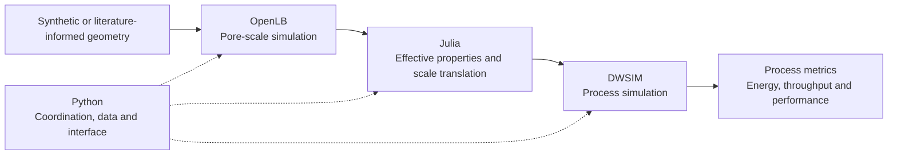
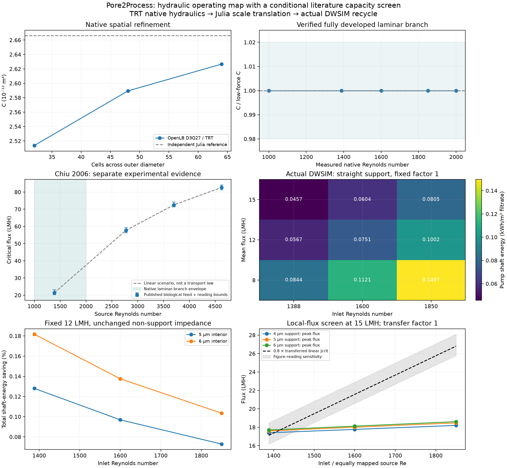

<p align="center">
  
</p>

# Pore2Process

**From porous-material structure to process-scale performance.**

Pore2Process is a research software project for connecting what happens inside a
porous material to what matters in a chemical process: pressure requirements,
pumping energy, throughput and, in future applications, conversion and thermal
performance.

The aim is a reproducible chain of calculations in which a change in pore
geometry produces an explainable change in a process result, with the
assumptions and intermediate evidence available for inspection.

> **Project status — 10 November 2026.** The filtration hydraulic example is
> complete and closed for now, with source, tests, dependency locks and curated
> references preserved as a regression benchmark. **Isothermal adsorption** is
> the next case in development. The verified native setup targets Apple Silicon
> macOS.

## The connected workflow



| Component | Defined role |
| --- | --- |
| **OpenLB** | Detailed pore-scale physics using existing OpenLB facilities and the structure of its official examples. |
| **Julia** | Custom numerical models, analysis, effective-property extraction and translation between scales. |
| **Python** | Workflow coordination, data handling, integration, visualization and a local Panel interface. |
| **DWSIM** | Actual process calculations in saved flowsheets, including equipment duties, recycle and balances. |

Models remain usable independently of the interface.

## First research showcase: membrane support design

**At a fixed filtration flux and unchanged selective layer, how much can support
geometry reduce total pumping energy, and when does the selective layer become
the dominant resistance?**

The current hydraulic study compares synthetic ceramic-membrane support
geometries with a fixed selective-side opening and different interior widths.
OpenLB resolves the support hydraulics; Julia translates the measured resistance
into a membrane pressure requirement; DWSIM calculates the resulting pump duties.

A crossflow extension includes separate feed and circulation pumps, recycle,
purge and temperature control. Its main process metric is **pump shaft energy
per cubic metre of filtrate**. Cooling heat is reported separately from shaft
work. This makes the trade-off visible: improving the support can reduce its
own pressure loss while other membrane resistances and circulation consume a
larger share of the total energy.

The current literature comparison identifies an **effective non-support
resistance**, which can include intermediate-layer and interface contributions.
It does not uniquely identify the intrinsic selective-layer resistance or
reconstruct a particular experimental specimen.

The final operating-map study makes the process trade-off clear. At **12 LMH**
and inlet **Re = 1388**, widening the support interior from **4 to 6 µm** lowers
mean transmembrane pressure from **1.2211 to 1.0831 kPa**, while total pump
shaft energy falls by **0.18166%**. Circulation supplies **98.72%** of baseline
shaft duty. The effective fixed resistance accounts for 68.50–77.23% of membrane
resistance across that geometry pair.

The study verifies **16 native hydraulic cases** and **91 actual DWSIM
solve/save/reload cases**, with **902 Julia assertions** and **74 Python tests**.
Its operating selections are conditional on the declared literature-transfer
policies and evaluated grid. See the [final report](docs/operating_window.md)
and [reproduction commands](examples/filtration/operating_map/README.md).



The earlier [low-Re interface showcase](docs/star_channel_showcase.md) remains
available with its own verified numerical range and completed browser checks.

## What has been demonstrated locally

| Stage | Documented development status |
| --- | --- |
| **Python–Julia reference** | Synthetic capillary network, Julia sparse pressure solve, analytical checks, permeability and a Darcy column calculation. |
| **Native hydraulic benchmark** | Actual 3D OpenLB calculations with conservation, analytical-reference and discretization checks; stock TRT revalidation of the current porous-support cases. |
| **Property-to-process connection** | OpenLB-derived hydraulic properties drive Julia pressure-load calculations and actual DWSIM pump flowsheets. |
| **Filtration and crossflow** | Controlled support comparisons, distributed hydraulic calculations, circulation energy, recycle balances and saved/reloaded DWSIM cases. |
| **Final operating map** | Higher-Re laminar-branch verification, literature-capacity policies and discrete material/operation comparisons; filtration hydraulics closed for now. |
| **Local interface and exports** | Panel/PyVista network and geometry inspection, pressure profiles, completed-run snapshots and downloadable results; browser checks performed on the development Mac. |
| **Literature comparisons** | Audited extractions, reduced-model calibration and held-out comparisons, with failed screens and evidence limits retained. |

These are computational demonstrations of idealized or literature-informed
systems.

## How results stay traceable

- **Explicit contracts:** SI units, coordinate systems, node indexing, array
  shapes, flow orientation and file formats are recorded at software boundaries.
- **Independent checks:** analytical solutions, conservation, numerical
  convergence and appropriate published comparisons support each stage.
- **Saved evidence:** inputs, assumptions, solver settings, diagnostics, software
  versions and outputs travel with each completed run.
- **Clear provenance:** extracted measurements are distinguished from illustrative
  scenarios; unreported quantities remain unavailable or are explored as labelled
  assumptions.
- **Reproducible environments:** the implementation uses an isolated Python
  environment, a shared explicit Julia project and saved dependency locks.

Published articles and their available supplements provide experimental
evidence.

## Scientific references

The membrane-structure, hydraulic and crossflow studies draw on the following
articles. Source locations and extraction records are in the
[literature workspace](literature/README.md) and [source ledger](literature/sources.json).

1. **Biesheuvel, P. M., and Verweij, H. (1999).** [Design of ceramic membrane supports: permeability, tensile strength and stress](https://doi.org/10.1016/S0376-7388(98)00335-4). *Journal of Membrane Science*, 156, 141–152.
2. **Zhu, W., et al. (2021).** [Design and optimization of ceramic membrane structure: From the perspective of flux matching between support and membrane](https://doi.org/10.1016/j.ceramint.2021.01.088). *Ceramics International*, 47, 12357–12365.
3. **Mo, J., Li, X., and Yang, Z. (2022).** [Dissecting the structure-property relationship of ceramic membrane with asymmetric multilayer structures for maximizing permselectivity](https://doi.org/10.1016/j.watres.2022.118658). *Water Research*, 220, 118658.
4. **Jan, A., et al. (2025).** [Silicon carbide coated alumina tight-ultrafiltration membrane prepared by low-pressure chemical vapor deposition for sulphate ion retention](https://doi.org/10.1016/j.desal.2025.119085). *Desalination*, 613, 119085.
5. **Chiu, T. Y., and James, A. E. (2005).** [Critical flux determination of non-circular multi-channel ceramic membranes using TiO2 suspensions](https://doi.org/10.1016/j.memsci.2005.01.037). *Journal of Membrane Science*, 254, 295–301.
6. **Chiu, T. Y., Lara Dominguez, M. V., and James, A. E. (2006).** [Critical flux and rejection behaviour of non-circular-channelled membranes: Influence of some operating conditions](https://doi.org/10.1016/j.seppur.2005.11.028). *Separation and Purification Technology*, 50, 212–219.
7. **Garcia Garcia, F. J., and Chiu, T. Y. (2008).** [Economic aspects of critical flux operability in star shaped microfiltration membranes: Influence of some operating conditions](https://doi.org/10.1016/j.memsci.2008.08.033). *Journal of Membrane Science*, 325, 641–646.
8. **Frederic, E., et al. (2018).** [Modelling of fluid flow distribution in multichannel ceramic membrane: Application to the filtration of produced water](https://doi.org/10.1016/j.memsci.2018.09.021). *Journal of Membrane Science*, 567, 290–302.

## Where this can go

The next case adds **isothermal adsorption and mass transfer**. Its research
question is how particle size changes usable treatment capacity and pumping
energy at fixed adsorbent inventory and required outlet quality. That work is
in progress; its current source and comparison reports are in
[examples/adsorption/](examples/adsorption/README.md).

The filtration example remains available for regression and comparison.
Reacting and non-isothermal chemical and bioprocess applications remain
longer-term directions.

See the [project roadmap](ROADMAP.md) for milestones and acceptance criteria.

## Project layout

Runnable studies are grouped in [examples/](examples/README.md):

- **[Hydraulics](examples/hydraulics/capillary_network/README.md):** network reference, native capillary benchmark, Darcy/pump coupling and tool checks.
- **[Filtration](examples/filtration/README.md):** the completed support/channel/crossflow operating-map study.
- **[Adsorption](examples/adsorption/README.md):** bed hydraulics, uptake models and literature comparisons in development.

Shared Python code stays in `src/pore2process_demo/`; Julia models and their
explicit environment stay in `julia/`. The article workspace, existing runs and
local tool installations remain in `literature/`, `results/` and `.local/`.
See [the layout and migration guide](docs/project_layout.md).

## Start with the capillary-network example

Install **uv** and **Julia** using their official installation instructions,
then run from a terminal. The initial Python–Julia example does not require
OpenLB or DWSIM.

```sh
git clone https://github.com/axeld92/Pore2Process.git
cd Pore2Process
source scripts/env.sh
uv sync --locked
uv run python scripts/bootstrap_julia.py
uv run python -m pore2process_demo.cli --output results/default
uv run panel serve app.py --address 127.0.0.1 --port 5006 --show
```

Open `http://127.0.0.1:5006/app` and press **Run simulation** in **Capillary
network**. Bootstrap accepts `--julia /absolute/path/to/julia` if Julia is not on
PATH. Python 3.12 and Julia 1.11.6 were tested with matching
JuliaCall/PythonCall 0.9.37; the exact dependencies are saved in `uv.lock` and
`julia/Manifest.toml`.

```sh
uv run python scripts/preflight.py
julia --startup-file=no --project=julia -e 'using Pkg; Pkg.instantiate(); Pkg.test()'
uv run pytest -q
```

Use the same Julia executable selected by bootstrap for direct Julia tests.
The VTK tests need normal host graphics access. The recorded full numerical
and interface checks are in the [acceptance report](docs/implementation_status.md)
and [browser record](docs/browser_checks.md).

## Reproduce the connected showcase

The native setup has been checked on **macOS ARM64**, with **OpenLB 1.9r0**,
**DWSIM 10.2.15**, a private **.NET 10** runtime and **Homebrew GCC 15**. Its
builders currently use that platform's compiler and library paths.

Follow the [clean-checkout reproduction guide](docs/reproduction.md) to download
the pinned tools, run the prerequisite studies and generate the filtration
showcase. The interface uses completed native evidence and launches actual
Julia/DWSIM process calculations; it does not rerun OpenLB whenever a control
changes. Native study generation can take substantial time.

| Documentation | Contents |
| --- | --- |
| [Setup and examples](docs/setup_and_examples.md) | Detailed Python–Julia setup, model derivation, contracts and original example commands |
| [Clean-checkout reproduction](docs/reproduction.md) | Native prerequisites and ordered connected-study commands |
| [Filtration showcase](docs/star_channel_showcase.md) | Geometry, model, quantitative results and evidence limits |
| [Closed filtration operating map](docs/operating_window.md) | Final hydraulic range, material/operation comparison and circulation-energy result |
| [Literature workspace](literature/README.md) | Curated references, extractions and provenance |
| [Integration roadmap](docs/integration_roadmap.md) | Detailed milestone and research status |
| [Publication record](docs/code_publication.md) | Published snapshot and verification scope |
