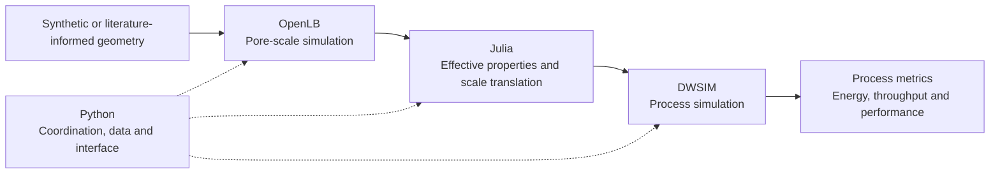

# Pore2Process

**From porous-material structure to process-scale performance.**

Pore2Process is a research software project for connecting what happens inside a
porous material to what matters in a chemical process: pressure requirements,
pumping energy, throughput and, in future applications, conversion and thermal
performance.

The aim is a reproducible chain of calculations in which a change in pore
geometry produces an explainable change in a process result, with the
assumptions and intermediate evidence available for inspection.

> **Repository status — 9 November 2026:** this initial publication contains the
> project overview and roadmap. The implementation is being prepared for a
> separate code publication. The demonstrations described below have been
> developed and checked in the local development workspace; they cannot yet be
> reproduced from this repository alone.

## The connected workflow

| Component | Defined role |
| --- | --- |
| **OpenLB** | Detailed pore-scale physics using existing OpenLB facilities and the structure of its official examples. Porous-media cases use at least TRT collision dynamics. |
| **Julia** | Custom numerical models, analysis, effective-property extraction and translation between scales. |
| **Python** | Workflow coordination, data handling, integration, visualization and a local Panel interface. |
| **DWSIM** | Actual process calculations in saved flowsheets, including equipment duties, recycle and balances. |

OpenLB and DWSIM are required parts of the final connected workflow. Models
remain usable independently of the interface. Project-specific OpenLB cases,
builds and outputs stay outside the original OpenLB source tree.

## First research showcase: membrane support design

**At a fixed filtration flux and unchanged selective layer, how much can support
geometry reduce total pumping energy, and when does the selective layer become
the dominant resistance?**

The current hydraulic study compares synthetic ceramic-membrane support
geometries with a fixed selective-side opening and different interior widths.
OpenLB resolves the support hydraulics; Julia translates the measured resistance
into a membrane pressure requirement; DWSIM calculates the resulting pump duties.

A crossflow extension includes separate feed and circulation pumps, recycle,
purge and temperature control. Its main process metric is **pump shaft energy
per cubic metre of filtrate**. Cooling heat is reported separately from shaft
work. This makes the trade-off visible: improving the support can reduce its
own pressure loss while other membrane resistances and circulation consume a
larger share of the total energy.

The current literature comparison identifies an **effective non-support
resistance**, which can include intermediate-layer and interface contributions.
It does not uniquely identify the intrinsic selective-layer resistance or
reconstruct a particular experimental specimen.

## What has been demonstrated locally

| Stage | Documented development status |
| --- | --- |
| **Python–Julia reference** | Synthetic capillary network, Julia sparse pressure solve, analytical checks, permeability and a Darcy column calculation. |
| **Native hydraulic benchmark** | Actual 3D OpenLB calculations with conservation, analytical-reference and discretization checks; stock TRT revalidation of the current porous-support cases. |
| **Property-to-process connection** | OpenLB-derived hydraulic properties drive Julia pressure-load calculations and actual DWSIM pump flowsheets. |
| **Filtration and crossflow** | Controlled support comparisons, distributed hydraulic calculations, circulation energy, recycle balances and saved/reloaded DWSIM cases. |
| **Local interface and exports** | Panel/PyVista network and geometry inspection, pressure profiles, completed-run snapshots and downloadable results; browser checks performed on the development Mac. |
| **Literature comparisons** | Audited extractions, reduced-model calibration and held-out comparisons, with failed screens and evidence limits retained. |

These are computational demonstrations of idealized or literature-informed
systems. They do not establish predictive accuracy for a real manufactured
membrane. The biological-feed extension is an initial hydraulic scenario with
an illustrative published COD-retention sensitivity; it does not establish
sustainable flux, fouling time or a validated bioprocess model.

## How results stay traceable

- **Explicit contracts:** SI units, coordinate systems, node indexing, array
  shapes, flow orientation and file formats are recorded at software boundaries.
- **Independent checks:** analytical solutions, conservation, numerical
  convergence and appropriate published comparisons support each stage.
- **Saved evidence:** inputs, assumptions, solver settings, diagnostics, software
  versions and outputs travel with each completed run.
- **Clear provenance:** extracted measurements are distinguished from illustrative
  scenarios; unreported quantities remain unavailable or are explored as labelled
  assumptions.
- **Reproducible environments:** the implementation uses an isolated Python
  environment, a shared explicit Julia project and saved dependency locks.

Published articles and their available supplements provide experimental
evidence. Full article files remain in the local literature workspace; the
code publication will include curated source metadata and extraction records.
New laboratory measurements and unavailable raw datasets are not prerequisites
for this computational-tool project.

## Where this can go

The immediate research extension is to strengthen the channel operating range
and introduce a defensible transport or retention/fouling relation before
optimizing circulation. Reacting and non-isothermal systems are longer-term
goals, including chemical and bioprocess applications selected around a clear
research question and published kinetic and thermal data.

See the [project roadmap](ROADMAP.md) for milestones and acceptance criteria.

## Code and reproducibility

Source code, setup instructions, tested platform details and exact launch/test
commands will be published together after the active implementation handoff.
No installation from this documentation-only snapshot is required. Platform
portability will be reported according to checks actually performed.
