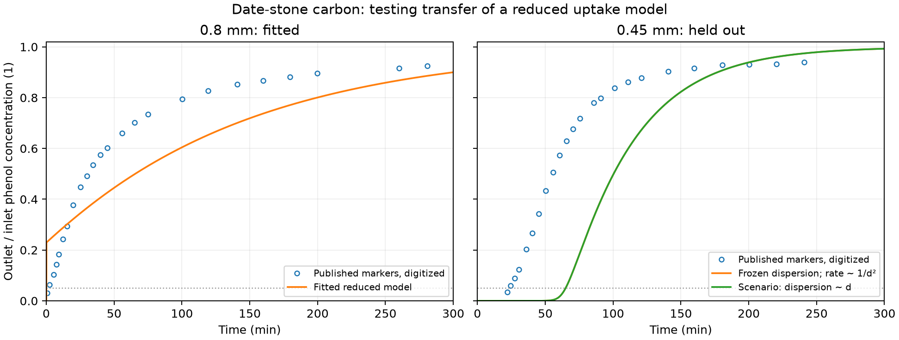

# Date-stone carbon: source audit and particle-size comparison

Reviewed on 10 November 2026. The supplied PDF is sufficient to start this
comparison; its Markdown conversion is not a prerequisite. The accepted
synthetic coconut-shell-carbon example and earlier filtration examples are
preserved.

## Engineering finding

Smaller particles delay early phenol leakage in the published test. At the
same 10 cm bed height, 11 mm column diameter, 150 mg/L inlet concentration and
43.8 mL/min flow, approximate Figure 7 readings give:

| Particle diameter | Time to 5% outlet/inlet concentration | Time to 50% |
| --- | ---: | ---: |
| 0.8 mm, calibration curve | 1.69 min | 30.75 min |
| 0.45 mm, withheld curve | 23.54 min | 55.36 min |

These are interpolated figure readings, not supplied raw data. In particular,
the first 0.8 mm crossing is close to the image's time resolution. It should
not be read as an accurate 1.69-minute operating guarantee. The selected 5%
threshold corresponds to 7.5 mg/L phenol here; it is a comparison criterion,
not a discharge standard. At fixed flow the smaller bed treats roughly
1.03 L before that threshold, versus approximately 0.074 L for the larger
particles. The very small latter volume inherits the poorly resolved early
crossing.

**The present Langmuir/LDF column model does not reproduce this dataset.**
With the source's equilibrium properties and derived inventory fixed, fitting
only the 0.8 mm curve gives concentration-fraction RMSE about 0.142 and a
50% crossing at 65.50 min, versus 30.75 min observed. That calibration already
fails the declared RMSE <= 0.10 and t50 error <= 20% screens.

Freezing those parameters and increasing uptake rate as inverse diameter
squared predicts the 0.45 mm bed's 5% crossing at 64.99 min and its 50%
crossing at 100.38 min. The observations are about 23.54 and 55.36 min.
Holdout RMSE is about 0.325. This is a failed predictive comparison, not a
validated adsorption or particle-size law. Reducing dispersion proportionally
to diameter does not rescue this case: the fitted dispersion is already at
the search's near-zero lower bound and is not an identified physical value.

The failure concerns the combination of transferred equilibrium/inventory
inputs and the reduced transport model. It does not uniquely identify film
resistance as the cause. The paper itself reports evidence of both film and
intraparticle limitations. We should resolve that model/evidence mismatch
before using this carbon to recommend a particle size or claim energy savings.

## Source, material and extraction

Y. A. Alhamed (2009), *Adsorption kinetics and performance of packed bed
adsorber for phenol removal using activated carbon from dates' stones*,
Journal of Hazardous Materials 170, 763–770.
[DOI: 10.1016/j.jhazmat.2009.05.002](https://doi.org/10.1016/j.jhazmat.2009.05.002).

The local PDF is `literature/inbox/Alhamed2009Adsorption/Alhamed2009Adsorption.pdf`.
SHA256: `c0d9eb61560f643b5b890b1926f1b0f2bc279386dc6bd882cb640ae3f0061b22`.
PDF pages 2–7 were rendered and inspected, including complete tables,
equations, plots, captions and the Table 3 dosage footnote. Original embedded
images were also extracted for marker inspection.

[The separate evidence ledger](../literature/alhamed2009_extraction.json)
retains Table 1 properties, seven Table 3 batch fits, all 18 Table 5 rows,
conditions, units, source locations and conflicts. This is date-stone carbon
prepared by ZnCl2 activation, not the coconut-shell carbon in the first
synthetic loop. The earlier loop's frozen evidence ledger remains its
historical snapshot; this new ledger records the newly reviewed source.

| Quantity | Source value | SI value / use |
| --- | --- | --- |
| Temperature, Sections 2.2/2.3 | 22 +/- 1 degC | 295.15 K; source operating range 294.15–296.15 K |
| Bulk density, Table 1 | 0.74 g/cm³ | 740 kg dry carbon/m³ packed bed |
| Bed porosity, Table 1 | 0.427 | 0.427 |
| Langmuir capacity, Table 1 | 111.5 mg/g | 0.1115 kg phenol/kg dry carbon |
| Langmuir affinity, Table 1 | 0.139 L/mg | 139 m³/kg phenol |
| Column diameter, Table 2 | 11 mm | 0.011 m |
| Liquid viscosity, Table 2 | 0.5 g/(cm min) | 8.3333e-4 Pa s |
| Phenol molecular diffusivity, Table 2 | 1e-5 cm²/s | 1e-9 m²/s |

Using the printed bulk density for this column gives 7.0325 g dry carbon in
10 cm of bed. This is a **derived inventory**, not a reported weighed mass for
each particle fraction. The Julia model requires particle-envelope dry
density, so the explicit conversion is `740/(1-0.427)=1291.45 kg/m³`.
BET area and internal pore volume do not supply a connected resolved 3D
specimen geometry.

The batch tests use 250 mL solution, usually 1 g carbon, 200 rpm and
200/400 mg/L phenol. Table 3 experiment 7 uses 0.5 g. Its pseudo-second-order
constants and equilibrium loadings are published fitted quantities; they are
not measured diffusivities or evidence that a chemical reaction controls
adsorption. Table 4 has nonzero piecewise intercepts and strongly size-dependent
apparent intraparticle diffusivities. Those values cannot simply supply one
intrinsic diffusivity for all particle sizes.

## Source inconsistencies retained

- Figure 6 says a 20 cm bed, while matching Table 5 concentration rows say
  10 cm. That concentration series is excluded from this comparison.
- Figure 7's particle-size pair agrees with Table 5 on the chosen conditions.
  The largest fraction elsewhere is called 1.47 or 1.5 mm; both labels are
  retained where printed rather than silently reconciled.
- Table 5 includes fit R² values 0.983 and 0.919, contrary to the blanket
  high-R² statement. All 18 rows remain in the extraction.
- The fitted `DL` is an effective breakthrough-shape parameter. Its large
  changes with particle size and operating conditions do not establish an
  independently measured hydrodynamic dispersion closure.
- Equation 10 visibly prints a `Pe/4` prefactor. Reconstructing the published
  fit using total-column-area volume and an explicitly labelled square-root
  alternative agrees better with the calibration points (RMSE about 0.027
  versus 0.154 for the printed expression). This diagnostic supports a
  formula/convention concern; it does not authorize silently correcting the
  paper or counting its own fitted curve as independent validation.
- No measured pressure drop, per-point Figure 7 uncertainty or pH is provided.
  These remain unavailable. There is no prerequisite for new measurements,
  unavailable raw data, a repository or author contact.

## What was executed

[The protocol](../literature/alhamed2009_protocol.md) was recorded before
model fitting. [The marker-centre CSV](../literature/alhamed2009_fig7_pixels.csv)
stores 24 points per curve, calibrated against the original embedded
674-by-532 pixel raster. Unresolved overlapping early diamonds were omitted;
the final centres were checked against the image. Earlier approximate
readings and their run snapshots are retained under `results/`.

The chosen +/- 2 pixel reading scenario corresponds to +/- 1.53 min and
+/- 0.00433 in concentration fraction. It is a digitization sensitivity,
not experimental uncertainty or a confidence interval. Crossing ranges are
saved explicitly. No origin point is included in calibration; a declared
clean-bed origin is used only when interpolating an early crossing.

Python coordinates a bounded log-parameter search; every forward column
calculation calls the **existing conservative Julia solver**. There is no
Python production solver, new OpenLB run, DWSIM run or simulator-source
modification in this evidence step. The primary holdout keeps dispersion
fixed and changes only uptake rate by `(0.8/0.45)^2`. The secondary scenario
also scales dispersion by diameter. Neither is fitted to holdout observations.

The search uses 80 cells and a 1 s step. Final full-duration predictions use
80 cells and 0.25 s; doubled-cell and halved-step results are retained. The
model's approximately six-second calibration t05 needs its own 120 s window
at 0.05/0.025 s to resolve it without exceeding the existing solver's step
ceiling. Both the coarser full-run t05 discrepancy and the separate early-time
refinement are reported. No solver guard or numerical tolerance is relaxed.

The first broad search hit the implicit convergence guard at large dispersion
with a 5 s step. A later search hit its iteration ceiling. These attempts and
the earlier digitization/refinement runs are retained; they are not promoted
as accepted validation. Final evidence/replay and physical-model acceptance
have separate status fields. A successful replay does not turn the failed
physical comparison into a pass.

The final independent check replays **10 real Julia columns**, verifies 12
source files and 27 saved artifacts, and passes conservation/refinement
screens. Maximum normalized mass residual among the final/refinement cases
is approximately 3.76e-12. Full-run t50 changes are below 0.038%; holdout t05
changes are below 0.35%. The separate early calibration t05 changes by 0.079%
on spatial refinement and 0.818% on temporal refinement, within the unchanged
2% screen. These numerical checks support retaining the physical discrepancy.

The full Python suite passes **94 tests**. The preserved synthetic-example
checker also passes: 11 replayed Julia columns, 1,178 artifacts, all four
saved DWSIM pump topologies and 2,070 original OpenLB source-file checks.
Recorded implementation hashes for both the original adsorption and
operating-map examples are unchanged. `git diff --check` passes.

Tested runtime: Python 3.12.9, Julia 1.11.6, JuliaCall/PythonCall 0.9.37,
NumPy 2.5.4 and Matplotlib 3.11.2. The final run is
`results/adsorption/alhamed2009/runs/20261110T063515Z-b21dba3d/summary.json`.
Cold Julia/module initialization, warmed solve timings and search settings
are recorded separately. No speedup claim is made.



## Reproduction and next executable step

The proposed finite-bath/film-particle follow-on has now been
[implemented and tested separately](film_particle_adsorption.md). Its batch
comparison passes the chosen screen, but Figure 7 column transfer still
fails. The original results and reproduction commands here are unchanged;
the final paragraph below records the original handoff to that work.

From the project root, using the existing locked environment:

```sh
source scripts/env.sh
uv sync --locked
uv run python -m examples.adsorption.alhamed.source
uv run python -m examples.adsorption.alhamed.study
uv run python -m examples.adsorption.alhamed.check
uv run pytest -q
```

No new dependencies or manifest changes are needed. The checker creates
[a compact reference](alhamed2009_reference.json), while unique run folders
retain full curves, inventory histories, fits, source snapshots, hashes and
the comparison figure. The original PDF and selected pixel CSV are required
for source verification. The figure-reading helper used the already available
bundled PDF runtime; the calculation itself does not depend on pypdf.

Next, implement a **separate finite-bath adsorption check** using this paper's
Table 3/Figure 2 conditions to audit equilibrium and effective uptake, then
test a conservative film-plus-intraparticle alternative against withheld
particle sizes and Figure 7. Keep source equilibrium, bed inventory and any
effective calibration factors separately traceable. Do not fit every column
curve independently and call that prediction. The existing native hydraulic
and actual DWSIM pump pathways can then receive a qualified adsorption model.
The paper does not validate absolute pressure loss, so bed-only energy remains
a separate synthetic-geometry scenario. Reaction and heat coupling stay deferred.
