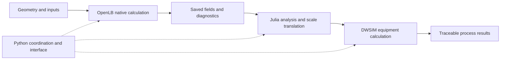

# Software boundaries and data contracts

Pore2Process separates numerical models, workflow coordination and process
equipment. The original Python–Julia capillary network is the initial reference;
the later native examples connect OpenLB-derived quantities to actual DWSIM loads.

## Responsibilities

| Location | Responsibility |
| --- | --- |
| `examples/<area>/<case>/` | Application code, inputs/protocols, report and commands |
| `julia/` | Independently usable numerical models and their explicit environment |
| `src/pore2process_demo/` | Julia bridge, interface, units, export and shared utilities |
| `src/pore2process_demo/runtime/` | External OpenLB builder and common DWSIM adapter |
| `scripts/setup/` | Bounded inventory and isolated native-tool setup |
| `literature/sources/` | Paper identities, single-paper extractions and digitized data |
| `literature/reviews/` | Shared comparisons across several papers |

Original OpenLB files are never modified. Project cases use stock facilities
and the official example lifecycle, with at least TRT for porous-media runs.
DWSIM adapters use stock equipment through the supported installed-version API.
Process-specific adapters remain beside their example.

## Boundary conventions

- Inputs and numerical arrays use SI units. Names carry unit suffixes where
  practical; display-unit conversion is explicit and tested.
- Each geometry defines its own coordinate axes, sample area and flow sign.
  A support's through-thickness x direction is not a channel's axial x direction.
- Julia uses one-based indices internally; Python/VTK use zero-based indices.
  The bridge materializes ordinary copied NumPy arrays and converts IDs once.
- Gauge pressure loads become absolute DWSIM equipment pressures explicitly.
  Reference-density flow and actual flashed stream volume are distinct fields.
- Unavailable values are JSON `null`, never valid-looking NaN/Infinity.
- Native fields, fitted literature properties, transferred parameters and
  illustrative assumptions remain distinguishable.

The detailed shape/unit contracts remain with each example's run guide and
report. There is no single geometry or transport closure imposed on every case.

## Runtime and evidence lifecycle

Python configures one explicit Julia project before importing JuliaCall. A local
application process uses one persistent Julia runtime on its calling server
thread. Actual DWSIM automation runs in an external .NET process. This layout
does not introduce a background Julia scheduler or new orchestration service.

Completed runs retain their inputs, source snapshot, hashes, settings, diagnostics,
software versions and outputs. Compact accepted observations are in the example's
`reference/`; they do not replace the full saved run. A numerical pass, physical
comparison and actual simulator execution are separate statuses in `example.toml`.

`project_path()` resolves recorded resource names through ordered relocation
registries. `verified_source_path()` additionally requires exact historical
source bytes and reviewed guards before an old source hash can pass. Changing
current implementation or corrupting archived bytes is rejected. Existing
run directories and scientific JSON/CSV contents are not rewritten to make
a folder move look like new scientific evidence.
