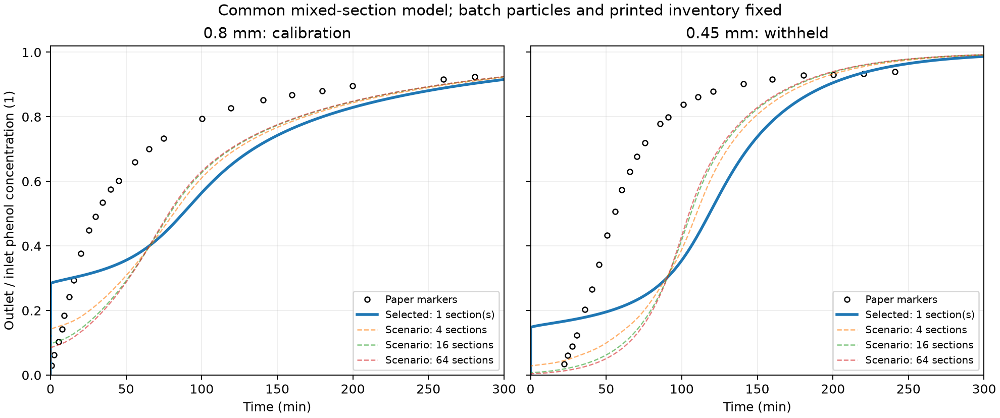
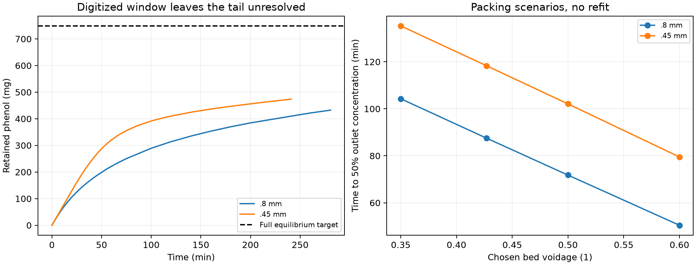

# Column contact and printed-density audit

The batch-qualified particle model is preserved unchanged. A common mixed-
section contact model, selected using only Alhamed's 0.8 mm column and then
transferred to 0.45 mm, **still fails the literature comparison**. Increasing
mixing alone does not explain the discrepancy while the source equilibrium,
printed inventory and batch particle properties remain fixed. This conclusion
applies to the tested equal-section family; it does not rule out every possible
flow distribution, bypass or material-property transfer explanation.

## What the paper establishes

Source: Y. A. Alhamed (2009), *Adsorption kinetics and performance of packed
bed adsorber for phenol removal using activated carbon from dates' stones*,
Journal of Hazardous Materials 170, 763-770,
[DOI 10.1016/j.jhazmat.2009.05.002](https://doi.org/10.1016/j.jhazmat.2009.05.002).
PDF SHA256: `c0d9eb61560f643b5b890b1926f1b0f2bc279386dc6bd882cb640ae3f0061b22`.
Complete PDF pages 2, 5 and 6 were visually reinspected for this audit.

Table 1 on PDF p2 labels 0.74 g/cm3 as **bulk density** and reports bed voidage
0.427. Section 2.3 says a desired carbon amount was packed to a desired height,
but Figure 7 supplies no weighed mass or voidage for either size fraction.
The density method and fraction-specific transfer are not documented here.
Thus 7.032455 g is the inventory **derived** from that printed bulk density,
11 mm column diameter and 100 mm bed height. It is not a measured run mass.

Using the printed label literally gives particle-envelope dry density
`rho_p = rho_bulk/(1-eps) = 1291.45 kg/m3`. This is the density with which the
batch transport component was qualified. It is not skeletal density. Combining
it with Table 1's 0.456 cm3/g pore volume would imply about 3141 kg/m3 skeletal
density **if** all measurement bases were compatible. Their bases are insufficiently
documented to use this diagnostic to prove an error or correct the source.

If 740 kg/m3 were instead particle density, the resulting bulk density would
be 424.02 kg/m3 and the bed mass 4.02960 g. That interpretation contradicts
the printed label and changes the particle density in the batch boundary flux.
It is retained as an arithmetic diagnostic, **not applied** as a forward-model
inventory correction. The old batch qualification cannot accompany that change
without being repeated.

Figure 7's matching conditions are 150 mg/L phenol, 43.8 mL/min downflow,
10 cm bed height and 22 +/- 1 degC. They imply:

| Quantity | Value |
| --- | ---: |
| Superficial velocity Q/A | 0.00768153 m/s |
| Interstitial velocity Q/(eps A) | 0.0179895 m/s |
| Empty-bed contact time AL/Q | 13.0182 s |
| Liquid void residence time eps AL/Q | 5.55879 s |
| Column/particle diameter ratio, 0.8 / 0.45 mm | 13.75 / 24.44 |

Section 2.3 describes a 5 cm glass-bead inlet section, glass-wool plugs and
bottom mesh. The bead section has at most 6.51 s liquid holdup even if its
entire volume were liquid. The entire 50 cm tube holds at most 65.1 s at this
flow. These are geometric upper bounds, not measured residence times; tubing
holdup remains unknown. They do not support attributing a tens-of-minutes
breakthrough discrepancy solely to the reported inlet calming section.
The authors' intention to distribute flow uniformly does not establish an
inert-tracer residence-time distribution. Wall effects, radial distribution,
actual accessible inventory and per-size packing remain unmeasured.

## Retention audit without inventing saturation data

At 150 mg/L the unchanged Langmuir isotherm gives 106.397 mg/g. The density-
derived bed would ultimately hold 748.232 mg adsorbed phenol plus 0.609 mg in
the external liquid. Its full mass-balance area time is 113.979 min. Mixing
changes the shape and useful breakthrough time, but cannot remove this
asymptotic inventory when all particles eventually equilibrate.

Integrating `Q*C0*(1-Cout/C0)` over the digitized Figure 7 markers gives:

| Diameter | Last marker time | Last Cout/C0 | Retained within window | Fraction of full equilibrium inventory |
| --- | ---: | ---: | ---: | ---: |
| 0.8 mm | 280.69 min | 0.9242 | 432.44 mg | 57.75% |
| 0.45 mm | 240.92 min | 0.9394 | 473.78 mg | 63.27% |

These values use linear segments and a declared clean-bed origin, not extra
measured points. They include liquid storage and are not a saturation loading.
If the last deficit never increases, accounting for the remaining inventory
would require **at least another 10.59 and 11.51 hours**, respectively. A
declining tail would require longer. Since that tail was not reported, this
audit neither measures actual mass nor proves that the printed density is
wrong. Chosen +/-2 pixel reading scenarios give retained-mass ranges of
414.76-450.33 and 457.39-490.21 mg; these are not experimental error bars.

## Common contact model and frozen calibration boundary

[The protocol](../literature/alhamed2009_column_contact_protocol.md) was recorded
before selecting the contact topology. Julia's new
[ColumnContact module](../julia/adsorption/ColumnContact.jl) reuses the unchanged
particle operators, surface-flux equation and conservative implicit integrator
from `FilmParticle.jl`. It does not reimplement particle physics.

The bed comprises N equal, perfectly mixed sections in series. For each j:

```text
V_liquid,j*dCj/dt + m_solid,j*dqbar_j/dt = Q*(C[j-1]-Cj)
V_liquid,j = eps*A*L/N
m_solid,j = (1-eps)*rho_particle*A*L/N
C[0] = Cin; Cout = C[N]
```

Every section contains its full liquid and solid share and the same particle
size. There is no bypass, dead solid, extra-column delay or reverse exchange.
All intraparticle states reuse the batch-qualified spherical loading-diffusion
model. Constant isothermal properties, clean initial conditions and constant
flow are retained. N is a phenomenological **physical topology**, not a finite-
volume grid to refine toward a chosen answer. Equal sections assume a common
contact pattern across both fractions; separate diameter-specific N values are
not fitted. Actual wall-channel geometry is not inferred by this approximation.

Frozen parameters: Ds=1.84603549e-12 m2/s, particle density 1291.4485 kg/m3,
qmax=0.1115 kg/kg, b=139 m3/kg. The declared superficial-velocity film
correlation is used with multiplier **1** for both sizes. The old fitted
column film multiplier 0.54782 is not carried into this alternative.

All integer N=1..64 were evaluated against the 24 **0.8 mm** markers only,
then the selected N and neighboring candidate were reevaluated at finer
radial/time settings. The 0.45 mm markers were withheld from selection.
The minimum is **N=1**, at the boundary of the allowed contact family. That
does not establish that the real column is a single stirred tank. It indicates
that this family prefers its broadest mixing option and cannot identify a
successful contact topology from these constraints.

**Table 5's DL=1601 and 171 cm2/min, and reported Pe=0.674 and 6.309, are
fitted breakthrough-shape descriptors. They are not independently measured
fluid dispersion.** Neither enters this model or determines N. The earlier
audit of the printed Equation 10 and its square-root alternative remains
separate, unchanged and explicitly labelled.

| Figure 7 quantity | Digitized paper | Common N=1 model |
| --- | ---: | ---: |
| 0.8 mm: t50 | 30.75 min | 87.49 min |
| 0.45 mm: t50 | 55.36 min | 118.32 min |
| 0.8 mm: concentration-fraction RMSE | - | 0.1821 |
| 0.45 mm: concentration-fraction RMSE | - | 0.2909 |
| 0.8 mm: t05 | 101.57 s | 0.3060 s, separately resolved |
| 0.45 mm: t05 | 1412.24 s | 0.3401 s, separately resolved |

Both sizes fail RMSE <=0.10, t50 error <=20% and resolved t05 error <=25%.
One common mixing choice has not repaired the column transfer. The overview
curves use full-run time steps; their coarse subsecond crossings are retained
but are superseded by the separately resolved startup values above.

Packing scenarios use eps=0.35, 0.50 and 0.60 with the **same particle density,
Ds, isotherm, film and N**, maintaining rho_bulk=(1-eps)*rho_particle. These
change solid and liquid volumes consistently; all solid remains active.
They are chosen scenarios, not measured voidage uncertainty or additional
calibrations. At eps=0.60 the mass is 4.9092 g and t50 becomes 50.45/79.52 min;
both curves still fail the stated comparison screens. No scenario was promoted
to a fitted density or specimen estimate.





## Verification, reproducibility and limits

For a nonadsorbing tracer the independently derived step response is
`F(t)=1-exp(-x)*sum(x^k/k!,k=0:N-1)`, `x=N*t/tau`, with
`tau=eps*L/u`. Its mean residence time is tau and variance is tau^2/N.
N=1 reduces to the analytical CSTR response. Fast linear adsorption produces
the same response with residence time multiplied by
`1+rho_bulk*K/eps`. The separate Julia tests check these limits, reconstructed
RTD moments, zero flow, no-exchange limits, positivity and conservation.
These are numerical/model-implementation checks, independent of paper fitting.

The separate contact suite passes **50 Julia assertions** and the unchanged
particle suite passes **51**. The full Python regression suite passes **128
tests**. Its first restricted run aborted while an existing PyVista UI test
initialized macOS AppKit; the unchanged suite then passed with host graphics
access. That is an existing UI regression check, not a new adsorption browser
test. Both scientific column comparisons remain failed.

Time stepping and radial shells are refined at fixed N. Subsecond t05 requires
a separate 0-5 s window (64 shells, 0.002 s step, independently doubled/halved).
Its largest t05 change is below 0.062%; its largest concentration-fraction
change is below 0.00023. Full runs check t50 and the 5-18000 s window separately;
the maximum t50 change is below 0.014% and fraction change below 0.0032.
Together these cover the entire time interval with the original <=2% crossing
and <=0.005 fraction-change screens. The failed coarse full-run t05/time
checks remain recorded, rather than being presented as convergence. Changing
N is a contact-model sensitivity, never numerical axial convergence.

All SI inputs and outputs have explicit unit-bearing field names. Liquid
concentration is kg phenol/m3 liquid; q is kg phenol/kg dry solid. Final shell
loading has shape `(sections, radial_cells)`. Rows go from inlet to outlet;
columns go from centre to surface. Python arrays are ordinary copied float64
arrays/lists with zero-based indexing. `axial_centres_m` gives section centres,
not resolved within-section gradients. Flow is positive along z in [0,L].
Physical/active mass are equal and separate from liquid/adsorbed inventory,
cumulative feed/effluent, global residual and interface-flux diagnostics.
Missing crossings are JSON null, never NaN/Infinity.

Exact commands are in [the module README](../adsorption/column_contact/README.md).
Python 3.12.9, Julia 1.11.6, JuliaCall/PythonCall 0.9.37 and the existing locked
project environment are reused. Cold runtime initialization is recorded
separately from warmed Julia solver and complete study time. The bridge uses
the existing single Julia runtime on the main calling thread. No dependency,
lockfile, original simulator source or earlier accepted implementation changed.
There are zero new OpenLB/DWSIM solves and no new UI/browser acceptance claim.

Unique results under `results/adsorption/column_contact/runs/` include source
snapshots, the density/contact audit, every calibration score, complete SI
case trajectories/CSVs, diagnostics and source/artifact hashes. The independent
checker replays the actual Julia model, reconstructs inventories and effluent
integrals, verifies exports and repeats every calibration score. The
[compact reference](column_contact_reference.json) separates numerical success
from the failed physical comparison.

Verified run: `20261110T092735Z-39dae4b2`. Independent replay checks **24 saved
forward cases, 66 calibration evaluations, 83 artifacts and 30 source files**.
Maximum normalized global mass imbalance is 1.62e-11; normalized interface-
flux mismatch is below 2.01e-13. Cold initialization was 4.30 s and the complete
study 49.88 s on this machine, including selection, sensitivity runs and exports;
this is not a comparative speed benchmark. The original synthetic, operating-
map, earlier LDF and particle implementation hashes remain unchanged.
The preserved particle-study checker also replays all 57 earlier cases and
seven analytical endpoints, verifying its 141 artifacts and 20 source files;
its batch pass and previous column failures remain unchanged. Both new figures
were visually inspected. Detailed logs are under
`results/adsorption/column_contact/`.

## Next executable step

Keep this as a documented failed column transfer and keep the batch particle
component available for reuse. Do not add size-specific fit factors or infer
actual packing density from these truncated curves. A useful next software
milestone is a **synthetic packed-bed inert-tracer benchmark in stock OpenLB
TRT**, separately checking its residence-time distribution and boundaries
before carrying contact descriptors across the saved-data interface. That
tests the tool's contact pathway without pretending to recover this specimen.
Any later literature qualification should use published column inventory and
adequate breakthrough coverage where available; inaccessible raw datasets,
new experiments and author contact remain unnecessary prerequisites.

For the present paper, performance and energy results must remain conditional.
Do not promote the synthetic DWSIM pumping loop into experimental adsorption
validation. Reactive, thermal and regeneration extensions remain deferred.
