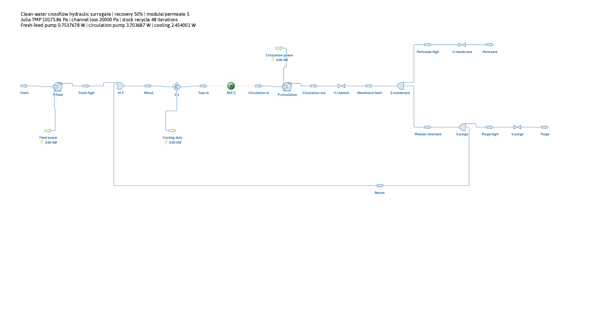
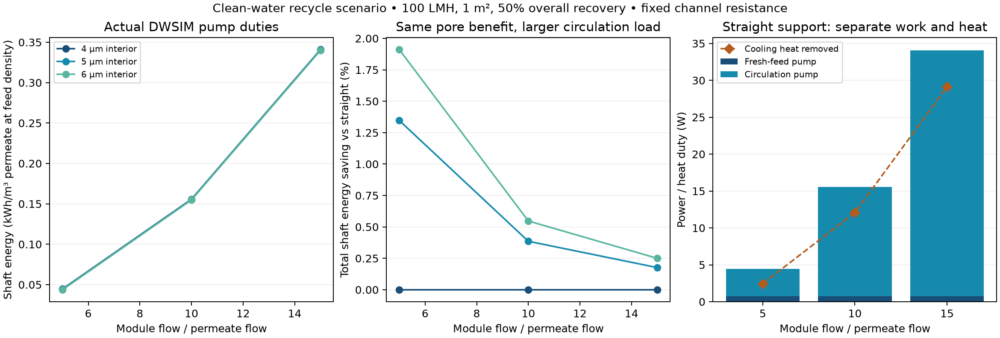
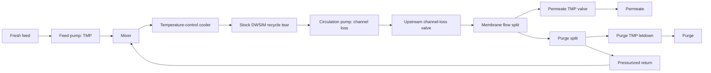

# Crossflow recycle and circulation energy

This extension preserves the verified OpenLB → Julia saved-data boundary and
adds a real DWSIM material recycle. It follows the
[once-through hydraulic flowsheet](process_filtration.md) and the
[fixed-opening support study](graded_support_study.md). The same synthetic
pore designs, common published-baseline calibration and fixed effective
non-support impedance are used. There is no new fit or specimen reconstruction.

## Verified result — 9 November 2026

Final run `20261108T233356Z-b884df5e` (UTC identifier) passes **25 actual DWSIM
recycle cases**: 21 design scenarios and four initialization/tolerance variants.
Every case was saved, loaded and solved again. All 13 material streams, three
energy streams, balances for all ten units and the overall flowsheet, and 26
directed archive connections are checked. The deliberately one-iteration case fails with the stock maximum-
iteration error, returns a nonzero exit status and produces no valid summary.

The earlier 18 filtration cases, 24 native OpenLB cases and three finest-grid
geometry audits were replayed from intact saved evidence. No new OpenLB solve,
original-source change or literature refit was needed. Exact inputs, versions,
hashes, numerical values and the actual nominal stream record are retained in
[the compact reference](crossflow_recycle_reference.json).

At 100 LMH, 1 m² and **50% overall recovery**, reference flows are:
fresh feed 0.2 m³/h, permeate 0.1 m³/h, and purge 0.1 m³/h. At module/permeate
ratio **5**, the module processes 0.5 m³/h and returns 0.3 m³/h to the mixer.
The nominal straight-support case requires **0.753768 W** fresh-feed pump work,
**3.703687 W** circulation pump work and **2.454001 W** cooling heat removal.
Circulation supplies **83.09%** of the total **4.457454 W** shaft duty.

| Pore interior radius, fixed 4 µm mouths | Total shaft energy at ratio 5, kWh/m³ permeate | Saving vs straight |
| --- | --- | --- |
| 4 µm | 0.04457454 | 0.00% |
| 5 µm | 0.04397422 | 1.35% |
| 6 µm | 0.04372277 | 1.91% |

The same native 35.88% body-resistance reduction that saved 11.30% of the
earlier transmembrane-load duty now saves **1.91%** of total pump work in this
declared loop. Higher circulation dilutes that benefit further:

| Module/permeate ratio | Channel drop | Straight-support shaft energy, kWh/m³ | Circulation share | 6 µm design saving |
| --- | --- | --- | --- | --- |
| 5 | 20 kPa | 0.04457454 | 83.09% | 1.91% |
| 10 | 40 kPa | 0.15568515 | 95.16% | 0.55% |
| 15 | 60 kPa | 0.34086948 | 97.79% | 0.25% |

At fixed channel resistance, doubling module flow quadruples circulation
power. Recovery changes fresh-feed pressurization while holding module flow
fixed in the recovery sensitivity cases. Small differences in circulation
power across pore designs come from DWSIM's pressure-dependent inlet density;
they are preserved in the actual results rather than rounded away in checks.

The small-flow stock energy labels round to 0.00 kW; the annotation and JSON
retain actual W values. No zero-duty result is inferred from those labels.

Across all cases, the maximum relative mass residual is **2.12e-11** of fresh
feed and maximum enthalpy residual **2.45e-5** of total shaft work. Maximum
viscosity/density departures are **0.0488% / 0.00302%**, below the declared
0.1% screens. The reference-density power approximation differs from DWSIM by
at most **4.49e-6 relative**; property-corrected pump checks pass the 1e-9
relative screen. These are numerical/scenario diagnostics, not experimental
error bars.

Direct-substitution convergence takes **16–185 iterations** across the matrix.
The nominal case takes 48. Different seed flow/temperature guesses and tenfold
tighter tolerances reproduce the duties within the declared 1e-8 relative
screen. The checker validates **138 local artifacts**, then can reverify all
ancestor evidence; it launches no new external solves.

The direct Julia suite passes **518 assertions**, including 96 independent
recycle-flow/work checks; the full Python suite passes **43 tests**. These call real Julia, replay the saved actual
DWSIM stream record and reject altered circulation mass, density, cooling and
convergence flags, disconnected recycle/heat ports and changed artifact bytes.
Fresh external-solver execution is verified by the study command separately.

Cold-process Julia initialization was **2.39 s**; per-case DWSIM setup was
1.002–1.214 s and initial solve 0.298–2.796 s. Archive reload, rendering,
process startup and upstream checks are additional. These are observations on
this Mac, not a performance guarantee or speedup claim.

## Equipment and physical assumptions

Fresh pure water enters at 298.15 K and 100000 Pa. A feed pump pressurizes only
fresh feed to the membrane-chamber pressure, external pressure plus Julia's
TMP. A stock mixer combines that stream with the pressurized return. A stock
cooler controls the circulation inlet to 298.15 K. The circulation pump supplies
only the separate upstream channel loss. The membrane and purge splitters
produce permeate, a depressurized purge, and a pressurized recycle return.

All components are stock DWSIM units. Python configures and coordinates them;
Julia supplies independent scale-translation and hydraulic functions. The
membrane chamber has uniform feed-side pressure. The channel is an upstream
loss lump; this is not a resolved axial crossflow pressure profile or a
prediction of crossflow shear inside the previously simulated support.
The pumps specify controlled discharge pressures; pump curves, cavitation,
motor efficiency and a pressure-flow network operating point are outside scope.

The selective-layer surrogate remains unchanged. Pure-water stream splitting
does not model solute rejection, osmosis, fouling or concentration polarization.
The prescribed flux therefore supplies no filtration-performance benefit for
increasing circulation. This study quantifies its hydraulic cost and how it
dilutes the material benefit; it cannot establish an optimal circulation rate
without an additional transport/fouling relation.

## Independent hydraulic reference

Let \(Q_p=JA\) be reference permeate flow, \(y=Q_p/Q_f\) the overall recovery,
and \(C=Q_m/Q_p\) the module-flow-to-permeate ratio. All reference volumes use
the same fresh-feed density, so these ratios are mass ratios too. Then

\[
Q_f=Q_p/y,\quad Q_m=CQ_p,\quad
Q_{return}=Q_m-Q_f,\quad Q_{purge}=Q_f-Q_p.
\]

The supported domain is \(0<y<1\) and \(C>1/y\), ensuring positive permeate,
purge and return. The membrane permeate split is \(1/C\). The purge fraction
of module retentate is \((1/y-1)/(C-1)\). Consequently the recycled fraction
of module flow is \(\beta=1-1/(yC)<1\); the direct-substitution mass recurrence
has the independent fixed point \(Q_{return}=\beta Q_f/(1-\beta)\).

A separate linear channel law is declared at reference density:

\[
\Delta p_c=R_c Q_m,\qquad
W_{f,ref}=Q_f\mathrm{TMP}/\eta_f,\qquad
W_{c,ref}=R_cQ_m^2/\eta_c.
\]

The nominal \(R_c=1.44\times10^8\) Pa s/m³ gives 20 kPa at \(C=5\),
100 LMH and 1 m². At fixed resistance, \(C=10,15\) gives 40 and 60 kPa.
These are uncalibrated channel scenarios, not measurements or a manufactured
channel geometry. Unlike the preceding prescribed-pressure sweep, increasing
module flow now changes both channel drop and circulating throughput.

DWSIM calculates each pump using its actual inlet state. The independent
property-corrected check is

\[
W=\frac{\dot m\,\Delta p}{\rho_{in}\eta}.
\]

The circulation inlet is at elevated pressure, so its actual density differs
slightly from the common reference density. Actual DWSIM power and the Julia
reference approximation are exported separately and screened, rather than
forcing exact equality. Specific shaft energy is \((W_f+W_c)/(Q_p 3.6\times10^6)\)
in kWh per m³ of permeate at fresh-feed density.

The incompressible hydraulic work partition satisfies

\[
\eta_fW_f+\eta_cW_c
=Q_p\mathrm{TMP}+Q_{purge}\mathrm{TMP}+Q_m\Delta p_c.
\]

Only fresh feed pays the TMP lift; recycled water retains that pressure.
Membrane loss, purge letdown, channel dissipation and pump inefficiencies are
kept distinct. DWSIM's full thermodynamic energy balance instead uses stream
enthalpies:

\[
\dot H_p+\dot H_{purge}-\dot H_f-(W_f+W_c)+\dot Q_{removed}=0.
\]

The cooler duty is heat removed, not cooling electricity. It is not added to
shaft work as if both were the same utility. Products carry some heat out;
cooling duty need not equal total pump work. No refrigeration system or COP
has been assumed.

## Installed interface and convergence choices

The target remains macOS 26.6.2 ARM64, CPython 3.12.9, Julia 1.11.6, DWSIM
10.2.15.0, and the existing private .NET SDK 10.0.403 / runtime 10.0.14.
No dependencies or locks were changed. Before implementation, installed
assemblies were inspected and the bundled official `16-recycle-loop` example
was read. It uses `AddUnitOperation(ObjectType.OT_Recycle, ...)` with a stock
`Recycle` object. Mixer, cooler and recycle settings are recorded by reflection
in each run's `adapter_build/installed_api.json`.

The stock solver uses direct substitution (`AccelMethod.None`), legacy mode,
at most 500 iterations, mass tolerance 1e-12 kg/s, pressure tolerance 1e-5 Pa
and temperature tolerance 1e-8 K. A deliberately perturbed module-flow estimate
starts the tear; Julia's analytical fixed point is a verification reference,
not a replacement for the DWSIM loop solve.

Early pilots stalled with a temperature residual near 1.9e-8 K despite settled
mass flow. Moving the tear to the cooler outlet alone did not remove the
stall. DWSIM's documented `OverrideSingleCompoundFlashBehavior` setting disables
automatic PH re-flashing of connected pure-compound streams. Applying it to
both temperature-controlled tear streams preserves their specified TP state.
The original tolerance is retained; no stock code or convergence algorithm is
reimplemented. Pilot logs remain under `.local/crossflow_recycle/`.

Primary references: [DWSIM recycle tutorial](https://dwsim.org/tutorials/en/fundamentals/03-recycles-and-convergence.html),
[stock material-stream setting](https://raw.githubusercontent.com/DanWBR/dwsim10/master/engine/DWSIM.Thermodynamics/MaterialStream/MaterialStream.vb),
[cooler API](https://dwsim.org/help/api/heat-transfer/cooler.html).
Installed-version execution and saved archives supply the actual verification.

## Acceptance, provenance and remaining scope

`crossflow_recycle/protocol.json` declares thresholds before the accepted study.
The matrix comprises 21 design scenarios: three supports; circulation ratios
5/10/15 at 50% recovery; recovery 25/75% at ratio 5; and half/double channel
resistance at the nominal operating point. Four additional cases test initial
flow/temperature estimates and tenfold tighter convergence tolerances. A
one-iteration case must be rejected without a valid result.

Every case checks the stock recycle flag, independent tear mismatch, all ten
unit balances and the overall balance, actual pressure levels, flow splits,
liquid states, pump-work oracles and the actual saved connector ports. Archives
are loaded and solved again; all material streams and three energy streams are
compared. Raw DWSIM diagnostic dictionaries are retained for inspection, while
acceptance recomputes residuals directly from stream states.

Mass residuals must be below 1e-9 of fresh-feed mass flow, and enthalpy residuals
below 1e-3 of total shaft power. Property-corrected pump work must agree within
1e-9 relative. The reference-density power approximation has a 1e-4 relative
screen; viscosity/density departures must remain below 0.1%. These screen
constant-property hydraulic assumptions, not experimental uncertainty.

[Reproduction commands](../crossflow_recycle/README.md) preserve the original
native data and earlier filtration evidence. Snapshots, units, numerical
settings, runtime/source hashes, actual flowsheets, CSV, images and cold versus
solve timings are retained. The original Panel app is unchanged and separate.

The next research step should give circulation a physically supported
performance role: select a module/channel geometry and a published relation
for mass transfer, fouling or concentration polarization in the chosen
application. That enables a hydraulic-cost/performance tradeoff. A future
reacting/non-isothermal or bioprocess showcase can then add justified chemistry
and heat-transfer models. No new experimental dataset is required to run the
present declared hydraulic scenario.
