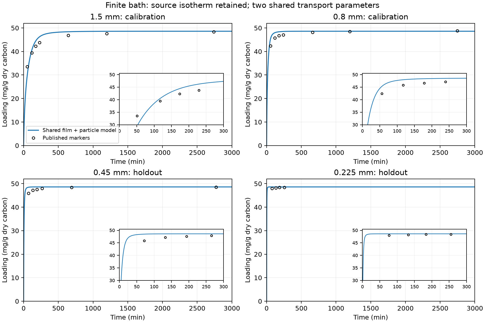
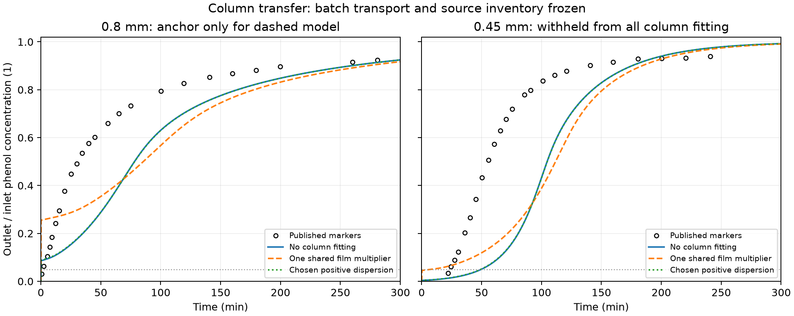

# Finite-bath audit and film-plus-particle adsorption model

Implemented and tested on 10 November 2026. The new model is separate from the
accepted synthetic adsorption example and the earlier failed LDF comparison.
It uses Alhamed's date-stone carbon only; coconut-shell-carbon inputs are not
pooled with it. Reaction, heat coupling and regeneration remain deferred.

## Engineering result

**The batch comparison passes the declared error screen, including the two
withheld particle sizes. The column prediction still fails.** Adding film
transfer and diffusion inside a particle does not, by itself, explain Figure 7.
We have retained that failure rather than fitting every column separately.

The paper's Langmuir isotherm, combined with a finite-bath mass balance,
reproduces its seven Table 3 fitted equilibrium loadings within **2.03%**.
That is a consistency audit against published fit endpoints, not independent
raw equilibrium measurements. It supports retaining the source isotherm for
this test; it does not establish the effective inventory of each packed bed.

Two shared transport parameters were fitted to the 0.8 and 1.5 mm Figure 2
batch curves. No smaller-particle curve was used in that fit.

| Batch particle size | Role | Loading RMSE | Chosen screen |
| --- | --- | ---: | --- |
| 1.5 mm | Calibration | 2.10 mg/g | Pass, <= 3 mg/g |
| 0.8 mm | Calibration | 1.62 mg/g | Pass |
| 0.45 mm | Withheld prediction | 1.33 mg/g | Pass |
| 0.225 mm | Withheld prediction | 0.42 mg/g | Pass |

These are comparisons to 24 digitized experimental markers. Figure 2 starts
at 30 mg/g; fast initial uptake is not visible. In particular, the 0.225 mm
points are already close to equilibrium. Passing their loading comparison
does not validate an unobserved initial uptake time. All four comparisons also
remain below 3 mg/g in the chosen +/- 2 pixel reading scenarios; these are
image-reading sensitivities, not experimental confidence intervals.

For the columns, the batch diffusivity and source isotherm were frozen. The
physical dry mass was derived from the printed bulk density and bed geometry,
and was never fitted. The primary calculation used a declared packed-bed
film correlation without fitting either Figure 7 curve. A separate conditional
route fitted only one film multiplier to the 0.8 mm column, then froze it for
the 0.45 mm prediction.

| Figure 7 quantity | Approximate paper reading | No column fitting | One common film multiplier |
| --- | ---: | ---: | ---: |
| 0.8 mm: time to 50% outlet concentration | 30.75 min | 78.14 min | 85.52 min |
| 0.45 mm: time to 50% | 55.36 min | 104.71 min | 111.76 min |
| 0.8 mm: concentration-fraction RMSE | — | 0.204 | 0.178 |
| 0.45 mm: concentration-fraction RMSE | — | 0.322 | 0.298 |

Both routes fail the RMSE <= 0.10 and t50 error <= 20% screens. The withheld
0.45 mm bed reaches 5% outlet concentration at approximately **23.54 min**
in the figure. The unfitted prediction is approximately 49.80 min. The
one-anchor prediction, with its early transient independently refined, is
approximately **11.90 min**. It also fails the 25% t05 screen. That refined
value replaces the coarse full-run t05 of 7.88 min when interpreting early
breakthrough; both values and their mesh settings are retained.

Thus, matching particle uptake in a shaken flask has not established the
packed column's usable capacity or contact pattern. The discrepancy could
involve column flow distribution/dispersion, effective contact/accessibility,
or transfer of the source properties to the packed fractions. This study does
not uniquely identify its cause. It does not support a validated particle-size
optimum or pumping-energy recommendation for this carbon.





The full-duration curves use the saved 80-cell trajectories for RMSE/t50.
The very early t05 values have separate higher-resolution checks. In
particular, the dashed 0.45 mm curve's first crossing on this overview is the
coarse value; the refined early-time value is reported above.

## What remains source data, and what was fitted

Source: Y. A. Alhamed (2009), *Adsorption kinetics and performance of packed
bed adsorber for phenol removal using activated carbon from dates' stones*,
Journal of Hazardous Materials 170, 763–770,
[DOI 10.1016/j.jhazmat.2009.05.002](https://doi.org/10.1016/j.jhazmat.2009.05.002).
The original PDF SHA256 is
`c0d9eb61560f643b5b890b1926f1b0f2bc279386dc6bd882cb640ae3f0061b22`.
Complete PDF pages 2–7 were previously inspected; Figure 2's original embedded
raster was inspected again and the selected marker centres visually checked.

[The protocol](../literature/alhamed2009_film_particle_protocol.md) precedes
fitting this model. [The extraction](../literature/alhamed2009_film_particle_extraction.json)
and [Figure 2 pixel centres](../literature/alhamed2009_fig2_pixels.csv) retain
units, axes, raster/source hashes, conditions, missing uncertainty and the
calibration/holdout partition. The previous Figure 7 extraction is unchanged.
The Figure 6/Table 5 height conflict remains excluded.

| Quantity | Role | Value used |
| --- | --- | --- |
| Langmuir capacity | Source Table 1, unchanged | 0.1115 kg phenol/kg dry carbon |
| Langmuir affinity | Source Table 1, unchanged | 139 m³/kg phenol |
| Primary equilibrium multipliers | Explicit, unchanged | Capacity 1; affinity 1 |
| Diagnostic capacity multiplier | Fitted to Table 3 rows 4, 5, 6 only; **not applied** | 0.96685 |
| Bed bulk density | Printed source property | 740 kg dry carbon/m³ bed |
| Bed porosity | Printed source property | 0.427 |
| Particle-envelope dry density | Derived, not skeletal density | 740/(1−0.427) = 1291.45 kg/m³ |
| Figure 7 physical bed mass | Derived from density and geometry; not a per-run weighed mass | 7.032455 g |
| Effective loading diffusivity Ds | Shared batch fit | 1.8460e-12 m²/s |
| Batch film coefficient at 0.8 mm | Shared batch fit at 200 rpm | 7.7322e-5 m/s |
| Batch film-size law | Declared assumption, exponent not fitted | kf(dp)=kf_ref*(0.8 mm/dp) |
| Column film multiplier | Fitted only to 0.8 mm Figure 7 | 0.54782; same factor for withheld 0.45 mm |

The fitted Ds is a coefficient for an effective **loading-diffusion** model.
It is not the free-liquid diffusivity, a reconstructed micropore diffusivity,
or an independently measured intrinsic material constant. Deterministic film
profiles show a trade-off: batch film coefficients 1e-4 and 1e-3 m/s give
similar acceptable loading errors with Ds around 1.75e-12 and 1.58e-12 m²/s.
Those profiles are not confidence bounds. Their unfitted column transfers are
saved as separate sensitivity cases.

The column film calculation uses the form `Sh=2+1.1*Re^0.6*Sc^(1/3)`, from
Alhamed Equation 19 and the original
[Wakao–Funazkri correlation](https://doi.org/10.1016/0009-2509(78)85120-3).
The primary Reynolds number explicitly uses superficial velocity. Replacing
it by interstitial velocity is an independently labelled convention scenario.
The two primary sizes have Re=7.37 and 4.15, within the original correlation's
published approximate Re range of 3–10000. This does not establish its accuracy
for these particular granules.

## Equilibrium, uptake and sampling audit

Batch conditions are 1 g dry carbon, 250 mL liquid, 200 mg/L phenol, 200 rpm and
22 +/- 1 degC. Table 3 additionally contains 400 mg/L and a 0.5 g test; those
conditions are checked for equilibrium and the published fitted initial-rate
comparison. Complete kinetic validation of those additional conditions is
not claimed because their raw time curves are not supplied in Figure 2.

The finite-bath equation is `V*C + m*q(C) = V*C0`. It is solved independently
of the transient model, and checked against the analytical Langmuir quadratic.
No batch liquid concentration is held artificially constant while carbon
adsorbs solute.

The clean-particle film-supply limit is `dqbar/dt = 3*kf*C0/(rho_particle*R)`
at t→0. The fitted shared model gives 5.39 and 1.53 mg/g/min for 0.8 and
1.5 mm at 200 mg/L, versus Table 3's pseudo-second-order fitted h values of
5.01 and 1.76. Its 0.225/0.45 mm predictions are 68.12/17.03, versus fitted
values 60.85/10.65. Discrepancies are larger for the 400 mg/L and 0.5 g
entries. These are descriptive comparisons to extrapolated fit parameters,
not measured t=0 derivatives or additional calibration targets. No inference
of a chemical reaction mechanism is made from a pseudo-second-order fit.

The baseline neglects aliquot removal. A separate sensitivity removes 1 mL
at each selected digitized time, updating liquid volume and exporting the
removed solute. This is a partial chosen schedule, not reconstruction of the
unknown full schedule or a conservative uncertainty bound. The largest
loading change is about 0.130 mg/g; none of these scenarios rescues the column
prediction. Final liquid volumes are 243, 243, 244 and 246 mL for the four
selected schedules. The 1.47 versus 1.5 mm source label is also retained as a
separate diameter scenario without refitting.

Chosen active-inventory fractions 0.5 and 0.75 preserve the physical dry mass
and source isotherm while changing the participating solid mass and associated
active surface. They are not measured uncertainties or fitted masses. With
50% active inventory the smaller column's t50 approaches the observation,
but the larger column's t50 becomes approximately 0.21 min. Improving a
single curve this way does not establish a common predictive model.

## Conservative equations and data contract

Julia implements a homogeneous spherical loading-diffusion approximation:

```text
∂q/∂t = Ds/r² * ∂/∂r(r² * ∂q/∂r)
∂q/∂r = 0 at r=0
q_surface = qmax*b*Cs/(1+b*Cs)
J = kf*(Cbulk-Cs) = rho_particle*Ds*(∂q/∂r at R)

Bath: V*dC/dt = -m*dqbar/dt
Column: eps*dC/dt + ∂(u*C-eps*Dax*∂C/∂z)/∂z
        = -active_fraction*rho_bulk*dqbar/dt
```

Separate intraparticle liquid inventory is neglected explicitly. There is no
heat equation, reaction, gravity, regeneration or resolved internal pore
geometry. Spherical-shell volume weights are `(r_outer³-r_inner³)/R³` and
sum to one. The column has a Danckwerts inlet total flux and zero dispersive
outlet flux. Baseline Dax=0; `Dax=0.5*v_interstitial*dp` is a chosen positive
dispersion scenario, not a measured hydrodynamic closure.

Backward-Euler finite volumes couple liquid and particle storage implicitly.
The radial linear systems are eliminated within the nonlinear liquid solve.
A monotone surface-concentration equation enforces one shared interface
flux. No completed state is clipped and no output mass is corrected. Trial
Newton iterates may be projected nonnegative before re-evaluating the
original conservative residual. Serial sampling removes both volume and
the corresponding dissolved solute explicitly.

The SI API is in [the separate Julia module](../julia/adsorption/FilmParticle.jl):
`solve_bath`, `solve_column`, `bath_equilibrium`, `film_coefficient`,
`initial_film_rate`, and the constant-bulk particle oracle `solve_fixed_bulk`.
The old numerical modules and manifests are unchanged.

Python materializes ordinary copied arrays. Final shell loading has shape
`(axial_cells, radial_cells)`, in kg phenol/kg dry active carbon. Rows increase
along z from inlet to outlet; columns increase from particle centre to surface.
`axial_centres_m` and `radial_centres_m` locate those cells, with ordinary
zero-based Python indexing. Flow is positive along z on [0,L]. Concentration
is kg phenol/m³ liquid. In bath results the common
`outlet_concentration_kg_m3` field denotes the uniform **bath concentration**;
there is no physical bath outlet. Physical and active dry masses, liquid and
adsorbed inventories, cumulative inlet/effluent/sample solute, surface-flux
mismatch and timing are separate fields. Missing crossings are JSON null.

## Verification and exact commands

The separate Julia suite passes **51 assertions** covering the analytical
spherical-diffusion series, finite-bath film limit, nonlinear equilibrium,
zero exchange, positive states, sampling and conservation. The first broad
implementation had a returned-array scope error, fixed before these results.
An early smaller-step bath run exposed accumulated nonlinear stopping error
at 1.92e-8 against the 1e-8 conservation screen. The new solver's per-step
residual was tightened; the scientific screen was not relaxed. Rejected runs
and source snapshots are retained.

The final study saves **57 actual Julia forward cases**, in addition to the
calibration evaluations and seven endpoint audits. Maximum normalized mass
residual is **1.84e-10** and maximum normalized interface-flux mismatch is
**2.04e-13**. Batch radial/time changes at observation times are below 0.060%
of the source equilibrium loading. Full-run t50 changes are below 0.157%.

The conditional smaller column's early t05 needed a separate 1500 s calculation:
1000→2000 axial cells changes it by 1.28%, 32→64 radial cells by 0.279%,
and 0.25→0.125 s by 0.0032%. Short-window checks also resolve both calibration
t05 values. All selected convergence changes pass the unchanged 2% screen.
The coarse full-run t05 changes, including the initially failed 27.9% axial
change, remain visible in the saved refinement records.

The independent checker replays all 57 cases, checks seven analytical bath
endpoints, 141 artifacts and 20 source files, and reconstructs inventories,
sample losses and inlet/effluent integrals. The full Python suite passes
**112 tests**. Both preserved studies reverify: the original synthetic loop
retains its 11-column/1,178-artifact check and all four saved DWSIM pump
topologies; the earlier LDF comparison retains its 10-column replay and
failed physical status. All 2,070 checked original OpenLB files remain
consistent with the pinned source archive (the documented pre-existing
configuration exception is unchanged). Figures were visually inspected.

From the project root:

```sh
source scripts/env.sh
uv sync --locked
uv run python -m adsorption.film_particle.data
julia --project=julia julia/adsorption/test_film_particle.jl
uv run python -m adsorption.film_particle.run
uv run python -m adsorption.film_particle.check
uv run pytest -q
```

The Python bridge uses the already selected Julia 1.11.6 executable, one
runtime on the main calling thread, and the existing `julia/` environment.
Tested Python is 3.12.9 with JuliaCall/PythonCall 0.9.37, NumPy 2.5.4 and
Matplotlib 3.11.2. No dependencies or lockfiles changed. There is no new UI
or browser pass in this model/evidence step.

The run is
`results/adsorption/film_particle/runs/20261110T083144Z-e33389b9/summary.json`.
Unique run folders retain JSON trajectories, SI time-series CSVs, source and
artifact hashes, fit histories, diagnostics and figures. The independent
checker replays the actual Julia model, reconstructs inventories and flow
integrals, checks the calibration boundary and exports
[a compact reference](film_particle_reference.json). It distinguishes passing
software/numerical checks from the failed physical column comparison. Cold
initialization and warmed core timings are recorded separately.

There are **zero new OpenLB or DWSIM solves** in this transport audit. Original
simulator source and all previously completed examples are preserved. The
existing synthetic permeability/pump pathway remains a conditional example;
this paper contains no measured pressure loss that could validate it.

## Next executable step

Keep the batch-qualified particle model as a tested component. Audit the
column contact/flow-distribution assumptions and the use of the printed bulk
density before adding more fitted parameters. The paper's fitted dispersion
coefficients summarize breakthrough shape and must not be relabelled as
independently measured fluid dispersion. A common, separately verified column
mixing/contact model should be tested against both diameters with the same
calibration boundary. No new laboratory data, author contact or unavailable
raw dataset is a prerequisite. Process-energy conclusions should wait until
that column comparison is qualified.
