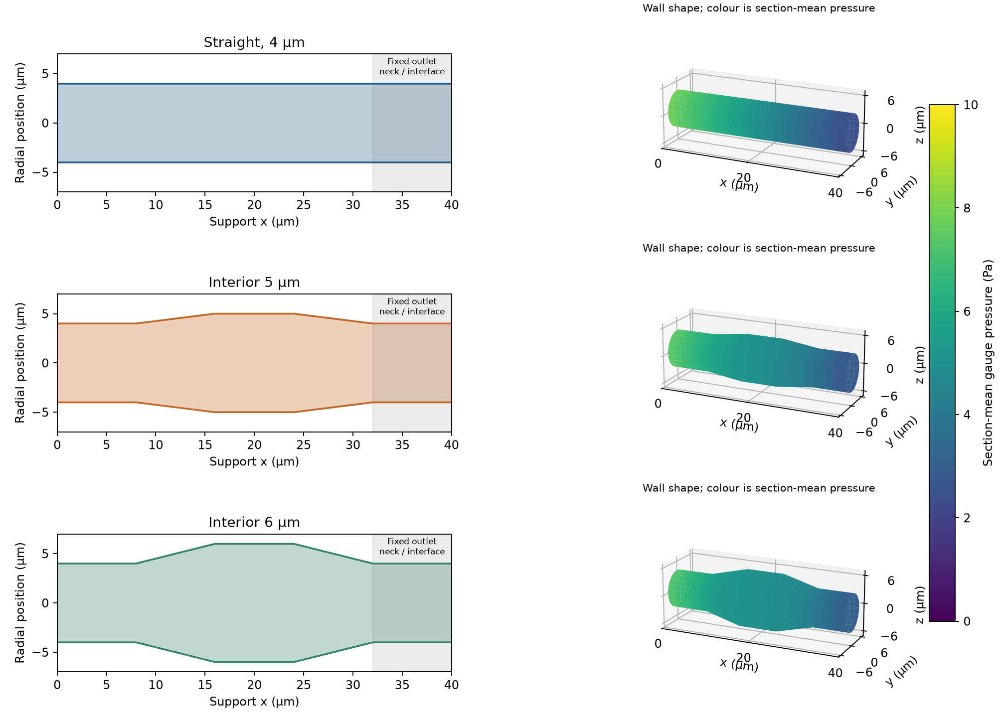
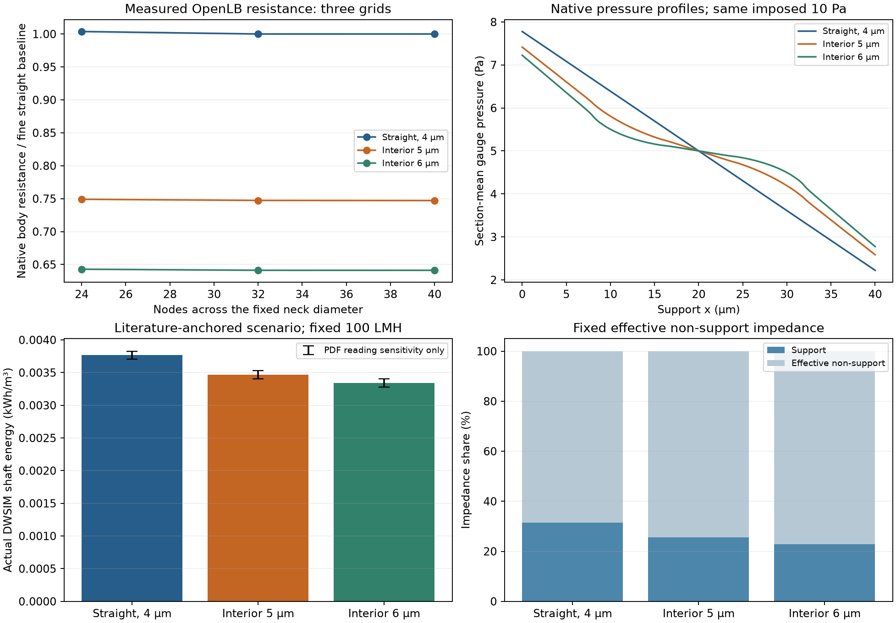

# Fixed-opening graded support: OpenLB → Julia → DWSIM

Study specified 8 November 2026. Research question: at fixed clean-water
filtration flux and unchanged effective non-support layer, how much does an
interior pore widening reduce transmembrane pressure-load shaft energy?
This is a synthetic design comparison using a bounded published hydraulic
reference. It follows [the computational verification scope](verification_scope.md).

## Verified result — 8 November 2026

All four steps are complete for this controlled geometry family. Final run:
`20261108T222740Z-26e9f37b`. [The compact reference](graded_support_reference.json)
retains exact values, versions, source/binary/lock hashes and the full run path.

The energy values use one common literature baseline calibration of the native
resistance ratios, detailed below. They are conditional scenario results.

At fixed 100 LMH, 1 m² and 75% pump efficiency:

| Interior radius µm | Native support resistance reduction | Pressure load bar | Actual DWSIM shaft energy kWh/m³ | Saving vs straight | Effective non-support share |
| --- | --- | --- | --- | --- | --- |
| 4 | 0.00% | 0.10176 | 0.0037688 | 0.00% | 68.50% |
| 5 | 25.29% | 0.09365 | 0.0034687 | 7.96% | 74.43% |
| 6 | 35.88% | 0.09026 | 0.0033429 | 11.30% | 77.23% |

The 4 → 5 µm widening saves **7.96%** of transmembrane shaft energy; the
4 → 6 µm widening saves **11.30%**, despite reducing native body resistance by
**35.88%**. Reading-bound scenarios give **7.84–8.11%** and **11.13–11.50%**
respectively. These are digitization sensitivities, not experimental confidence
intervals or complete uncertainty budgets.

The effective non-support layer already dominates at baseline. It reaches
77.23% for the widest case, below 90%. In the series model, 90% requires a
support flux of **12.91 m/h at 1 bar**; the widest translated design provides
about **4.87 m/h**. Even a hypothetical zero-resistance support could save at
most **31.50%** from this baseline. The fixed terminal necks and
non-support impedance limit this family's benefit; three designs do not
establish an optimized material.





## Observed numerical checks

| Interior radius µm | N32 → N40 resistance change | Largest pressure/domain/time-step change at N24 | Fine-grid all-plane mass spread | Difference from lubrication reference |
| --- | --- | --- | --- | --- |
| 4 | 0.00036% | 0.1216% | 0.0326% | +0.0820% |
| 5 | 0.02558% | 0.1310% | 0.0532% | +0.7497% |
| 6 | 0.00795% | 0.1638% | 0.0748% | +2.3263% |

The straight fine-grid permeability differs from the analytical result by
**0.0820%**; its velocity-profile L2 error is **0.0780%**. Fine-grid stability
is reported without claiming a formal convergence order or monotonic error.
The tapered-reference differences include actual 3D flow effects, since the
locally developed formula is approximate. Across all 24 cases, pressure-range
resistance changes remain below **0.0042%**; maximum Re is **0.01391** and
Mach **0.000101**. Longer leads preserve body resistance; changing time step
produces the largest cross-case changes, still below the frozen 0.5% bound.
Actual material labels match the declared profile on every fine-grid plane,
with one connected fluid component per geometry.

The common baseline impedance multiplier is **813.84**. Raw straight-pore
impedance is only **141777 Pa s/m**, compared with the anchored
**1.15385e+08 Pa s/m**. This exposes the unresolved thickness/network-structure
scaling instead of presenting the synthetic pore's absolute permeance as a
measured ceramic prediction. Transfer of the shape ratio through this common
multiplier remains a model assumption.

The final direct Julia suite passes **372 assertions**; the complete Python
suite passes **25 tests**. **18** native guards reject invalid inputs or a
forced nonconvergence. Verification checks **24** native cases, **3** full
material/connectivity audits, **9** actual saved DWSIM cases and **270**
artifacts. A modified full-run CSV is rejected. Wall VTP exports reload with
float64 coordinates/pressure fields, correct SI bounds and finite values.
Both scientific figures were visually inspected at common physical scales.
No new Panel/browser interface was built or claimed.

The final publication run reuses all 24 byte-verified native measurements and
performs nine fresh DWSIM design/scenario solves, plus a property-anchor case.
Native measurements were obtained across the preceding execution directories
with the same binary and inputs. A 535-second fine baseline prompted a longer
launcher allowance before the wider cases; the longest accepted native solve
was about **647 seconds**. This changed only the wall-time cap, not numerical
settings or acceptance thresholds. The final replay reanalyzes stored native
data and Julia loads; it does not perform new external solves. Timing fields
distinguish cached measurements, Julia initialization and actual DWSIM solves;
no speedup claim is made.

Tested versions: macOS 26.6.2 ARM64, CPython 3.12.9, Julia 1.11.6,
JuliaCall/PythonCall 0.9.37, OpenLB 1.9r0, GCC 15.2, DWSIM 10.2.15.0 and
.NET SDK 10.0.403. No new dependencies were installed; locks and the existing
bridge/adapter are unchanged. The shared Python launch helper adds only an
optional timeout, preserving earlier examples' default. Original OpenLB files
continue to match the pinned archive. No installation or execution blocker
remains for this milestone.

## Controlled geometry and measurement

All three designs have a 40-µm body, 4-µm terminal pore radii and a 20 × 20 µm
representative cell. Axial knots are 0, 8, 16, 24, 32 and 40 µm. Radii at these
knots are 4, 4, bulk, bulk, 4, 4 µm; bulk is **4, 5 or 6 µm**. Thus both mouths,
both terminal necks, selective-side interface region, thickness and
representative area stay fixed. Body porosity increases with widening; constant
porosity or equal mechanical strength is not imposed.

OpenLB uses its existing cylinder/cone indicators and union operator, D3Q19,
BGK dynamics in this historical run, Bouzidi walls, local pressure boundaries, physical plane-integral
functors and ValueTracer stopping. The project code follows the official
example lifecycle and stays in [a separate application folder](../examples/filtration/graded_support/openlb/case.h).
The installed poiseuille3d and venturi3d examples and
[official geometry documentation](https://openlb.gitlab.io/release/content/03_geometry.html)
were consulted. No original OpenLB implementation is changed.

Pressure boundaries are placed in 16-µm development sections on each side.
Those sections are excluded from body pressure taps. The domain check extends
them to 24 µm while preserving the complete 40-µm support body. Positive flow
is +x; OpenLB pressures are gauge Pa. Julia computes

```text
R_body = delta_p_body / Q                 [Pa s/m³]
k_body = mu * L_body / (A_cell * R_body)   [m²]
```

Every design has three neck grids, N24/N32/N40. Additional N24 cases use
5, 20 and −10 Pa, longer leads and half the physical time step through
tau=0.65 instead of 0.8. This gives **24 actual native solves**. The
[protocol](../examples/filtration/graded_support/protocol.json) fixes tolerances before those solves:
1% fine-grid resistance change, 0.5% cross-case resistance change, 1% maximum
all-plane mass spread, 0.01% inlet/outlet mass mismatch, native Re<0.05 and
Mach<0.001. The straight case must also meet 1% analytical permeability and
velocity-profile errors. Six-neighbour connectivity is checked directly on
exported fine-grid OpenLB fluid labels.

The independent Julia reference integrates locally developed Poiseuille
resistance along piecewise-linear radii:

```text
R_lubrication = (8*mu/pi) * integral dx/r(x)^4
```

This is exact for the straight pore and an approximation for tapered pores.
For a segment of length l and end radii a,b,
`integral dx/r^4 = l*(a²+a*b+b²)/(3*a³*b³)`, including a=b. The OpenLB result
is not generated from this expression. Agreement with the approximation is
reported for tapered designs without imposing an exact-solution error bound.

## Literature-informed scale translation

[Zhu's PDF-refined M1 series](zhu_pdf_refinement.md) supplies effective fixed
non-support impedance Z, including possible interface/access contributions.
It is not a separately measured intrinsic selective-layer property. At a
fixed computational scenario of 100 LMH, 1 m², 298.15 K and 75% pump efficiency:

```text
c_i = measured R_body,i / measured R_body,straight
P_support,0 = (3.12 / 3600) / 100000        [m/(Pa s)]
Z_support,i = c_i / P_support,0            [Pa s/m]
delta_p_i = J * (Z_support,i + Z_fixed)    [Pa]
Q_process = J * A_membrane                [m³/s]
E_shaft_per_volume = delta_p_i / eta       [J/m³]
```

The published 3.12 m/h support value at 1 bar anchors a **single common
baseline calibration**. There is no geometry-specific fit. This assumes that
the resolved shape ratio transfers through the same unresolved-structure
multiplier for all three designs. The raw pore impedance is exported separately
so the calibration magnitude is visible. This is not an absolute prediction
for an actual ceramic specimen or an identified connected pore structure.

Water-flux measurement temperature/viscosity and uncertainty are unreported.
No experimental correction is invented. DWSIM's water properties at the
declared scenario configure the native calculation; retaining the fitted
experimental Z at that temperature is an explicit approximation. Three fixed
Z scenarios use the nominal PDF result and its low/high reading bounds. These
are reading sensitivity bounds, not experimental uncertainty intervals.

DWSIM receives each Julia pressure requirement as its real pump's absolute
discharge pressure above 100000 Pa. Mass flow is the shared inlet density × Q.
It solves material and energy streams, saves a flowsheet, reloads and solves
it again. There are **nine design/scenario pump cases**, plus a fluid-property
anchor. Independent Q·delta_p/eta checks and mass/energy-balance checks assess
the actual DWSIM results. A stored-data checker subsequently replays native
analysis and Julia loads; that checker does not perform new external solves.

This first energy metric excludes crossflow circulation, fouling, backwash,
osmotic pressure, motor losses and plant auxiliaries. The DWSIM flowsheets
contain pumps and streams; an explicit membrane separation/recycle model is
a subsequent process milestone.

## Reproduction and acceptance record

[Launch commands and all array/file contracts](../examples/filtration/graded_support/README.md)
include fresh execution, native-data reuse with strict hashes, saved-result
verification, direct Julia tests and the Python integration suite. The
separate native input validator exercises invalid geometry, fluid/numerical
values and a deliberately unconverged run.

The initial pilot exposed an application geometry-padding error: fluid cells
extended beyond pressure planes. The marking extent was corrected before the
accepted study, using a short extent for material marking and a longer extent
for stock wall-distance queries as in the original reference. Its interrupted
logs remain separate under `results/graded_support/pilot/`; corrected pilots
and the later study do not reuse that result.

## Next process milestone

The subsequent [explicit hydraulic filtration case](process_filtration.md) now
passes 18 actual DWSIM geometry/recovery/upstream-loss cases, retaining the
unchanged measurements from this study. Julia supplies the hydraulic closure;
DWSIM solves a stock pump, splitter and pressure-loss valves with explicit
feed/permeate/retentate and energy balances. The installed interfaces were
inspected before that representation was selected.

The subsequent [crossflow recycle extension](crossflow_recycle.md) also passes
25 actual DWSIM cases, with independent channel resistance, circulation duty,
purge and temperature control. Recovery, separation assumptions and operating
constraints remain explicit. The next research step should use published
channel geometry and transport/fouling behavior to evaluate a circulation
cost/performance tradeoff. No experimental total-plant energy validation is
implied by these hydraulic studies.
