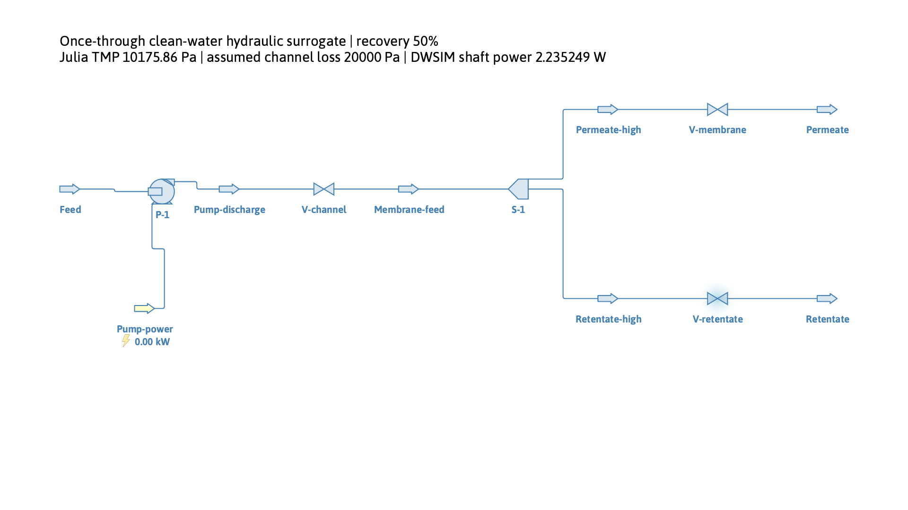
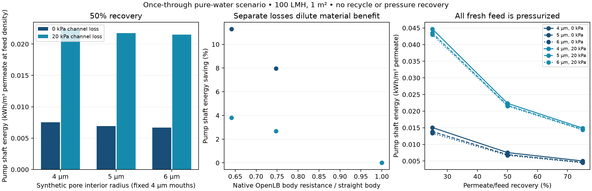
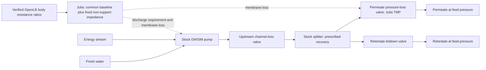

# From pore resistance to an explicit filtration flowsheet

This milestone keeps the [verified fixed-opening OpenLB comparison](graded_support_study.md)
and its common literature baseline calibration. It adds the feed and retentate
that the earlier transmembrane-load pump demonstration omitted. All conditions
below describe a declared clean-water scenario, not Zhu's experimental device.

## Verified result — 9 November 2026

Final run: `20261108T231207Z-316d61cb` (UTC identifier). **All 18 actual DWSIM
filtration cases pass**, including save/load/solve, every stream and unit
balance, independent pump-work/recovery scaling and all saved connector ports.
The unchanged upstream study was independently replayed: 24 native cases,
three geometry-connectivity audits and nine earlier pump configurations.
There were no fresh OpenLB solves or edits to original OpenLB/DWSIM files.

At 50% recovery, permeate is 0.1 m³/h and fresh feed 0.2 m³/h, both expressed at
the common fresh-feed density. Exact results and provenance are in
[the compact reference](process_filtration_reference.json).

| Pore interior radius | Shaft energy, zero separate channel loss | Shaft energy, assumed 20 kPa channel loss | Saving with 20 kPa loss |
| --- | --- | --- | --- |
| 4 µm | 0.00753768 kWh/m³ | 0.02235249 kWh/m³ | 0.00% |
| 5 µm | 0.00693734 kWh/m³ | 0.02175216 kWh/m³ | 2.69% |
| 6 µm | 0.00668588 kWh/m³ | 0.02150070 kWh/m³ | 3.81% |

All mouths remain 4 µm. With zero separate channel loss the widest interior
retains the previous **11.30%** relative saving, but pressurizing the full feed
at 50% recovery doubles specific energy relative to the earlier permeate-only
pump duty. The assumed 20 kPa upstream loss reduces that design's saving to
**3.81%**. This is an explainable process effect of the same pore-scale input;
channel loss is explicitly independent of the material resistance.

Changing recovery from 25% to 75% divides energy per reference permeate volume
by three at fixed imposed pressure losses. The recovery sweep prescribes those
losses; it is not a friction-law prediction for the same physical channel at
three different feed flows. That correlation belongs to the next circulation
model.

Maximum mass residual is zero at exported precision. Maximum unit/overall
enthalpy residual is **2.64×10⁻⁵ of shaft power**, below the predeclared 10⁻³
screen. Maximum viscosity change is **0.02197%**, and density change
**0.001286%**, within the 0.1% frozen-property screens. These are numerical and
scenario checks, not experimental uncertainty bounds.

The stock energy label rounds to 0.00 kW at this small flow. The annotation and
JSON retain the actual **2.235249 W** duty; it is not a zero-power solve.

Direct Julia tests pass **422 assertions**, including 50 new hydraulic closure
checks. Python tests also replay the actual saved DWSIM stream record through
Julia and reject altered mass/enthalpy/property data and swapped splitter
ports. Full CLI acceptance covers all 18 freshly solved external cases, rather
than treating saved-record unit tests as new DWSIM execution.

Cold-process Julia initialization, including needed package precompilation, was
3.38 s. Per-case DWSIM flowsheet setup was 0.989–1.158 s and the first solve
0.074–0.108 s on this Mac; process startup,
archive reload, rendering and upstream checks are additional. These are
observations from this run, not performance guarantees or a speedup claim.

## Model and equipment boundary

The pure-water split represents a **hydraulic surrogate**, with recovery
prescribed as an operating assumption. It does not predict a separation factor,
solute rejection or concentration polarization. Each valve is DWSIM's stock
isenthalpic pressure-loss operation. There is no new custom simulator unit.
The [interface investigation](dwsim_filtration_interfaces.md) records why these
supported operations were selected.

The membrane chamber has a uniform feed-side pressure. An optional upstream
loss represents a separate channel/distribution lump. This deliberately simple
placement does not resolve the pressure profile along a crossflow membrane or
claim to infer channel friction from through-membrane permeability. Both
products leave at the fresh-feed absolute pressure; retentate pressure is
dissipated without recovery.

## Independent hydraulic reference

The already measured native ratios are carried through unchanged:

\[
Z_{s,i}=\frac{R_{\mathrm{OpenLB},i}}{R_{\mathrm{OpenLB},0}}\frac{1}{P_{s,0}},
\qquad \mathrm{TMP}_i=J(Z_{s,i}+Z_\mathrm{fixed}).
\]

Here \(P_{s,0}=(3.12/3600)/10^5\) m/(Pa s) is the published baseline,
and \(Z_\mathrm{fixed}=250946524.48872787\) Pa s/m is the unchanged nominal
effective non-support impedance from the Zhu PDF fit. It may include access or
interface effects; it is not identified as a uniquely intrinsic selective layer.
The same common calibration, reading limits and specimen limitations remain
documented in the previous study. No design-specific refitting is introduced.

At common fresh-feed reference density \(\rho_0\), let \(y\) be permeate/feed
mass recovery. The reference volume rates satisfy

\[
Q_p=JA,\quad Q_f=Q_p/y,\quad Q_r=Q_f-Q_p,\quad
W=\frac{Q_f(\mathrm{TMP}+\Delta p_c)}{\eta},\quad
e=\frac{\mathrm{TMP}+\Delta p_c}{\eta y\,3.6\times10^6}.
\]

\(e\) has units kWh per m³ of permeate **at feed density**. Actual flashed
product volumes are exported separately. At fixed channel loss and recovery,
the energy saving relative to the straight support is

\[
1-\frac{W_i}{W_0}
=\frac{\mathrm{TMP}_0-\mathrm{TMP}_i}{\mathrm{TMP}_0+\Delta p_c}.
\]

This reference is derived independently from flow and hydraulic work balances.
Julia computes equipment loads, while actual DWSIM unit operations compute
stream states and shaft work; the equations also check those results. The
hydraulic work is partitioned as

\[
\eta W=Q_p\mathrm{TMP}+Q_r\mathrm{TMP}+Q_f\Delta p_c.
\]

The terms are membrane hydraulic dissipation, retentate pressure letdown and
upstream channel loss. Pump inefficiency adds \((1-\eta)W\). DWSIM's thermodynamic
energy test instead uses the full inlet/outlet enthalpy flows and pump work;
the hydraulic partition is not added again to that balance.

## Declared scenarios and acceptance

`examples/filtration/once_through/protocol.json` freezes the scope and thresholds. Conditions
are 298.15 K, 100000 Pa external pressure, 100 LMH reference flux, 1 m² membrane,
75% pump efficiency, three already verified support geometries, mass recoveries
25/50/75%, and separate upstream drops 0/20000 Pa. The latter values are scenario
assumptions, not extracted experimental measurements or fitted channel friction.
The two product streams must have positive flow, so recovery endpoints 0 and 1
are outside this runner's contract.

Every case checks all five unit balances plus the overall balance. Maximum
mass residual is limited to \(10^{-10}\) of feed mass flow; maximum enthalpy
balance residual to \(10^{-3}\) of shaft power. Independent pump work must
agree within \(10^{-9}\) relative. All streams must remain pure liquid water;
viscosity and density must each depart by less than 0.1% from the common inlet
anchor, screening the frozen-property hydraulic approximation. The threshold
is declared before the comparison, not adjusted to the results.

Each actual DWSIM flowsheet is saved, loaded and solved again. All seven stream
pressures, flows, temperatures and enthalpies, plus pump energy-stream duty,
are compared. The saved archive's actual connector IDs and splitter outlet
order are inspected independently. Numerical arrays in the upstream OpenLB
exports retain their original SI units and indexing contract.

## Reproduction and remaining scope

[Run and check commands](../examples/filtration/once_through/README.md) reproduce this stage
from intact saved OpenLB data. Each run stores inputs, original source summary,
model/runtime versions and hashes, actual DWSIM archives, stream results,
timings, logs, CSV and figures. The checker replays Julia and validates stored
evidence; it performs no fresh external solves. Cold Julia initialization and
individual DWSIM initialization/solve times are retained separately.

The subsequent [crossflow recycle stage](crossflow_recycle.md) is now complete:
stock mixer, recycle tear, separate circulation pump, channel resistance and
temperature-control cooler. Twenty-five actual DWSIM cases pass convergence,
external/unit balances and save/reload checks. Its actual shaft work and
removed heat remain separate. The next research extension should give
circulation a published transport/fouling performance role; no exact membrane-
selectivity or experimental temperature claim is implied.

This milestone excludes recycle, energy recovery, motor losses, fouling,
osmotic pressure, backwashing and total-plant duty. The original interactive
Panel example remains independently usable; this process study is a CLI
workflow with exported flowsheets and figures.
