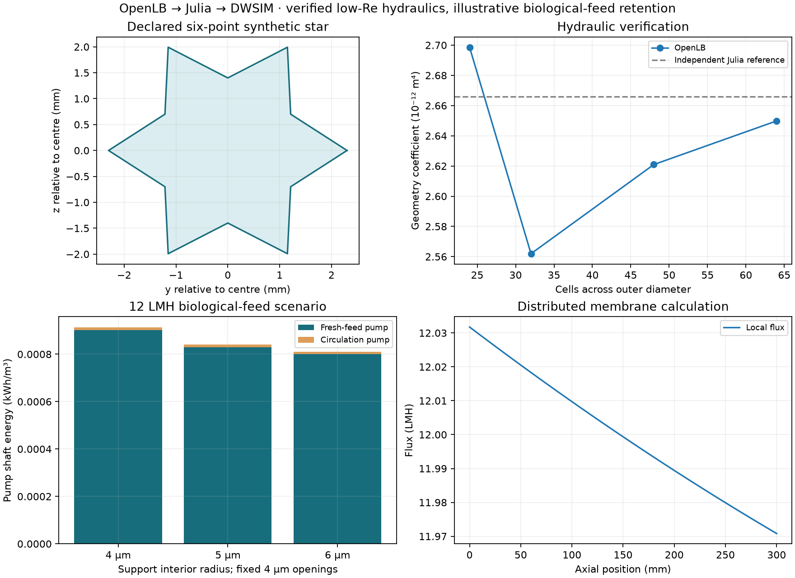
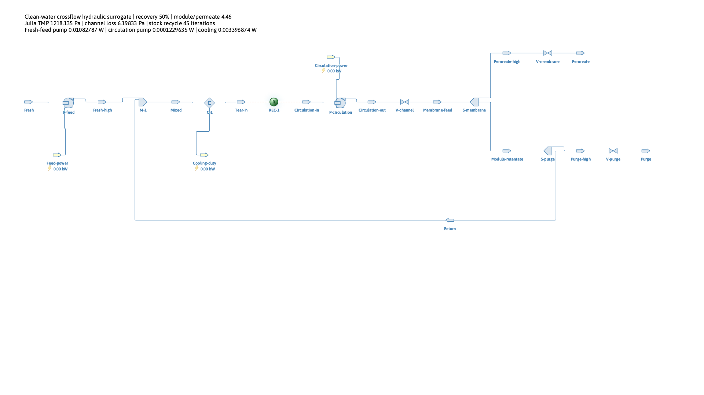

# Explicit channel, biological-feed sensitivity and local interface

Implementation and verification record, 9 November 2026. The accepted numerical
workflow passes 17 native channel cases, 24 native TRT support cases, 28 actual
DWSIM crossflow solve/save/reload cases, 878 Julia assertions and 61 Python
tests. The separate capillary TRT regression adds eight native cases. Browser
checks are recorded separately in [browser_checks.md](browser_checks.md).

At 12 LMH and inlet Re=20, widening the support interior from 4 to 6 µm,
with its 4 µm openings held fixed, reduces native support resistance by
35.89% and **total pump shaft energy by 11.20%**. Mean TMP falls from
1.2211 to 1.0831 kPa. The fixed effective non-support resistance is already
dominant: its share rises from 68.50% to 77.23%. These are clean initial,
literature-anchored scenarios, not a validated fouling/separation prediction.

## Scope and data boundary

The first research question remains: at fixed filtration flux and unchanged
selective-layer scenario, how much does support geometry reduce total pumping
energy, and when does the fixed layer dominate resistance? The comparison holds
the common effective non-support impedance fixed. It cannot identify that
effective quantity uniquely as intrinsic selective-layer resistance.

In this series law, the fixed contribution dominates when
`Zfixed > Zsupport`, or `Zfixed/(Zfixed+Zsupport) > 0.5`. Even eliminating the
support entirely can remove at most its initial share of the transmembrane
load. Circulation adds another pump duty and reduces the fractional saving in
total shaft energy. Each comparison therefore reports both the resistance
partition and the actual two-pump saving at identical flux, inlet Re, recovery,
viscosity scenario and fixed impedance. It is not evidence that the selective
layer alone has been separately measured.

The four extensions are an explicit synthetic star channel; its measured
hydraulics in the existing actual DWSIM recycle; a published biological-effluent
COD/retention sensitivity; and a second tab in the existing Panel application.
Earlier completed examples and their saved numerical references are retained.

The model is intentionally a clean initial hydraulic calculation. Critical flux
and sustainable operating time at this new geometry/speed are unavailable.
COD retention is a transferred scenario parameter, not a validated separation
law for this synthetic material. No new experimental measurements are needed.

## Geometry and OpenLB implementation

The channel is a straight extrusion of a counterclockwise 12-vertex polygon.
Vertices alternate between radii 2.3 and 1.4 mm at angles `n*pi/6`. Flow is +x;
the star lies in y/z and its centre is y=z=2.3 mm in the native mesh. Coordinates
in all native and exported files are metres.

The exact declared cross-sectional area is `3*R*r = 9.66e-6 m2`. The perimeter
is `12*sqrt(R^2+r^2-2*R*r*cos(pi/6)) = 0.015520395663334843 m`; hence
`Dh=4*A/P = 0.0024896272516610235 m`. There are seven channels in the nominal
bundle, giving `7*P*0.3 = 0.03259283089300317 m2` active membrane area. Parallel
replication supplies the process reference area of 1 m2. Fractional equivalent
channel count describes area normalization, not a fabricated integer plant.

Each velocity has the explicit definition `u=Q_channel/A`. Bundle flow is seven
times channel flow. These dimensions are synthetic; neither the paper's
unresolved flow convention nor its stated 0.03 m2 area is silently corrected.

The application follows the official OpenLB example lifecycle: createMesh,
prepareGeometry, prepareLattice, setInitialValues, simulate, getResults. It
reuses D3Q19, TRT collision, exact-difference forcing, `Tuple`, STLreader/SDF,
BounceBack, field/plane integration functors and ValueTracer. The alias composes
existing types; no dynamics, forcing, descriptor, indicator class, integration
algorithm or other numerical library facility is reimplemented. Native centre
classification uses stock STL signed-distance facilities. An independent Julia
polygon reference is solely a verification oracle, never the production
hydraulic input or an OpenLB initializer.

The short axial domain is periodic and represents fully developed flow under
an equivalent pressure gradient G. The inferred geometric coefficient is
`C = mu_native*Q_native/G` in m4. A full module has `dp/dx=-mu*Q/C`. Pressure
gradient, viscosity and density are recorded separately; no physical inlet
pressure is inferred from the periodic density field. Axial-periodic-domain
and refinement checks concern this fully developed model, not entry losses or
an arbitrary developing module.

All additions stay in project folders. The distribution is compared against
its pinned archive; 2,070 original files are checked. Its pre-existing configured
`config.mk` is explicitly excluded from the archive comparison and is neither
read by the external build nor changed here.

Porous-media cases now require at least TRT. Older BGK results remain historical.
The current support comparison is rerun with stock pressure-driven TRT and
magic parameter 3/16. The star uses stock TRT collision plus stock Kupershtokh
exact-difference forcing, with odd relaxation time 1.6 following the existing
OpenLB example parameterization.

## Distributed channel and process equations

With channel flow q(x), TMP p(x), wetted perimeter P and common local membrane
impedance Z=Zsupport+Zfixed, Julia solves the constant-property equations

```
dp/dx = -(mu/C)*q
dq/dx = -(P/Z)*p
J(x) = p(x)/Z
beta^2 = (mu/C)*P/Z
```

The exact hyperbolic solution uses prescribed inlet flow and prescribed mean
flux. Its integrated permeation is `Jmean*P*L`; outlet TMP must remain positive.
The inputs, local pressure/flux/flow profiles, suction/inertia screens and
hydraulic energy identity are exported. Slowly varying fully developed sections
remain an approximation; entrance, turbulence, osmosis and physical fouling
time are outside this case.

The porous support's local x axis denotes through-thickness flow. Its measured
scalar impedance is assigned uniformly to the local normal of every wetted
star wall. The channel x axis instead denotes axial circulation. This is a
declared scalar scale translation; an anisotropic permeability tensor or
wall-dependent material orientation is not resolved by this example.

The actual DWSIM circuit receives outlet TMP, inlet module flow and the complete
channel pressure drop. Its feed pump raises fresh feed to the return/outlet
pressure; its circulation pump raises mixed flow to channel inlet pressure.
Stock valves and splitters provide a hydraulic port representation, with the
distributed interior calculated in Julia. The individual lumped valve losses
are not the distributed friction/membrane losses. Their combined hydraulic
work obeys the same port identity:

```
Qin*(pin-pout) + Qpermeate*pout
  = integral((mu/C)*q^2 + (P/Z)*p^2, x=0..L)
```

Thus the physical port pressures and flows drive actual DWSIM pump powers.
Actual flashed volumes and property-corrected pump checks are distinct from
reference-density Julia volumes. Every reported process case must pass mass,
enthalpy, pressure, tear convergence, saved-topology and save/reload checks.
Cooling heat is separate; cooling electricity and motor losses are not included.

The low-head case exposed accumulated pressure/enthalpy re-flash errors in the
default steam-table route: the first 8 LMH pilot failed the unchanged 0.1%-of-
shaft-power enthalpy screen (0.128% observed). The new showcase explicitly
selects DWSIM's **stock forced-liquid flash route**, retaining the IAPWS
property package and stock equipment. The same pilot's residual falls to
0.00204%; no output state is repaired after solving and no tolerance is relaxed.
This opt-in input is `Force_liquid=true`; older examples keep their default
phase calculation. All streams must remain above freezing and above twice
their stock calculated saturation pressure. Original and reloaded phase
settings are exported and checked. This is appropriate for the declared
25 °C, approximately 1 bar water carrier; it is not a general two-phase model.
The new showcase also tightens the stock recycle's absolute mass tolerance
from 1e-12 to 1e-14 kg/s. A low-duty pilot's reload cooling discrepancy drops
from 1.28e-8 to 4.14e-13 relative. The 1e-8 power/heat invariance criterion and
all mass/enthalpy acceptance screens remain unchanged; earlier examples retain
their original settings.
The installed API and official [SteamTables implementation](https://github.com/DanWBR/dwsim/blob/windows/DWSIM.Thermodynamics/PropertyPackages/SteamTables.vb)
and [ForcedPhaseFlash implementation](https://github.com/DanWBR/dwsim/blob/windows/DWSIM.Thermodynamics/FlashAlgorithms/ForcedPhaseFlash.vb)
informed this configuration; no original DWSIM source is changed.

## Biological evidence and retained unknowns

[Chiu et al. (2006)](https://doi.org/10.1016/j.seppur.2005.11.028) supplies the
effluent of a synthetic activated-sludge production system. Table 2 reports
mean membrane-feed COD 68.7 mg/L and an operating range of 65.3–72.1 mg/L.
These ranges are not error bars. Table 1 is the upstream recipe and is not
mistaken for the membrane feed.

Table 3 reports COD rejection 0.65 and permeate COD 24.1 mg/L for the 0.2 µm
membrane in transient below-critical filtration at 1.6 m/s, pH 7.5 and 0.1 bar.
Using that rejection as a constant local coefficient at our new speed and TMP
is a scenario assumption. The 0.5–0.8 sensitivity is chosen, not experimental
uncertainty. Supplied Markdown and figure provenance are retained in
`literature/chiu2006_bio_extraction.json`; no original PDF typography check is
claimed for this source.

For local rejection r and COD-equivalent concentration c, the external Julia
tracer balance gives `c(x)=cin*(qin/q(x))^r`. Permeate concentration follows the
integrated COD flux. The module-inlet concentration is the reported mean;
fresh concentration follows the recycle mixer balance rather than silently
being assigned that same value. Module, mixer and overall residuals are checked.
COD is an oxygen-demand equivalent, not a molecular compound. It does not
pretend to be a DWSIM species, measured suspension rheology or reaction model.
The reported overall COD-removal fraction is diversion to the purge,
`1-recovery*Cp/Cfresh`; it does not represent chemical degradation.

The source's lowest critical-flux point is 21.4 LMH at Re=1388. It is outside
the new verified low-Re case. It remains a source reference; it is not used to
declare the new case below critical flux. Missing sustainable flux and fouling
time are exported as unavailable (`null` where represented in JSON).

## Verification and rejected configurations

The accepted channel run is `20261109T145021Z-d988e9a0`. Its 17 native cases
and independent replay pass. The retained numerical screens are:

| Quantity | Verified result |
| --- | --- |
| Accepted outer-diameter resolution | 64 cells, compared with 48; 24/32 retained |
| Native geometry coefficient C | 2.6498554841352223e-12 m4 |
| Difference from independent 256-grid Julia reference | -0.6082% |
| Finest native grid-pair difference | 1.1019% |
| Operating-flow grid-pair difference | 1.3910% |
| Maximum lattice Mach number across accepted cases | 0.06703 |
| Maximum relative density departure | 5.53e-6 |
| Actual native operating Re envelope | 4.9414–34.5896 |

The process inlet range is restricted to Re=10–30 and mean flux 8–12 LMH.
Local outlet flows also remain inside the checked native range. The 1D model
separately screens slow axial variation/suction. Its arrays have 101 axial
points; local x is in metres and p is TMP in Pa. Native section data are sampled
at x=dx; j/k are OpenLB block indices and y=(j-0.5)dx, z=(k-0.5)dx. VTP point
IDs begin at zero. The displayed low-flow native field is not relabelled as a
new solve when process controls change.

The independent Julia duct oracle solves the cross-sectional Poisson equation
with sparse finite differences and polygon cut distances. Its square-duct
solution is checked against the analytical Fourier series. Native OpenLB also
has a circular Hagen–Poiseuille reference, star refinement, signed pressure
scaling, conservation, periodic-domain, time-step and initialization checks.
New input/discretization changes require fresh verification.

For a straight fully developed laminar duct, transverse velocity and axial
convection vanish. Momentum balance reduces to `-laplacian(w)=1`, with zero
wall values, `u=(G/mu)*w`, and therefore `C=integral(w,dA)`. This derivation is
independent of the OpenLB collision/streaming calculation. Stability of a
higher-Re flow is a separate question from this laminar conductance reference.

Exploratory BGK, default forced-TRT/Guo, MRT and higher-Re configurations are
kept under `results/star_channel/` with their logs. The selected unequal-rate
forced-TRT/Guo combination did not pass the circular oracle; no universal
upstream defect is claimed. Sharp-wall/high-Re runs became unstable or failed
steady criteria and are excluded from accepted hydraulic/process results.
No Python solver or analytically substituted permeability is used to turn a
failed native run into a pass. Coarse operating-grid failures prompted further
refinement; acceptance tolerances are not relaxed.

## Launch and reproduction

The accepted support run is `20261109T153749Z-bd772ca1`; the accepted process
matrix is `20261109T162032Z-4f70cac1`. Their `latest.json` pointers are in
`results/graded_support_trt/` and `results/star_channel/process/`. Independent
replay verifies 283 support artifacts and 449 process artifacts, including all
saved process topologies and upstream evidence, without substituting new solves.
The [compact reference](star_channel_reference.json) retains the verified
measurements, actual DWSIM nominal case, assumptions and comparison table.

| Support interior radius | Mean TMP (kPa) | Pump shaft energy (kWh/m³) | Saving vs straight | Fixed resistance share |
| --- | --- | --- | --- | --- |
| 4 µm | 1.221104 | 0.000912569 | 0% | 68.50% |
| 5 µm | 1.123836 | 0.000840519 | 7.90% | 74.43% |
| 6 µm | 1.083071 | 0.000810323 | 11.20% | 77.23% |

The comparison holds 12 LMH, Re=20, 25 °C, 1 m² and 50% recovery fixed, with
both pump efficiencies 0.75. The straight case's feed/circulation powers are
0.0108278663/0.0001229635 W, so circulation is 1.123% of total shaft work.
Across the declared sensitivity matrix the widest support saves 6.62–16.62%;
this is a scenario span, not a confidence interval or continuous optimum.
The module-inlet/fresh/permeate/purge COD values are
68.7/53.53185/26.04984/81.01385 mg/L under the transferred local rejection 0.65.

All 27 design/sensitivity cases pass, plus a differently seeded/tightened
recycle. The stock block takes 12–75 iterations across the matrix. Maximum
relative mass residual is 1.97e-12; maximum enthalpy residual divided by total
shaft power is 1.95e-6, against the unchanged 1e-3 limit. The minimum pressure
to saturation-pressure ratio is 31.5. A one-iteration recycle is separately
rejected, and prototype bounds reject 100 LMH without claiming a physical
critical-flux limit. The minimum outlet Re is 5.519, inside the verified native
envelope. The finest 6 µm support solve took 2,011 s on this run; execution
timings include machine contention and do not establish a speed comparison.





See [star_channel/README.md](../star_channel/README.md) for setup and ordered
commands. The shared Julia executable is
`/Users/dula/.julia/juliaup/julia-1.11.6+0.aarch64.apple.darwin14/bin/julia`.
It is the same executable used by JuliaCall. Direct tests use:

```sh
source scripts/env.sh
/Users/dula/.julia/juliaup/julia-1.11.6+0.aarch64.apple.darwin14/bin/julia --startup-file=no --project=julia -e 'using Pkg; Pkg.test()'
uv run pytest -q
```

Open `http://127.0.0.1:5006/app` and select **Filtration showcase**. The new
controls choose support interior radius, inlet Re, mean flux, assumed retention,
viscosity sensitivity and the common fixed impedance. Inputs remain per session.
An explicit run performs Julia translation and launches an actual DWSIM child
process. Julia remains synchronous on the main server event loop. The child
has a bounded timeout; no background Julia or user cancellation is claimed.

Downloads contain the input snapshot, units, source conditions, diagnostics,
versions, native/TRT support provenance, axial CSV, native section CSV/VTP,
STL geometry in metres, pressure plot and actual saved DWSIM file. Editing
inputs marks the previous run stale; invalid or failed runs preserve its
results/download. No shared mutable output directory is used.
The STL is the padded native input shape; its end caps lie beyond the periodic
mesh. The 3D view clips it to the numerical window. It is not a claimed full-
module CFD velocity field over the 0.3 m process length.

Both VTK views remain mounted when switching tabs. The capillary view reuses
its render window across runs. The optional orientation marker is disabled
after an observed vtk.js resize callback error; explicit x/y/z tick labels,
physical units, colour bars and drag rotation remain available. No vendor
JavaScript patch is used.

## Remaining scientific extensions

The software connection is an implemented computational workflow. Predictive
feed rheology, retention versus conditions, physical fouling time, cleaning and
reacting/non-isothermal behavior remain separate extensions. Matching the
paper's high-Re operating points requires an independently verified suitable
native flow setup and a justified empirical transfer; the present case makes
neither claim. No new laboratory measurements or unavailable raw data are gates.

Changing circulation here predicts hydraulic cost and a conservative balance
under prescribed retention; it supplies no validated circulation-dependent
fouling or separation benefit. An optimum circulation rate cannot be inferred
from this case. A concrete next numerical step is a separately verified
higher-Re stock-OpenLB channel reference with low Mach number, refinement,
time-step and stationarity checks before extending the synthetic star toward
the paper's Re=1388 point. Any critical-flux/retention transfer would then
still need a stated literature comparison. A reacting, non-isothermal model
requires a chosen reaction and published kinetic/thermal inputs as its own
milestone rather than an assumed extension of this COD tracer.
