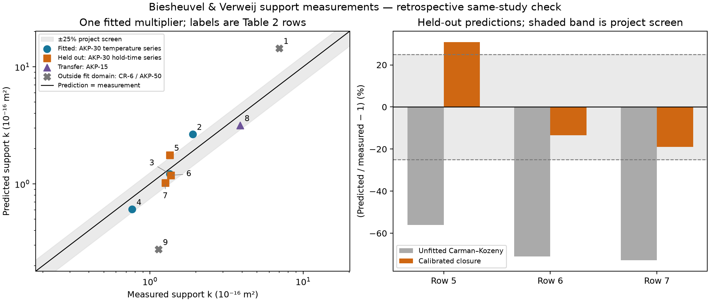
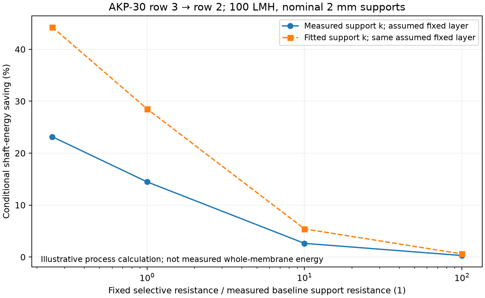

# Experimental support calibration and held-out check

> **Dated verification record.** This retains the execution/audit history.
> Use the [maintained scientific report](../../../examples/filtration/calibration/REPORT.md) for the current explanation
> and the example README for current commands.

Completed 8 November 2026 on the existing Mac environment. The workflow runs
and its numerical/export tests pass. **The primary ±25% prediction screen
fails.** The fitted model is retained as a documented limited reference, not
promoted to a validated material model.

## Evidence and source audit

The nine experimental Table 2 cases from Biesheuvel and Verweij (1999),
[DOI 10.1016/S0376-7388(98)00335-4](https://doi.org/10.1016/S0376-7388(98)00335-4),
were checked visually against the same study in Chapter 7 of
[Biesheuvel's publicly hosted author thesis](https://ris.utwente.nl/ws/portalfiles/portal/6077974/t0000015.pdf).
Printed page 105 (PDF index 118) confirms every table value and the 10⁻¹⁶ m²
multiplier. Printed pp. 97 and 103–104 confirm the CK formula, approximate
primary powder diameters and test method. This is corroboration of the same
dataset, not a second independent experiment. The publisher journal PDF was
not inspected. [The audit](../../../literature/sources/biesheuvel1999/source_audit.json) records
PDF/image hashes and locations; full text stays in ignored `literature/inbox/`.

These are flat, sintered alumina support water-permeability measurements.
Nitrogen pressurises the distilled-water cell; it is not the permeating fluid.
Reported k and porosity can support a bounded empirical comparison without
inventing a water viscosity. The per-case pressure/flow series, temperature,
viscosity actually used to infer k, repeatability and quantified uncertainty
remain unavailable. Hence neither pressure linearity nor measurement error
can be independently established from this table. Particle sizes are nominal
primary powder means, not hydraulic pore sizes. Strength/Weibull statistics
were not used as permeability uncertainty or device pressure certification.

## Calibration and evaluation

The fixed [protocol](../../../examples/filtration/calibration/protocol.json) fits only one dimensionless
multiplier in `k = b*d²*epsilon³/[180*(1-epsilon)²]`, using equal-weight squared
natural-log residuals. The Julia implementation evaluates the exact log-space
minimiser. Python sends typed vectors through the existing persistent bridge.

| Role | Table 2 rows | Why |
| --- | --- | --- |
| Fit | 2, 3, 4 | AKP-30, one-hour hold, sintering-temperature series |
| Primary holdout | 5, 6, 7 | AKP-30, 1100 °C, 0/5/10-hour holds; never fitted |
| Transfer diagnostic | 8 | AKP-15, different powder/preparation details |
| Outside fit domain | 1, 9 | Dry-pressed CR-6 and agglomerated AKP-50 |

The split was specified before this implementation's fit, after reading the
table. It is a retrospective same-study check, not a blind or independent
laboratory test. The **25% maximum absolute relative error** is a project
engineering screen, not a statistical test or published uncertainty bound.
Neither split nor threshold was changed after seeing the result.

Fitted `b = 2.98437863044`. Training log RMSE is 0.243971. Training errors range
from −20.8% to +40.0%, so even the fitted subset is not reproduced closely by
one multiplier. Omitting each training case gives multipliers 2.656–3.532;
this is sensitivity to three cases, not a confidence interval.

| Primary holdout | Measured k (10⁻¹⁶ m²) | Predicted k (10⁻¹⁶ m²) | Signed error |
| --- | --- | --- | --- |
| Row 5: 0 h | 1.35 | 1.76706 | +30.89% — fails |
| Row 6: 5 h | 1.37 | 1.18531 | −13.48% |
| Row 7: 10 h | 1.26 | 1.02122 | −18.95% |

Primary held-out mean absolute relative error decreases from **66.66%** for
unfitted CK to **21.11%** after calibration; maximum error is **30.89%**.
AKP-15 transfer error is −18.66%; out-of-domain errors are +106.62% for CR-6
and −75.77% for AKP-50. These additional cases were reported without fitting
them. No uncertainty interval or new model parameter was introduced to force
agreement. The result is consistent with a closure missing morphology and
processing effects; it does not identify which mechanism causes the discrepancy.

## Consequence for the process question

The existing Julia layers model also receives measured k, separately from
predicted k, for an illustrative row 3 → row 2 comparison. At equal nominal
2 mm support thickness, measured support resistance falls **28.95%**.
At fixed flux, energy savings decrease as the unchanged selective resistance
increases. This comparison changes preparation/porosity, not a measured
isolated geometric feature with a proven unchanged coating.

| Assumed selective R / measured baseline support R | Saving using measured support k | Saving using fitted support k |
| --- | --- | --- |
| 0.25 | 23.16% | 44.27% |
| 1 | 14.47% | 28.53% |
| 10 | 2.632% | 5.416% |
| 100 | 0.2866% | 0.5950% |

The same absolute selective resistance is used in both columns and is unchanged
within each design pair. Both support rows were used for fitting, so this is
an illustration of discrepancy propagation, not another independent validation.
For the measured baseline, the selective layer exceeds half the series
resistance when `R_selective > R_support`, and reaches 90% at
`R_selective >= 9*R_support`, with other fixed resistance set to zero.
For the alternative measured support, those thresholds are 0.7105 and 6.3947
times the measured baseline support resistance. No measured selective-layer
resistance is inferred from these thresholds.

The conditional calculation assumes 100 LMH, 1 m², 1 mPa·s and 75% pump
efficiency. These are not the paper's confirmed test conditions. Nominal 2 mm
thickness is not an exact specimen thickness. High-resistance scenarios exceed
the reported 2 MPa cell pressurization and are flagged in JSON; all scenarios
remain unverified for strength, coating compatibility and complete-membrane
performance. No new OpenLB run, DWSIM run or browser validation is claimed here.
The original synthetic four-tool workflow is preserved.

## Reproducibility and checks

The final run, source/model/lock hashes, versions, fitted values and metrics
are preserved in [experimental_calibration_reference.json](../../../examples/filtration/calibration/reference/experimental_calibration_reference.json).
See [launch and replay commands](../../../examples/filtration/calibration/README.md). Tests cover the
analytic fit, units and scaling, invalid inputs, an independent prediction
oracle, isolation of held-out values from fitting, unchanged selective
resistance, JSON/CSV export replay, refusal to overwrite results, and rejection
of altered numbers/artifacts. Prediction-screen failure remains separate from
software-test success. The final direct Julia suite passes **315 assertions**
and the complete Python regression suite passes **16 tests**. Saved-result
replay passes, and the strict `--require-screen-pass` command exits with failure
for row 5 as intended. Figures were visually inspected.

No new dependencies, runtime, depot or environment were introduced. The tested
versions remain Python 3.12.9, Julia 1.11.6 and JuliaCall/PythonCall 0.9.37.
The existing numerical/bridge/UI regression suite was run; no new UI was built.

## Next executable step and evidence limits

The current closure should not be extrapolated as a validated support geometry
model. Its failed screen remains a scientific result. The later **Zhu et al.
(2021), DOI 10.1016/j.ceramint.2021.01.088**, provides a separate matched M1
effective-impedance calibration/holdout reference. The added PDF improves its
reading: [both 10% screens now pass](zhu_pdf.md). No supplement or
new raw dataset is required, and this does not change the Biesheuvel result.

As clarified by the user, this project builds a computational tool using papers
and available supporting information. [The acceptance scope](../../architecture/verification_scope.md)
does not require new experiments or reconstruction of a specimen's connected
3D geometry. Unknown conditions/uncertainty remain explicit limits; matching
one permeability cannot identify a unique geometry. Effective non-support
impedance includes possible selective/intermediate/interface contributions,
rather than a uniquely measured intrinsic selective-layer resistance.

Next, specify a synthetic graded-support comparison with the selective-side
opening/interface held fixed. Build it using stock OpenLB indicators outside
the original tree, perform grid/domain/pressure checks, and pass its resistance
through the existing Julia → saved-data → DWSIM boundary. Use the Zhu reference
for bounded scale translation and declared scenario conditions where physical
inputs are unreported. No additional experimental evidence is a gate to begin.
