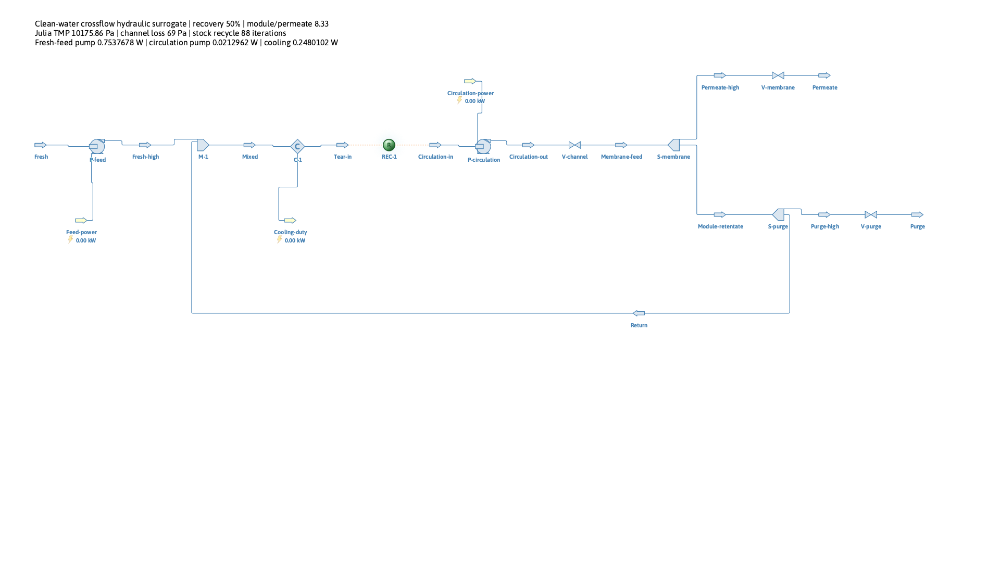
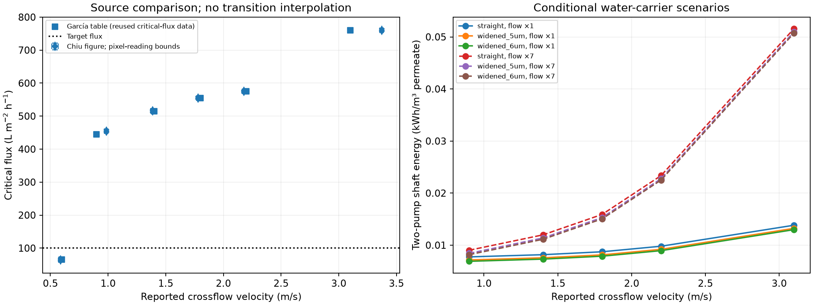

# Critical-flux-constrained crossflow benchmark

> **Dated verification record.** This retains the execution/audit history.
> Use the [maintained scientific report](../../../examples/filtration/literature_benchmark/REPORT.md) for the current explanation
> and the example README for current commands.

Verified 9 November 2026. Run `20261109T005324Z-230bef0c` connects published
crossflow constraints to the preserved OpenLB → Julia → DWSIM workflow.
It passes **32 actual DWSIM cases**: 30 design cases and two high-circulation
seed/tolerance checks. Each flowsheet was saved, loaded and solved again.
The separately forced one-iteration run is rejected. No new OpenLB simulation
or experimental parameter fit was made.

[Exact commands and contracts](../../../examples/filtration/literature_benchmark/README.md),
[compact reference](../../../examples/filtration/literature_benchmark/reference/crossflow_benchmark_reference.json),
[source review](../../../literature/reviews/crossflow/papers_review.md).

## Result at fixed flux

The scenario holds permeate flux at **100 LMH**, area at **1 m²**, overall
water recovery at **50%**, and each design pair's effective non-support
impedance fixed. The three support designs retain the verified native
4/5/6 µm interior radii and identical 4 µm openings. DWSIM computes pump work,
stream states, recycle and cooling from Julia's pressure and flow requirements.

Two policies select among discrete source operating points:

- **Table nominal:** use García's tabulated critical flux. The lowest-energy
  admissible tested point is **0.9 m/s**. The 0.6 m/s point fails the 100 LMH
  constraint and is not sent to DWSIM.
- **Cross-source monotonic:** also require the target to be below a lower bound
  from Chiu's figure readings. The 0.9 m/s point is **indeterminate**, because
  the curve is sparsely sampled across the sharp transition and differs from
  García's borrowed table values. The selected tested point is **1.4 m/s**.

This is not a claim that 0.9 m/s is physically infeasible, or that 1.4 m/s is
a continuous optimum. The second policy makes a nondecreasing-flux assumption
and uses only measurements definitely left/right of the query, allowing for
the recorded reading intervals. It neither interpolates through the transition
nor extrapolates outside the measured domain. An additional 0.8 capacity
fraction scenario leaves these discrete selections unchanged at 100 LMH;
that margin is a policy assumption, not an experimental safety factor.

The source's absolute flow convention remains unresolved. Consequently both
**literal Q** and **7×Q**, a hypothetical per-channel interpretation, are
retained. The factor seven is not an accepted correction. Parallel area
normalization and unchanged per-element axial pressure loss are assumptions.

| Flow interpretation | Policy / selected speed | Straight support, kWh/m³ permeate | 6 µm interior, kWh/m³ | Wider-support saving |
| --- | --- | ---: | ---: | ---: |
| Literal table Q | Table / 0.9 m/s | 0.00775064 | 0.00689885 | **10.99%** |
| Literal table Q | Cross-source / 1.4 m/s | 0.00817286 | 0.00732107 | **10.42%** |
| 7×Q scenario | Table / 0.9 m/s | 0.00902841 | 0.00817662 | **9.43%** |
| 7×Q scenario | Cross-source / 1.4 m/s | 0.01198395 | 0.01113216 | **7.11%** |

All values above are actual DWSIM **two-pump shaft energy** in conditional
water-carrier scenarios. They are not experimentally validated absolute energy
predictions for the paper's module. Changing the flow interpretation multiplies
circulation work by seven at unchanged head, while fresh-feed pump work is
unchanged. It does not multiply circulation work by 49: this comparison holds
the measured point's pressure drop fixed rather than holding channel resistance
fixed as in the earlier recycle example.

At 0.9 m/s with literal Q, the straight support requires **0.753768 W** feed
work and **0.021296 W** circulation work. With 7×Q, circulation requires
**0.149073 W**. At 1.4 m/s those circulation duties are **0.063518 W** and
**0.444628 W**. The 6 µm support reduces feed-pump work to **0.668588 W**.
These source-based channel losses are much smaller than the earlier assumed
20 kPa channel drop; the different savings therefore describe different
declared channel scenarios, not a revised measurement of the earlier one.

The stock labels round small duties to 0.00 kW; the render annotation and
JSON retain the actual nonzero W values.

Left-panel bounds describe pixel/tick reading sensitivity, not experimental
confidence intervals. The García and Chiu data are related: García credits
Chiu for the critical flux. They do not provide independent validation.
Right-panel lines connect tested process scenarios and are not fitted channel
correlations. Cooling heat is exported separately from shaft work.

## Source reproduction and suspension bookkeeping

The Julia core reproduces `E_source = delta_p*Q/(J_critical*S)` from the six
published table rows within **0.912%** of the rounded reported energy column.
At 0.9 m/s that is approximately **129.2 J/m³**, evaluated at 445 LMH. At fixed
100 LMH, the corresponding literal-flow axial hydraulic dissipation is
**575 J/m³**, before pump efficiency and transmembrane work. These energy
boundaries are separately named in JSON and CSV.

The source does not report a filtration temperature/viscosity adequate for a
property correction. Its empirical pressure drops are transferred unchanged
to the existing **298.15 K Water-only DWSIM scenario** as an explicit
assumption. The source's rheometer and electrokinetic measurement temperatures
are not substituted for filtration conditions.

Julia additionally balances a passive solute through the finite-pass module,
retentate/purge split, return mixer and whole loop. The assumed rejection is
`R = 1 - C_permeate/C_module_inlet = 1`. To match the TiO₂ reference condition,
module-inlet concentration stays at **0.01 kg/m³** by adjusting fresh-feed
concentration with circulation. Thus this is a fixed-module-concentration
comparison, not a fixed-fresh-composition sweep. All four concentrations and
three solute residuals are exported. The largest component residual is
**3.39e-21 kg/s**, a numerical closure check.

The solute is not a DWSIM species and has no rheological, osmotic, thermal or
reaction effect. Water properties are a conditional dilute-carrier approximation.
No slurry/emulsion property package, measured rejection law, fouling-time
prediction, cleaning model or long-term sustainable-flux guarantee is claimed.
The same empirical crossflow criterion is imposed on all three support designs;
the result does not establish that widening the support improves fouling.

## Verification and reproducibility

The complete suites pass **846 Julia assertions** and **50 Python tests**.
They include source-energy/flow scaling, invalid inputs, bounded constraints,
finite-pass component conservation, actual Python–Julia conversion, saved
high-circulation DWSIM state replay and rejection of altered mass, cooling,
convergence flags and artifact bytes. The original VTK tests also pass.

The independent saved-run checker verifies **174 artifacts**, all 32 archive
topologies, actual material/energy states and discrete policy selections. It
also rechecks the earlier 25 recycle cases, 18 once-through cases and 24 native
OpenLB cases with their saved geometry audits. It starts no external solver.
Fresh execution of DWSIM is verified separately by the study run.

Across the new matrix:

| Diagnostic | Maximum observed | Existing screen |
| --- | ---: | ---: |
| Unit/overall mass residual relative to fresh feed | 1.80e-11 | 1e-9 |
| Unit/overall enthalpy residual relative to total shaft work | 8.12e-4 (0.0812%) | 1e-3 (0.1%) |
| Relative viscosity departure | 5.60e-5 | 1e-3 |
| Relative density departure | 4.87e-6 | 1e-3 |
| Reference-density power difference from DWSIM | 3.93e-6 | 1e-4 |

Property-corrected pump checks retain the 1e-9 relative screen. These are
numerical/scenario tolerances, not experimental uncertainty. The enthalpy
residual is closer to its existing screen at high circulation and remains
explicitly reported; no tolerance was relaxed after observing results.

Stock direct substitution converges in **88–2511 iterations**. The largest
module/permeate ratio is **186.67**. Two deliberately different flow seeds,
including a temperature offset and tenfold tighter tolerances, reproduce
the high-circulation duties within the inherited 1e-8 relative screen.
Our separate adapter's input ceiling was raised to 5000 iterations; the old
example's 500-iteration default and DWSIM's stock algorithm are preserved.

The host preflight reports Python 3.12.9, Julia 1.11.6, JuliaCall/PythonCall
0.9.37, NumPy 2.5.4, Panel 1.10.0, PyVista 0.49.2, VTK 9.7.2 and Matplotlib
3.11.2. DWSIM remains 10.2.15.0 with private .NET SDK 10.0.403. Locked Python
synchronization passes; Python and Julia dependency manifests are unchanged.
The restricted preflight could not write Julia's compilation cache; host
preflight imports and actual tests pass. This is not an installation blocker.

Observed cold-process Julia initialization is **2.43 s**. Timing records for
every DWSIM setup/solve and Julia translation remain in the saved JSON. These
are observations on this machine, not a speedup claim. Reproduction commands
and ancestor prerequisites are in [the benchmark README](../../../examples/filtration/literature_benchmark/README.md).

## Remaining research step

The bounded computational milestone is complete. Absolute module calibration
still needs a declared physical channel geometry and consistent total-flow
definition; the paper ambiguity is retained rather than repaired. The next
executable hydraulic extension is to define a synthetic star-channel area,
wetted perimeter and velocity convention explicitly, then verify its native
OpenLB pressure-loss calculation using existing OpenLB facilities and examples.
This can remove ambiguity from our own model without claiming to reconstruct
the experimental specimen or requiring new laboratory data.

The supplied Chiu (2006) biological-feed benchmark remains available as a
separate subsequent case. Its measured critical-flux series reaches roughly
83 LMH, so it requires a separately validated lower-flux setup before being
connected to a biological-treatment or downstream-processing showcase. No
additional article or unavailable raw measurement is required to make that
choice.
