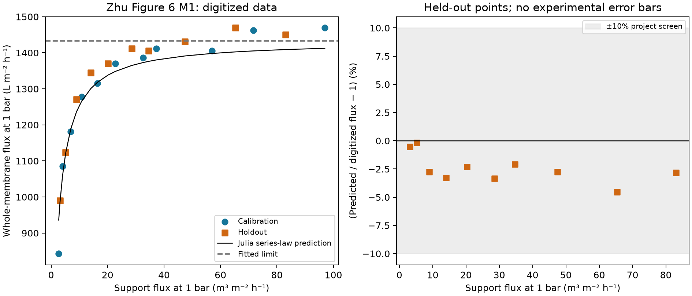
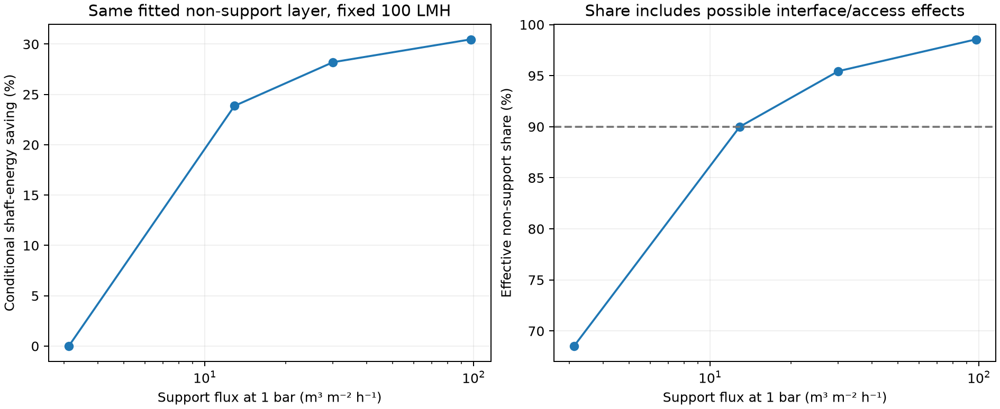

# Zhu matched support and membrane data

**Preserved JPEG-reading v1 report.** The subsequently supplied original PDF
supports [a separate refinement](zhu_pdf_refinement.md) using the same points,
model, split and 10% screen. Its conservative reading-corner screen passes;
the earlier failure below is retained. [The current computational scope](verification_scope.md)
does not require new experiments, unavailable raw data or an actual specimen's
3D reconstruction. Statements below about PDF availability describe this first reading.

Completed 8 November 2026. The supplied main article and figures are sufficient
for a bounded experimental series-law check; a supplement is not required for
this result. **Nominal held-out predictions pass a 10% project screen, but
the conservative digitization sensitivity does not.** The model is a provisional
effective hydraulic reference, without an experimentally validated OpenLB
geometry or complete process prediction.

## Source and experimental scope

W. Zhu et al., *Design and optimization of ceramic membrane structure: From
the perspective of flux matching between support and membrane*, Ceramics
International 47 (2021), 12357–12365,
[DOI 10.1016/j.ceramint.2021.01.088](https://doi.org/10.1016/j.ceramint.2021.01.088).
The supplied Markdown, conversion metadata and all ten scientific figures
were reviewed. Original files remain unchanged in
`literature/inbox/Zhu2021Design/`; [the extraction](../literature/zhu2021_extraction.json)
retains their SHA-256 hashes and locations. Metadata marks pages 3–7 as OCR
extraction; tables/equations are therefore kept distinct from direct figure
readings. No original main PDF has been supplied.

No supplement was identified in the supplied text or targeted publisher search.
The direct publisher page returned HTTP 403, so absence cannot be confirmed.
This is not a blocker: Figure 6 provides the paired series used here, while
Sections 2.3/3.2 and Figure 4 describe measurement conditions and layer similarity.

The experiment uses pre-saturated, deionized-water, crossflow measurements
at **1 bar**, effective area **2.64e-4 m²**, and stable collected flux. It
changes support performance through thickness, pore former and firing.
Transfer-coated layers are formed separately before attachment. The illustrated
M2 specimens have similar thickness and pore diameter across three supports;
porosity similarity is inferred rather than independently measured in each
coated specimen. This supports an approximately fixed effective layer within
a series, without establishing identical intrinsic selective properties or
rejection. M1 is selected because the authors identify it as the steadier
hydraulic series. M2/M3 are not pooled into this fit.

Water-flux temperature and viscosity are **unconfirmed**. The 25 °C in the
methods belongs to alcohol porometry and is not assigned to the hydraulic
measurements. Table 2 gives author-fitted resistances/limiting fluxes, not
independent validation measurements. Neither those fits nor an assumed water
viscosity enters our fit. Unknown specimen-specific support thickness/porosity
also prevents deriving a verified intrinsic support k for each point.

## Frozen fit and data reading

[The protocol](../examples/filtration/calibration/zhu_protocol.json) was saved before fitting the
digitized values. Article plots and reported fits had already been read, so
this is a retrospective same-study split, not blind or independent-laboratory
validation. It uses all **21 M1 black diamonds** from Figure 6: odd ranks in
increasing support flux are calibration cases (**11**), even ranks are held
out (**10**). No residual-based exclusions were made.

[The digitization record](../literature/zhu2021_fig6_points.json) stores raw
pixel centres, axis anchors, units and reading method. Dark connected-component
centres are used, with four visually inspected touching pairs separated
explicitly. A numbered original-image overlay was inspected. The
[reproduction helper](../examples/filtration/calibration/digitize_zhu.py) reproduces the recorded
points from the source JPEG. Deterministic sensitivity bounds are ±2 pixels
for marker centres and ±1 pixel for each axis anchor. These are **reading
bounds**, not experimental error bars or statistical confidence intervals.
Replicate counts and hydraulic measurement uncertainty remain unknown.

The Julia model fits one positive intercept with the support coefficient
fixed at one:

```text
P_support = J_support / delta_p
P_total   = J_total   / delta_p
Z_fixed   = mean(1/P_total - 1/P_support) over calibration points only
P_pred    = 1 / (1/P_support + Z_fixed)
```

P has units m/(Pa s). Z has units Pa s/m and equals μR. This formulation avoids
inventing viscosity. `Z_fixed` is effective **non-support impedance**, which
can include interface/access effects; it is not a separately measured intrinsic
selective-layer resistance. The reciprocal formula is derived independently
from common-flux layers in series; inconsistent OCR symbols in Eq. 3-2 are
not copied into code. The original OpenLB solver is not replaced by this model.

## Observed result and limitations

| Quantity | Result |
| --- | --- |
| Fitted effective non-support Z | 2.51170e8 Pa s/m |
| Fitted limiting flux at 1 bar | 1433.29 LMH |
| Held-out mean absolute flux error | 2.44% |
| Held-out maximum absolute flux error | 4.53% |
| Nominal held-out 10% engineering screen | Pass |
| Largest training residual | +11.04%, lowest-flux point 1 |
| Z range from reading bounds | 2.40203e8–2.60079e8 Pa s/m |
| Worst held-out error over reading corners | 10.78% — outside 10% |

All ten nominal held-out predictions are below the digitized observations,
so a small systematic bias remains. The lowest-flux calibration point is also
not reproduced within 10%. Neither issue is removed by changing the split or
model. The paper's reported M1 limiting flux, 1458 LMH, is a same-data fitted
comparison, not another validation set. Figure 7 also prints a free-slope
reciprocal fit, whereas our physical support coefficient remains fixed at one.



This supports the series-law plateau as a useful reduced approximation,
with limited precision. It does not establish a universally constant layer,
an independent experimental uncertainty bound, pressure linearity for every
M1 specimen, or the geometry of any specific support. The earlier Biesheuvel
screen remains failed and is preserved as a separate material-model study.

## Implication for the fixed-flux energy question

The existing workflow now evaluates the following Julia impedance relation
without an unreported viscosity:

```text
delta_p_required = J_target * (1/P_support + Z_fixed)
shaft_energy_per_volume = delta_p_required / efficiency
```

At fixed 100 LMH, 1 m² and 75% shaft-to-hydraulic efficiency, using the same
fitted non-support layer and unchanged water properties:

| Support flux at 1 bar m³ m⁻² h⁻¹ | Effective non-support share | Pressure required bar | Conditional shaft energy kWh/m³ | Saving vs 3.12 m/h support |
| --- | --- | --- | --- | --- |
| 3.12 | 68.52% | 0.10182 | 0.003771 | baseline |
| 12.90 | 90.00% | 0.07752 | 0.002871 | 23.86% |
| 30.00 | 95.44% | 0.07310 | 0.002708 | 28.20% |
| 97.53 | 98.55% | 0.07079 | 0.002622 | 30.47% |

The effective non-support layer exceeds 50% at a support flux of 1.433 m/h
and reaches 90% at 12.90 m/h. These shares are independent of target flux
within the linear model. Circulation, fouling, osmotic pressure, backwash,
motor efficiency and a temperature correction are not included. This is a
translation of measured hydraulic response under a Darcy assumption, not a
measurement of pumping energy. No new DWSIM or OpenLB run is claimed here.



The paper's reported endpoint flux gains of 75%, 186% and 228% translate
algebraically to **42.86%, 65.03% and 69.51%** fixed-flux pressure/shaft-energy
savings for M1/M2/M3 respectively, if linear flow and unchanged efficiency
apply. Those are translations of reported experimental gains, not predictions
of our M1 fit. The M1 endpoint translation (42.86%) exceeds our fitted estimate
(30.47%): the low-flux residual and fixed-layer approximation matter. It would
be misleading to present the fitted energy saving as validated by that endpoint.

High support flux is also mechanically costly. The article reports bend
strength below 15 MPa above about 40 m/h and discusses a practical 30 MPa
screen near 30 m/h. This is a specimen-specific screening argument, not a
certified device pressure limit. The 97.53 m/h scenario is retained to show
the plateau and is flagged above the authors' practical flux discussion.

## Reproduce and continue

Commands are in [the calibration guide](../examples/filtration/calibration/README.md). The
[compact reference](zhu_validation_reference.json) identifies the final run,
code/source/lock hashes, numerical values and timing. Saved inputs, predictions,
figures and artifacts can be replayed through Julia. Tests verify an independent
series oracle, held-out isolation, pixel-to-unit conversion, impedance versus
the existing μR layer model, threshold shares, source reproduction and altered
artifact rejection. Final numerical test counts are recorded in implementation
status. All plots were visually reviewed.

The next work is to use this measured impedance as a **bounded calibration
reference for scale translation**, then specify one controlled graded-support
OpenLB comparison while retaining the selective-side opening/interface and
using stock components outside the original tree. Such a geometry initially
remains synthetic: Figure 6 does not provide a specimen-linked 3D structure or
point-specific support thickness/porosity. Geometry calibration must be kept
separate from validating the connected pore structure.

The original PDF has since been received and used in the separate refinement.
Unreported temperature/viscosity and experimental uncertainty stay unavailable;
they are not acquisition requirements. The next synthetic native comparison
should preserve these evidence limits and recheck grid/domain/pressure
convergence before connecting its load to the saved-data DWSIM case. A geometry
informed by this paper need not represent a particular experimental specimen.
