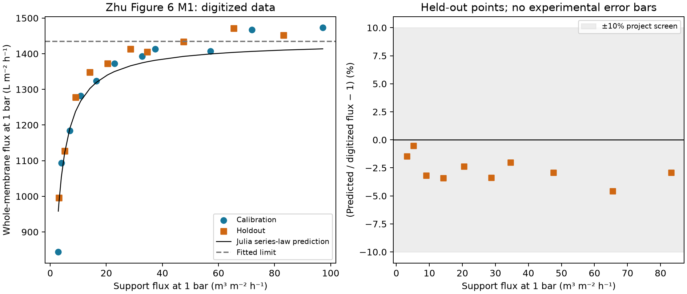
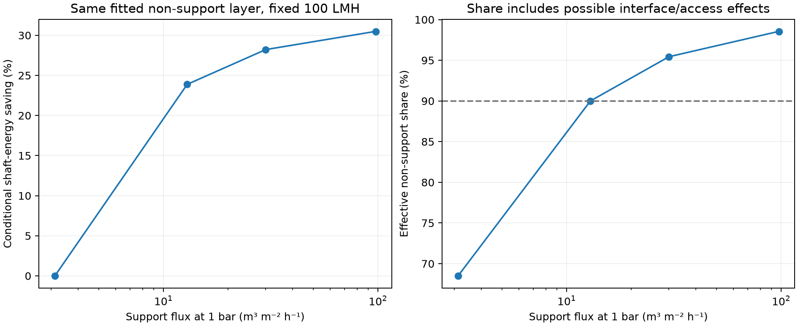

# Zhu Figure 6: original-PDF refinement

Completed 8 November 2026. The supplied original PDF improves the reading of
the same published M1 series. Both the nominal held-out comparison and the
conservative reading-corner check pass the **unchanged 10% engineering screen**.
This is a literature-based effective hydraulic reference for the computational
tool, not a new experiment or a reconstruction of an actual specimen.

## Source and method

W. Zhu et al., *Design and optimization of ceramic membrane structure: From the
perspective of flux matching between support and membrane*, Ceramics
International 47 (2021), 12357–12365,
[DOI 10.1016/j.ceramint.2021.01.088](https://doi.org/10.1016/j.ceramint.2021.01.088).
The original nine-page PDF is retained unchanged under
`literature/inbox/Zhu2021Design/Zhu2021Design.pdf`. Its SHA-256 is
`b3ec370f966131169ac3fc90d25ab68a09304cf017c73773a276b90c4d8ea583`.

Figure 6 is a native **890 × 906** raster image on PDF page 5, printed page
12361, compared with the earlier 623 × 624 converted JPEG. The embedded image
was extracted directly with the bundled pypdf runtime; it was not enlarged or
resampled before digitization. The native image, full relevant rendered page
and numbered 21-marker overlay were visually inspected. Four touching diamond
pairs were separated explicitly, using the same method as before. The
[extraction audit](../literature/zhu2021_extraction.json) retains image/PDF/overlay
hashes, coordinates and provenance; [the new points](../literature/zhu2021_fig6_pdf_points.json)
retain raw pixels and SI conversion information.

[The PDF protocol](../calibration/zhu_protocol_pdf.json) was fixed before this
reading was fitted: same 21 M1 points, 11 odd-rank calibration points, ten
even-rank holdouts, support coefficient one, one positive non-support impedance
and 10% screen. The same ±2-pixel marker and ±1-pixel axis bounds cover a
smaller physical interval on this larger image. They remain deterministic
reading bounds, not measurement error bars or confidence intervals. This is a
retrospective same-study split, with no independent experimental validation.

The [JPEG-v1 report](zhu_matched_validation.md), protocol, digitized values and
saved outputs are preserved. No point exclusions, threshold relaxation or
model changes were made to obtain the PDF result.

## Observed result

| Quantity | JPEG v1, preserved | PDF v2 |
| --- | --- | --- |
| Fitted effective non-support impedance, Pa s/m | 2.51170e8 | 2.50947e8 |
| Fitted limiting flux at 1 bar, LMH | 1433.29 | 1434.57 |
| Held-out mean absolute flux error | 2.44% | 2.66% |
| Held-out maximum absolute flux error | 4.53% | 4.56% |
| Worst held-out reading-corner error | 10.78%, fail | 7.88%, pass |
| Lowest-flux training residual | +11.04% | +13.56% |

The fit changes by less than 0.1%. The improvement is in the reading-bound
sensitivity, not nominal prediction accuracy. The PDF impedance range over
the reading corners is **2.44558e8–2.56624e8 Pa s/m**. All ten nominal held-out
predictions remain below the observations, and the lowest-flux training point
is still poorly reproduced. Both discrepancies remain visible; passing the
held-out screen does not establish constant intrinsic layer properties.



The Julia relation is unchanged:

```text
P_support = J_support / delta_p
P_total   = J_total / delta_p
Z_fixed   = mean(1/P_total - 1/P_support) on calibration points
J_pred    = delta_p / (1/P_support + Z_fixed)
```

Measured pressure is 1 bar. Permeance P has units m/(Pa s); Z has units Pa s/m
and equals μR. This avoids assigning the unreported water viscosity or
temperature. Effective non-support Z may include interface/access effects; it
is not a separately measured intrinsic selective-layer resistance. Unknown
replicate structure and measurement uncertainty remain unavailable. No extra
data acquisition or new experimental measurements are required by the project.

## Consequence for the energy question

Within the linear series model, at the same water properties and unchanged
effective non-support layer, the PDF fit places **90% non-support dominance
at a support flux of 12.91 m/h at 1 bar**. The illustrative fixed-100-LMH,
1-m², 75%-efficiency calculation gives **30.49%** pressure-load shaft-energy
savings between the previously declared 3.12 and 97.53 m/h support scenarios.
The paper's reported M1 endpoint gain translates to 42.86% under the same
linearity assumption; that discrepancy is preserved. Neither value is a
measurement of plant pumping energy. Crossflow circulation, fouling, backwash,
osmotic pressure and mechanical certification are excluded. The high-flux
endpoint exceeds the authors' practical strength discussion and is retained
only to illustrate the hydraulic plateau.



## Reproduction, checks and next step

From the project root:

```sh
source scripts/env.sh
uv run python -m calibration.zhu --source pdf --require-sources
uv run python -m calibration.zhu --check results/zhu_calibration/runs/20261108T211057Z-3d592c4b
uv run python -m calibration.zhu --source jpeg
uv run pytest -q
```

New runs receive new directories. Both readings replay through the actual
shared Julia package; the Python code does not substitute a production solver.
The [compact reference](zhu_pdf_reference.json) records the final run, exact
hashes, versions, timing and all predicted values. Python 3.12.9, Julia 1.11.6
and matching JuliaCall/PythonCall 0.9.37 were used. The full Python suite passes
**20 tests**, including a new PDF-source, unchanged-threshold, Julia-oracle,
digitization and export-replay check. Plots were visually inspected. Julia
numerical code is unchanged from the preceding **347-assertion** test run;
that full direct suite was not rerun for this reading refinement. Dependencies,
locks, bridge configuration, native OpenLB/DWSIM cases and the Panel UI are unchanged.

The [clarified verification scope](verification_scope.md) distinguishes
numerical verification, published-data evaluation and end-to-end coupling from
exact-specimen validation. Next, implement a controlled synthetic graded
support using stock OpenLB components, keep its selective-side opening and
interface assumptions fixed, verify grid/domain/pressure behaviour and pass
the resistance through Julia into the saved-data DWSIM route. This is a design
scenario informed by the papers; no inaccessible raw dataset or reconstructed
experimental 3D pore structure is a prerequisite.
