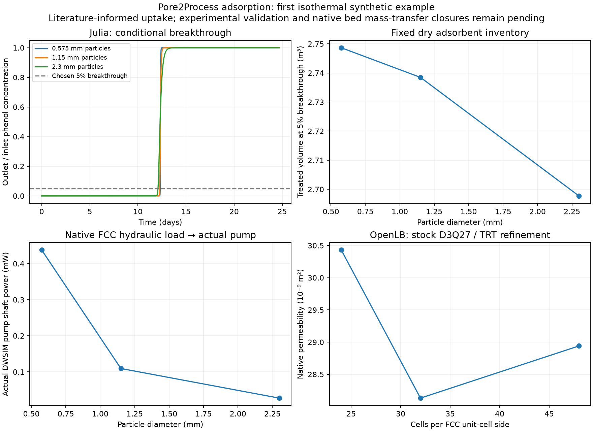

# Synthetic adsorption bed: treatment capacity and pumping energy

## Research question

At fixed dry adsorbent inventory, feed concentration, flow and outlet-quality
criterion, how does particle diameter affect usable treatment capacity and
pumping energy? This first connected isothermal adsorption example combines
native bed hydraulics, a Julia uptake/transport model and actual DWSIM pump work.
It is a synthetic study with literature-informed chemistry.

## Material, geometry and assumptions

The ordered face-centred-cubic bed has porosity $\epsilon=0.6$, length 1 m,
area 0.01 m² and assumed particle-envelope dry density $\rho_p=1000$ kg/m³.
Every design therefore contains $(1-\epsilon)\rho_pAL=4$ kg dry solid.
Diameters are 0.575, 1.15 and 2.3 mm. The feed contains 50 mg/L phenol
(0.05 kg/m³); the chosen outlet limit is 5% of feed, or 2.5 mg/L.

OpenLB resolves external periodic flow around impermeable spheres using stock
TRT components. Internal adsorption porosity is unresolved. The measured
directional permeability is $k=\mu u/G$, where $u$ is superficial velocity
averaged over total cell volume and $G$ is the applied pressure gradient.
Geometrically similar beds should have $k\propto d_p^2$ in this regime;
native scale checks verify that dependence. An Ergun estimate is a comparison,
not an exact oracle for the ordered bed.

[Meneghini's 2017 author dissertation](https://rd.uffs.edu.br/handle/prefix/1681),
Tables 2/4, supplies coconut-shell-carbon fitted parameters
$q_{max}=0.04169$ kg/kg, $b=94$ m³/kg and
$D_{eff}=6.5973\times10^{-12}$ m²/s. Their transfer to this synthetic bed is
an assumption. Source density and affinity conventions contain recorded
conflicts; source column validation is not claimed. The related
[2021 article](https://doi.org/10.1590/S1413-415220180046) is not an independent
validation dataset for these parameters.

## Transport and uptake equations

With axial coordinate $z$ in metres, liquid concentration $C$ in kg/m³ and
solid loading $q$ in kg phenol/kg dry solid, Julia solves

$$
\epsilon\frac{\partial C}{\partial t}
+\frac{\partial}{\partial z}\left(uC-\epsilon D_{ax}\frac{\partial C}{\partial z}\right)
=-\rho_b\frac{\partial q}{\partial t},\qquad
\rho_b=(1-\epsilon)\rho_p,
$$

$$
\frac{\partial q}{\partial t}=k_{LDF}(q_{eq}(C)-q),\qquad
q_{eq}(C)=\frac{q_{max}bC}{1+bC},\qquad
k_{LDF}=\frac{15D_{eff}}{R_p^2},\quad R_p=d_p/2.
$$

The linear-driving-force law approximates intraparticle diffusion; it does
not separately resolve an external film. A Danckwerts inlet imposes total
solute flux $uC_{in}$, the outlet has zero dispersive flux, and the bed starts
clean. A coupled implicit finite-volume update conserves feed, effluent,
liquid and adsorbed inventories. Baseline $D_{ax}=0$; chosen sensitivities use
$D_{ax}=a_D(u/\epsilon)d_p$ with $a_D=0.1,1$.

The breakthrough time $t_b$ is the first crossing of $C_{out}/C_{in}=0.05$;
missing crossings remain unavailable. Treated volume and solid utilisation are

$$
V_b=Qt_b,\qquad
U_s=\frac{M_{ads}(t_b)}{M_s q_{eq}(C_{in})}.
$$

Utilisation is relative to equilibrium at feed concentration, not the
infinite-concentration Langmuir capacity.

## Hydraulic-to-process connection

Actual DWSIM water properties configure Darcy translation:
$\Delta p=\mu LQ/(kA)$. A real stock pump receives that measured-property
load and is solved, saved, loaded and solved again. Phenol remains an external
dilute tracer; DWSIM contains Water only. Integrated service energy is
$E_b=W_{shaft}t_b$ J. At constant flow and power,
$E_b/V_b=W_{shaft}/Q$ J/m³, so a longer service time changes total treatment
and cycle energy, not the constant-head energy per volume by itself.

## Results

Run `20261110T003326Z-8ff89948` uses the same 155.014850 mL/min inlet-reference
flow and 4 kg solid in every design:

| Diameter (mm) | Treated volume (m³) | Feed-equilibrium capacity used | Bed pressure loss (Pa) | Actual shaft power (mW) | Bed-only energy (Wh/m³) |
| --- | ---: | ---: | ---: | ---: | ---: |
| 0.575 | 2.748661 | 99.726% | 127.085497 | 0.437781 | 0.04706870 |
| 1.15 | 2.738479 | 99.353% | 31.773851 | 0.109454 | 0.01176809 |
| 2.3 | 2.697734 | 97.863% | 7.945930 | 0.027372 | 0.00294294 |

Eight native hydraulic cases, seven separate free-fluid scalar-TRT transport
cases and four actual DWSIM cases pass. The 48/32 bed permeability change is
2.8783%; maximum Mach is 0.003824 and density departure $8.33\times10^{-5}$.
The scalar benchmark shows approximately second-order convergence, but does
not identify this bed's dispersion or film coefficient. Doubling axial cells
changes the largest-particle breakthrough time by 0.069936%, halving the step
by 0.003826%; maximum nominal normalized solute imbalance is $5.17\times10^{-15}$.

## Discussion

Reducing diameter fourfold increases treated volume by only 1.8878%, while
bed-attributable pump power rises 15.9938×. At this long contact time, even the
largest particles use most available feed-equilibrium capacity; faster uptake
adds little. Positive-dispersion scenarios reduce treated volume modestly
and are model assumptions, not measured uncertainty bounds.

The low absolute pump duty reflects a clean open synthetic bed. Static head,
other equipment, carbon manufacture, replacement, regeneration and thermal
utilities are excluded. A large relative bed-duty increase is not a large
demonstrated plant-energy penalty. No industrial particle-size optimum follows.
The source's experimental specimen is not reconstructed and its column has
not been validated by these synthetic checks.

## Conclusions

The transient adsorption model, native-property boundary and actual pump
calculation are connected and numerically verified. Material predictions need
their own evidence comparison. The separate
[date-stone-carbon LDF study](alhamed/REPORT.md),
[film/particle model](film_particle/REPORT.md) and
[contact audit](column_contact/REPORT.md) preserve that distinction; their
failed column predictions do not become passes because this software loop works.

## Reproduction and evidence

[Commands](README.md) · [Detailed study](../../docs/adsorption_example.md)
· [Compact reference](../../docs/adsorption_reference.json)
· [Frozen source/scenario ledger](../../literature/adsorption_evidence.json).
The source ledger's early access statuses are historical; subsequent Alhamed
PDF review is recorded with the separate date-stone examples.
