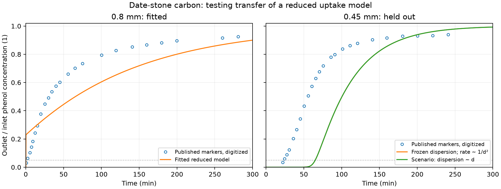

# Date-stone carbon: testing a lumped uptake model against particle-size data

## Research question

Can a Langmuir/linear-driving-force column model fitted to one particle size
predict a second size without changing equilibrium, bed inventory or fitting
the withheld curve? The answer for this dataset and model is **no**. The
numerically reproducible failed comparison is the main result.

## Experimental evidence and assumptions

[Alhamed (2009)](https://doi.org/10.1016/j.jhazmat.2009.05.002), *Adsorption
kinetics and performance of packed bed adsorber for phenol removal using
activated carbon from dates' stones*, studies ZnCl₂-activated date-stone
carbon. It is distinct from the coconut-shell carbon in the synthetic example.

Figure 7 compares 0.8 and 0.45 mm particles at 150 mg/L phenol, 43.8 mL/min,
10 cm bed height, 11 mm column diameter and 22 ±1 °C. Table 1 supplies
bulk density 740 kg/m³, porosity 0.427, $q_{max}=0.1115$ kg/kg and
$b=139$ m³/kg. Literal density interpretation gives

```math
M_s=\rho_bAL=7.032455\ \mathrm g,\qquad
\rho_p=\frac{\rho_b}{1-\epsilon}=1291.45\ \mathrm{kg/m^3}.
```

The mass is derived, not a reported per-fraction weighing; $\rho_p$ is
particle-envelope dry density, not skeletal density. Missing pointwise
uncertainty, pressure drop and pH remain unavailable. Figure 6's conflicting
bed heights are not silently resolved or pooled into this test.

## Equations and calibration boundary

For superficial velocity $u=Q/A$, concentration $C$ in kg/m³ liquid and
loading $q$ in kg/kg dry solid, the conservative Julia model is

```math
\epsilon C_t+\partial_z(uC-\epsilon D_{ax}C_z)=-\rho_b q_t,
\qquad q_t=k_{LDF}(q_{eq}(C)-q),\qquad
q_{eq}(C)=\frac{q_{max}bC}{1+bC}.
```

It assumes isothermal constant properties, a clean bed, Danckwerts inlet total
flux and zero dispersive outlet flux. It does not resolve external film and
radial particle states. Equal-weight concentration-fraction RMSE is minimized
on 24 digitized **0.8 mm** markers only. Python searches parameters; every
forward calculation uses the existing Julia solver.

The fitted rate and dispersion are effective reduced parameters, not separately
measured diffusivities. Primary prediction keeps dispersion fixed and applies

```math
k_{LDF}(0.45\ \mathrm{mm})
=k_{LDF}(0.8\ \mathrm{mm})\left(0.8/0.45\right)^2.
```

A separate scenario scales dispersion with diameter. The 0.45 mm observations
are withheld from fitting. The declared screens are concentration-fraction
RMSE ≤0.10, t50 relative error ≤20%, and resolved t05 relative error ≤25%.
These are engineering screens, not statistical uncertainty tests.

## Results

The fit gives $k_{LDF}=1.1757432659\times10^{-4}$ s⁻¹ and
$D_{ax}=10^{-10}$ m²/s, the dispersion search's lower boundary.

| Quantity | 0.8 mm, calibration | 0.45 mm, withheld |
| --- | ---: | ---: |
| Digitized t05 | ≈1.69 min | ≈23.54 min |
| Digitized t50 | ≈30.75 min | ≈55.36 min |
| Predicted t50 | 65.50 min | 100.38 min |
| Concentration-fraction RMSE | ≈0.142 | ≈0.325 |

The primary withheld t05 is about 64.99 min. At fixed flow the digitized
5% crossings correspond to approximately 0.074 and 1.03 L treated, but the
very early 0.8 mm crossing is poorly resolved and is not an accurate operating
guarantee. ±2-pixel sensitivities correspond to ±1.53 min and ±0.00433
concentration fraction, not experimental confidence intervals.

The accepted evidence/replay run is `20261110T063515Z-b21dba3d`. Ten actual
Julia column replays pass numerical checks, with maximum normalized mass
residual about $3.76\times10^{-12}$. Full-duration t50 refinement changes are
below 0.038%. The model's very early calibration t05 has a separate refined
startup window; numerical convergence does not repair its physical mismatch.
There are no new OpenLB or DWSIM solves in this comparison.



## Discussion

The calibration already fails its own screens, and inverse-diameter-squared
transfer substantially delays the withheld breakthrough. Near-zero fitted
dispersion is a search-bound result, not evidence of an identified physical
dispersion coefficient. Adding another size-specific fit would remove the
prediction test rather than demonstrate transferability.

The paper's Table 5 dispersion values are fitted breakthrough-shape descriptors,
not independent hydraulic measurements. Its printed Equation 10 and a separately
labelled square-root alternative give different reconstructions; that audit
does not authorize silently correcting the source. Pseudo-second-order batch
constants are not substituted for particle diffusivity or proof of a chemical
reaction mechanism.

The failure concerns the combined model and property/inventory transfer. It
does not uniquely prove that external film resistance is missing or that the
printed density is wrong. No experimental pumping-energy recommendation follows.

## Conclusions

The lumped model is numerically verified but does not predict this literature
particle-size series. The next separate model tests finite-bath uptake and
explicit film/particle transport before attempting the column transfer again:
[film/particle report](../film_particle/REPORT.md).

## Reproduction and evidence

[Frozen comparison protocol](../../../literature/alhamed2009_protocol.md)
· [Extraction](../../../literature/alhamed2009_extraction.json)
· [Detailed record and commands](../../../docs/alhamed2009_comparison.md)
· [Compact reference](../../../docs/alhamed2009_reference.json).
The original PDF, figure locations, raw marker pixels and source hashes are
retained with the extraction. No raw-data acquisition or new experiment is a gate.
