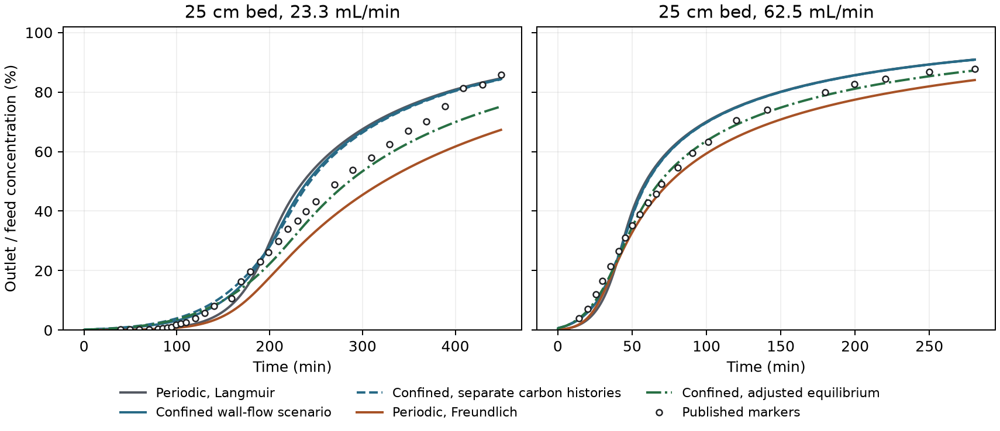

# Diagnosing the phenol breakthrough discrepancy

Alhamed's 25 cm bed at 62.5 mL/min released the first 5% of the feed
concentration at about 16 minutes and reached 50% at about 72 minutes.
The periodic reference first released phenol later, at 23 minutes, and
then reached 50% sooner, at 59 minutes. It also retained too little
phenol over the reported time window. Each hypothesis had to explain
this combination of earlier initial release, a slower rise and more
phenol held at the end. The digitized outlet integral estimates phenol
remaining in the carbon and liquid together. At 25 cm the liquid alone
can hold at most 0.087 mg phenol per g dry carbon at the feed concentration.
[Alhamed (2009), Figures 4 and 5](https://doi.org/10.1016/j.jhazmat.2009.05.002)

The test kept 17.581 g dry carbon at 25 cm from 740 kg/m³ reported bulk
density and the bed dimensions. This is an inventory inferred from the
paper. Each shorter bed used the same bulk density and tube diameter.
The feed was 150 mg/L, the nominal grain diameter 0.80 mm, and the bed
void fraction 0.427. The archived N60 film and the additional resistance
for slower carbon access stayed fixed except where a hypothesis explicitly
varied an independently qualified input.

## Faster flow near the wall

The first sensitivity treated the outer 0.40 mm annulus and core as two
parallel beds at the same pressure gradient, with no liquid exchange.
Its equal-voidage case reproduced the archived reference. Increasing
outer voidage to 0.47 moved the 5% crossing by six minutes in the
needed direction. Stronger segregation caused phenol to emerge too
early. Throughout this sensitivity the model predicted less net uptake
by the final marker.

| 62.5 mL/min and 25 cm | Wall flow (%) | 5% time (min) | 50% time (min) | Net retained (mg/g) |
| --- | ---: | ---: | ---: | ---: |
| Published outlet data | — | 16.16 | 71.63 | 55.67 |
| Periodic reference | — | 23.16 | 59.23 | 50.51 |
| Wall voidage 0.47 | 19.80 | 17.04 | 61.00 | 50.45 |
| Wall voidage 0.50 | 24.43 | 9.99 | 63.63 | 50.35 |
| Wall voidage 0.55 | 33.06 | 2.91 | 70.51 | 50.07 |

The independent MRI bed had a 21 mm tube and 3 mm spheres. At
particle Reynolds number 10 its outer half particle diameter carried
37.0% of the flow. Applying separate Ergun beds to the measured
voidages gave 55.2%. Retaining the radial voidage profile and imposing
no slip via Brinkman momentum diffusion gave 35.3%. For Alhamed's
11 mm tube and 0.80 mm nominal carbon, the two literature-informed
voidage profiles gave 20–32% throughput and about 10–11% of the carbon
in that annulus. Those are scenario estimates for the Alhamed bed.
[Independent radial benchmark](benchmark/README.md)

### Confined stock-TRT scenario

The no-slip cylinder contained 747 equivalent spheres at the reported
0.427 bulk voidage and used axial periodicity over 3.678 mm. The
outer 0.40 mm contained 22.6% of the void volume, 7.63% of the
solid volume and 8.24% of the geometrical sphere surface. Its local
void fraction was 68.8%, above the literature-informed scenario
estimates of 55–60%. The short geometry is a strong wall-channeling
scenario. The Alhamed specimen's radial geometry remains unknown.

| Flow (mL/min) | Fine-grid signed wall flow (%) | Mean transit from wall / core (s) | Perfect-sink capture from wall / core (%) | Exit-time variance change (%) | Fine-grid face correction (%) |
| ---: | ---: | ---: | ---: | ---: | ---: |
| 23.3 | 45.82 | 0.203 / 0.539 | 12.3 / 53.5 | 14.0 | 11.2 |
| 62.5 | 47.11 | 0.077 / 0.203 | 8.7 / 38.2 | 17.4 | 10.3 |

The inert tracer passed its mean-residence, recovery and time-step
checks at both rates. Captured markers count first contact with
carbon only. The allowed changes in exit variance and local face
correction were 10% and 5%, respectively. At high flow the
half-diameter flow share changed by 2.08 percentage points between
grids, just above the 2-point limit. The fine-grid wall share estimated
directly from the native velocity at cell centres was 44.1% and
45.5% at low and high flow. At fixed low flow on the coarse grid,
changing the numerical time step and TRT relaxation product shifted
the balanced wall share by 3.0 percentage points. The results bound
a strong channeling scenario. The wall fraction remains sensitive
to the numerical treatment.
[Native and tracer methods](hydrodynamics/README.md)

The Julia model projects the two measured directional tracer
crossovers onto equal-volume exchange and rescales it from one
pore period to an axial column section. It preserves throughput and
the overall holdup. Both regions use the same original within-region
periodic path rules, with mean travel time scaled by the region's liquid
volume per flow. Exchange pairs paths of the same rank at each plane.
The reduced particle area in each group follows its carbon mass to
keep the same spherical particle model. These are closure assumptions
for the synthetic handoff. In particular, first-hit probabilities
characterize ideal clean-wall contact and do not set the adsorption rate.

At 23.3 mL/min, confined flow and separate wall/core histories
brought the simulated 20 cm rise width from 84.7 to 123.1 minutes,
close to the reported 128.7 minutes. At 25 cm the analogous values
were 93.0, 133.4 and 148.7 minutes. The same wall contrast caused a
5% crossing of about 8 seconds in the 10 cm prediction, versus 14.6
minutes reported. Across all four depths the confined cases retained
slightly less phenol than their corresponding periodic references.
The scenarios show why bypass can broaden the front and cannot
account for the late uptake gap on its own.

At 62.5 mL/min, the finer confined field with separate carbon histories
gave 17.30 and 60.52 minutes at the 5% and 50% crossings. The
coarser field gave 16.46 and 60.72 minutes. The observed crossings are
16.16 and 71.63 minutes. The fine-grid prediction retained 50.40 mg/g
by the last marker, compared with the observed 55.67 mg/g and the
periodic reference's 50.51 mg/g. The improvement is confined to
early release and part of the rise.

## Carbon histories at fixed mass

The periodic test grouped flows by carbon contact per unit flow and
gave the two groups separate particle loading histories in each axial
section. It preserved total carbon area, total mass, both particle
uptake laws, and every stream's instantaneous contact and transit
rules. The bundled reference forecast reproduced the archived
conservative outlet and inventories at both flow rates. The split
histories moved any reported crossing by at most 0.40 s across
all five cases. The original periodic pathways therefore give little
leverage through this change.

At 23.3 mL/min the published interval between 5% and 50% expanded
from 73.3 to 148.7 minutes as bed depth increased from 10 to 25 cm.
The periodic reference expanded from 53.5 to 93.0 minutes. The main
difference is the increase in the width of the front. Cases in this
comparison were frozen before reading their figures. The 25 cm
low-flow curve contributes once, using Figure 4.

## Independent particle inputs

The alternatives preserved one set of particle parameters across all
sizes in each stirred-bath test and held the two smaller particle sizes
out of calibration. With the published Langmuir equilibrium, the lowest
and highest qualified particle diffusivities were
\(1.582\times10^{-12}\) and \(2.458\times10^{-12}\) m²/s.
The faster particle transferred to the original column improved
end-window retention by up to 2.28 mg/g. At high flow it delayed
the predicted 5% time to 28.62 minutes. Both alternatives gave about
21 mg/g of additional retention between the observed midpoint and the
last high-flow marker. The outlet data give 26.08 mg/g over that same
interval. [Particle methods and replay](batch/README.md)

The published Langmuir and Freundlich fits imply 106.4 and 153.2 mg/g,
respectively, at the column's 150 mg/L feed concentration. The Table 3
fitted endpoints imply final liquid concentrations of 4.2–38.8 mg/L
at the original bath volume. Both laws agree closely over that range.
The loaded inlet region exposes carbon to concentrations above the
audited range. Using Freundlich with its independently batch-qualified
diffusivity brackets late uptake at both flow rates with the Langmuir
reference. Freundlich gives more net retention than published at both
rates, while improving the high-flow midpoint and curve RMSE.

| 25 cm case | 5% time (min) | 50% time (min) | Net retained (mg/g) | Retained after published midpoint (mg/g) |
| --- | ---: | ---: | ---: | ---: |
| 23.3 mL/min, published | 125.74 | 274.40 | 57.13 | 10.71 |
| 23.3 mL/min, Langmuir | 143.50 | 236.51 | 53.88 | 8.43 |
| 23.3 mL/min, Freundlich | 151.87 | 323.33 | 64.40 | 15.48 |
| 62.5 mL/min, published | 16.16 | 71.63 | 55.67 | 26.08 |
| 62.5 mL/min, Langmuir | 23.16 | 59.23 | 50.51 | 21.18 |
| 62.5 mL/min, Freundlich | 21.64 | 76.06 | 61.59 | 31.08 |

The equilibrium curves require evidence for the same activated carbon
around 75–150 mg/L residual liquid concentration. The original isotherm
source is Y. A. Alhamed, *Phenol removal using granular activated carbon
from dates’ stones*, Bulgarian Chemical Communications **40**(1), 26–35
(2008). The journal's index confirms volume 40. The study team located
the index and the authors' publication record. The concentration range
of the original measurements remains unavailable.
[Journal index](https://bcc.bas.bg/BCC_Volumes/Volume_40_Number_4_2008/Volume_40_Number_4_2008_PDF/Index-vol40.pdf)
· [KAU publication record](https://www.kau.edu.sa/Files/3203201/Files/27982_dr_yahia_alhamed.pdf)

Alhamed (2009) Figure 6 has concentration-dependent breakthrough curves
at 43.8 mL/min and 0.80 mm. Its caption gives a 20 cm bed, while
Tables 5 and 6 list 10 cm for the lower-concentration runs. The outlet
curves also end before equilibrium across the bed. The figure was
excluded from quantitative equilibrium qualification.
[Alhamed (2009), Figure 6 and Tables 5–6](https://doi.org/10.1016/j.jhazmat.2009.05.002)

## Shared equilibrium and two-mechanism comparison

Both source equilibria and three fixed intermediate weights passed the
finite-bath checks across all four particle sizes. The short-bed
calibration picked an equal blend of the two equilibrium loadings at
each liquid concentration. The objective used end-window net retention
at 10 cm and 15 cm at 23.3 mL/min. The selected model gave 62.08 and
61.27 mg/g, versus 64.05 and 60.32 mg/g from the two reported series.
The blended equilibrium loading at feed is 129.78 mg/g and its
batch-qualified diffusivity is \(1.512\times10^{-12}\) m²/s.
The weight is a shared effective calibration. The current evidence
allows other equilibrium curves over the column concentration range.
[Calibration protocol](batch/conditional/protocol.md)

The same weight was transferred without further fitting to the
20 cm low-flow case and both 25 cm flow rates. A second transfer
applied the same material inputs to the confined-flow scenario and
separate radial carbon histories. This tests whether improving early
arrival and late uptake together is sufficient.
[Joint protocol](coupled_protocol.md)

Each cell in the table gives the 5% crossing, 50% crossing and net phenol
retained at the last marker. Crossings are in minutes and retention is
in milligrams per gram of dry carbon.

| Held-out condition | Published | Periodic, blended equilibrium | Confined, blended equilibrium |
| --- | --- | --- | --- |
| 20 cm, 23.3 mL/min | 63.85 / 192.59 / 56.37 | 97.03 / 210.32 / 61.55 | 63.05 / 215.09 / 60.88 |
| 25 cm, 23.3 mL/min | 125.74 / 274.40 / 57.13 | 151.55 / 280.85 / 60.28 | 114.45 / 285.84 / 59.58 |
| 25 cm, 62.5 mL/min | 16.16 / 71.63 / 55.67 | 22.94 / 68.38 / 56.89 | 16.80 / 69.05 / 56.62 |

All three joint predictions passed the crossing and curve-shape screens.
The outlet/feed RMSEs were 0.0552, 0.0420 and 0.0154. At high flow the
model also passed the last-marker retention check. It retained 26.86
mg/g after the published midpoint, compared with 26.08 mg/g from the
markers. At low flow the joint model overpredicted net retention by
4.51 and 2.46 mg/g. The digitization reading intervals for those cases
are 55.51–57.24 and 56.48–57.77 mg/g. The two low-flow cases therefore
remain outside the full breakthrough qualification.

### What the tests establish

Faster paths can explain much of the early high-flow discrepancy.
The independently plausible equilibrium range changes the phenol taken
up after arrival. Together these changes reproduce the high-flow curve
through the reported window, conditional on the synthetic flow field
and one shared low-flow calibration. A single common change in
equilibrium did not transfer the retained inventory across all depths
and flows. The confined tracer variance and local-flow checks also
remain open. Figure 7 stays reserved for a size-transfer test when the
column and transport inputs meet these checks.

The highest-value independent material check is the original isotherm
data for the same carbon near 75–150 mg/L residual liquid phenol.
Those data would constrain equilibrium before a further column
calibration. The reported outlet histories already distinguish a
timing problem from a retained-mass problem.

### Numerical verification

The one-region solver reproduced the archived 25 cm time histories at
both rates. The equal-region control and all joint columns conserved
phenol. The greatest joint normalized phenol balance residual was
\(6.1\times10^{-13}\), and the greatest normalized film-to-particle
flux mismatch was \(2.0\times10^{-12}\). Each joint history passed
the prescribed step and shell refinement at 48 radial shells and a
4 s main step. The three forecasts were sealed before scoring and
the saved inputs, curves, mass balances and metrics replayed.
Python 3.12.9, Julia 1.11.6 and stock OpenLB 1.9r0 were used.
[Reproduction commands](README.md) · [Compact run record](reference_summary.json)
