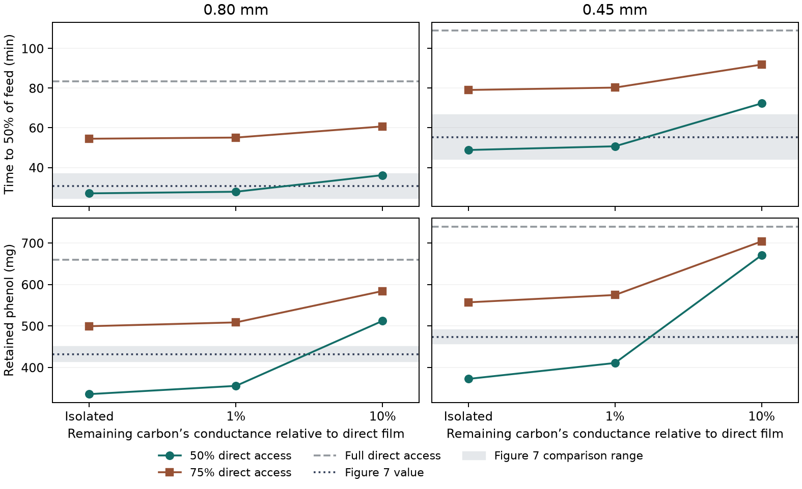

# Isolated carbon or slow access to part of the bed?

These scenarios keep 7.032455155 g of dry carbon in the column for both
particle sizes. The two cohorts share the same particle diameter,
density, batch loading diffusivity and Langmuir isotherm. The direct
cohort sees the original fluid film. For the other cohort, an external
access resistance in series with that film lowers its effective
conductance. The zero-conductance limit leaves that cohort isolated.
Either communicating cohort can eventually equilibrate at the feed
concentration. This distinguishes an inventory limit from a rate
limit while conserving the same total dry carbon.

The two cohorts draw from the same liquid paths with separate radial
loading profiles and the original N160 contact shares. Geometry, bed
liquid hold-up and fully mixed repeat joins are carried over from the
archived column. Each cohort receives its mass-proportional share of
the total particle area. The tested scenarios use 50% and 75% direct
carbon and give the remainder zero, 1% or 10% of the direct-film
conductance. The factors and fractions were declared before running
and apply to both particle sizes. The external access resistance is
an illustrative boundary condition for the column.
[Protocol](protocol.md) · [Frozen column](../disordered_memory_column/REPORT.md)

## Midpoints and matched-window retention

The 0.80 and 0.45 mm mass comparisons end at the last markers, 280.69
and 240.92 min respectively. Retention includes adsorbed phenol and
phenol in the bed liquid. The two comparison ranges are the existing
±20% midpoint screen and the retention range from the ±2 pixel
reading scenarios. The latter describes digitization sensitivity.
All predictions were frozen before scoring.
[Alhamed Figure 7](https://doi.org/10.1016/j.jhazmat.2009.05.002) · [Retention audit](../figure7_retention/REPORT.md)

| Direct access | Remaining carbon | 0.80 mm midpoint (min) | 0.80 mm retained (mg) | 0.45 mm midpoint (min) | 0.45 mm retained (mg) |
|---:|---|---:|---:|---:|---:|
| — | Figure 7 | 30.75 | 432.44 | 55.36 | 473.78 |
| 100% | — | 83.57 | 659.64 | 109.06 | 739.81 |
| 50% | Isolated | 26.96 | 335.83 | 48.83 | 372.49 |
| 50% | 1% conductance | 27.79 | 355.69 | 50.69 | 410.88 |
| 50% | 10% conductance | 36.16 | 512.51 | 72.33 | 670.78 |
| 75% | Isolated | 54.51 | 499.61 | 79.09 | 557.13 |
| 75% | 1% conductance | 55.10 | 508.77 | 80.28 | 574.83 |
| 75% | 10% conductance | 60.70 | 584.42 | 91.89 | 704.10 |

The 50%-direct isolated and 1% cases meet both midpoint screens and
retain too little phenol for both diameters. At 10%, the slow half
adds enough uptake to take both cumulative totals above the reading
ranges. The 0.45 mm midpoint also goes outside its timing screen.
With 75% direct access, even the isolated case retains too much and
reaches its midpoint too late for each size. Every tested case falls
outside the retention reading range at both diameters. None meets the
full breakthrough-curve screens.

The gray bands show the ±20% midpoint screen in the top row and the
image-reading retention range in the bottom row. The connecting lines
guide the eye across the three separately simulated cases.

## What distinguishes isolation from slow access?

At 50% isolation, the model can adsorb at most **374.12 mg** at the
source feed concentration. Even adding the 0.61 mg maximum dissolved
inventory leaves the ceiling below the phenol already retained in
both observed windows. This excludes half the carbon being permanently
isolated under the fixed source mass and isotherm. With 75% direct
access and the remainder isolated, the adsorbed ceiling is 561.17 mg.

With positive conductance, the full **748.23 mg** adsorbed equilibrium
inventory remains available. At 50% direct access and 1% conductance,
the slow half contributes just 20.08 mg and 38.73 mg by the last
markers for 0.80 and 0.45 mm. At 10% it contributes 178.85 and
300.73 mg. These are distinct from the total retained masses because
the direct cohort also responds to the change in the liquid
concentration. At 1% conductance, the slow-access midpoint is close to
the isolated case even while their ultimate inventories differ by a
factor of two. Enough of the slow half remains empty to leave a mass
deficit through the recorded window. The 1% and 10% cases at 50%
direct access bracket the measured retained masses. The tested
scenarios leave the real access fraction and rate unverified.

## Reproduction

Run `20261117T090234Z-234da0ca` reproduced the original full-access
curves and checked the 24-to-48-shell and time-step refinement for
all fourteen size-and-access combinations. The maximum selected
normalized phenol balance residual was 1.1 × 10⁻¹², and the
film-to-particle flux mismatch was below 2.5 × 10⁻¹². The regression
test verifies that equal access collapses to the original particle
response and that isolated carbon contributes exactly zero uptake
while still counting toward dry mass. Read-only replay verified 27
sources and 31 artifacts.
[Commands](README.md) · [Compact record](reference_summary.json)
