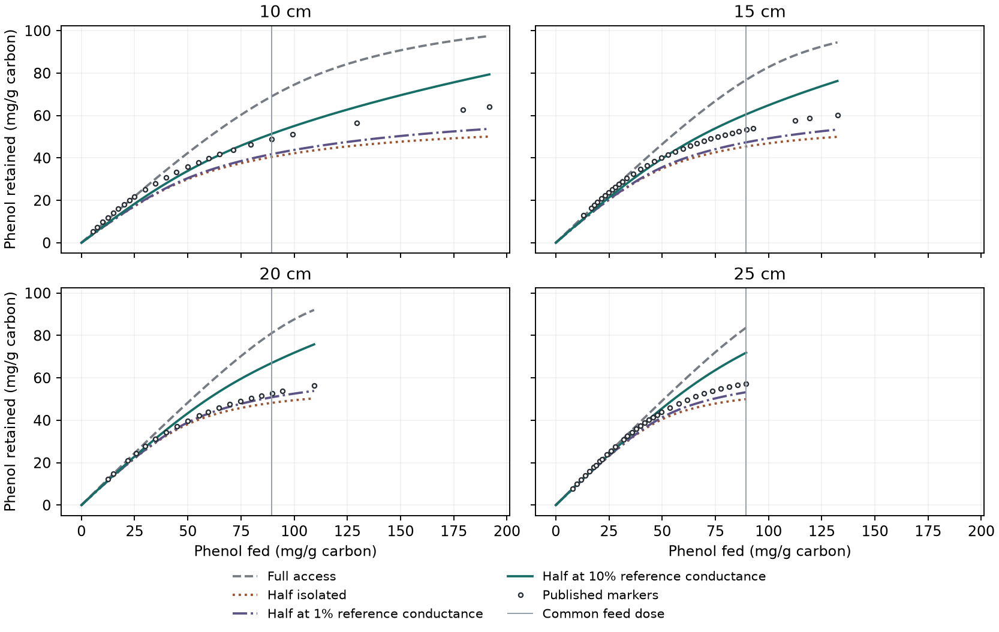
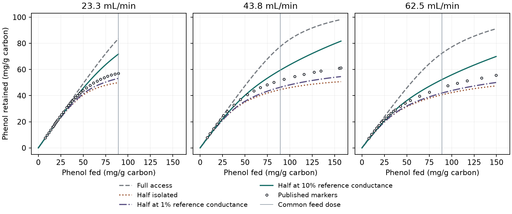

# Does the carbon-access model transfer to other operating conditions?

The [Figure 7 carbon-access scenarios](../carbon_access/REPORT.md) were
carried over to 0.80 mm carbon at new flows and bed depths. In
Figure 5 the bed depth varies from 10 to 25 cm at 23.3 mL/min.
Figure 4 supplies the 25 cm bed at 23.3, 43.8 and 62.5 mL/min.
All six distinct cases use 150 mg/L phenol and match rows in Table 5.
The 25 cm, 23.3 mL/min curve occurs in both figures and counts once
for transfer. [Alhamed Figures 4–5 and Table 5](https://doi.org/10.1016/j.jhazmat.2009.05.002)

The open experimental markers were digitized from the embedded
rasters and checked against the symbols and the axis ticks. The
5 cm curve in Figure 5 has no matching Table 5 condition. The 88.1
and 141.5 mL/min curves lie outside the selected flow range. The
particle properties and all seven access scenarios come from the
preceding unfitted test. Carbon and liquid amounts scale with each
published bed depth using the original density and voidage basis.
Per-case weighed dry inventories and pointwise experimental
uncertainty are unavailable.
[Digitized markers](../../../literature/sources/alhamed2009/figure45_pixels.csv) · [Protocol](protocol.md)

### What transfers between flow rates

The added resistance of the slow cohort, in s/m, stays fixed as the
flow-dependent fluid film changes. Separate loading profiles use the
original batch diffusion and equilibrium model. The 23.3 and 62.5
mL/min tracer probes adjust the Péclet number while reusing the saved
N160 TRT velocity shape. The worst arrival-variance errors across
sections 3–8 are 7.15% and 6.72%, and the corresponding mean-time
errors are 0.26% and 0.28%. The 43.8 mL/min case uses the archived
rules. This test represents new speeds on the same velocity shape.
The actual flow redistribution with rate in the experimental
packing remains unresolved.

## Holdout results

Two frozen scenarios pass the existing ±20% midpoint screen at all
six cases. Both give 50% of the carbon direct access, and the other half
is either isolated or has 1% of the direct-film conductance at the
reference rate. The largest midpoint errors are 12.58% for isolation
and 8.62% for the 1% case. Neither passes the late retained-mass or
early-leakage screens. The 1% case retains too little phenol by
2.5–10.3 mg/g across the recorded windows. All seven scenarios miss the
retention reading ranges, and all seven fail the full curve screen.

The table gives experimental / simulated values for the 50%-direct,
1%-reference-conductance scenario. The duplicate 25 cm low-flow
comparison uses the Figure 5 reading.

| Bed depth | Flow (mL/min) | Time to 5% (min) | Midpoint (min) | Retained at last marker (mg/g) |
|---:|---:|---:|---:|---:|
| 10 cm | 23.3 | 14.62 / 0.16 | 87.93 / 81.42 | 64.05 / 53.72 |
| 15 cm | 23.3 | 51.21 / 0.24 | 146.89 / 141.45 | 60.32 / 53.40 |
| 20 cm | 23.3 | 63.85 / 0.34 | 192.59 / 201.37 | 56.37 / 53.86 |
| 25 cm | 23.3 | 125.04 / 38.07 | 274.62 / 261.28 | 57.17 / 53.24 |
| 25 cm | 43.8 | 42.78 / 0.23 | 124.89 / 114.12 | 61.31 / 54.58 |
| 25 cm | 62.5 | 16.16 / 0.15 | 71.63 / 67.88 | 55.67 / 50.04 |

At 25 cm and a common inlet dose of 89.30 mg phenol per gram of carbon,
raising flow from 23.3 to 62.5 mL/min reduces observed retention from
57.13 to 46.16 mg/g. The 1% scenario reproduces the change, from 53.21
to 42.00 mg/g. With increasing bed depth, the same scenario captures
the overall increase in retention per gram at the common Figure 5
dose and falls below the published totals. The model thus predicts a
substantial part of the change with longer contact and bed depth.
The shortfall in retained mass and premature leakage still prevent
qualification of the column response.

The plots show the full-access and 50%-direct cases. The compact
record includes all scenarios and the pixel-reading ranges. The two
digitizations of the shared condition give a midpoint difference of
14 s and a last-marker retention difference of 0.05 mg/g.

### Reproduction

Run `20261117T092847Z-6bf8a9d8` freezes all predictions before scoring.
All 42 case-and-scenario combinations passed time and shell refinement
and phenol mass balance. The largest normalized mass residual among
the selected runs was below 6 × 10⁻¹³. The solver extension reproduced
the earlier full-access and 50%-direct/10%-reference reference curves.
Read-only replay checked 28 sources, 99 run artifacts and the separate
tracer probe archive.
[Commands](README.md) · [Compact evidence](reference_summary.json)
