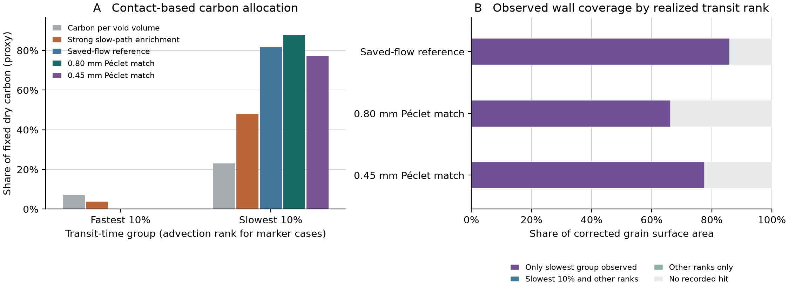

# Carbon-wall exposure in the saved TRT packing

The [earlier fixed-inventory sensitivity](../exchange_attribution/REPORT.md)
advanced breakthrough most when 47.81% of the carbon was assigned to the
slowest tenth of the flow and that group remained isolated. We measured
which trajectories visit the synthetic grain surfaces and checked both
conditions using the saved carrier field and geometry. The dry carbon
total for mass accounting is 7.032455 g. The Figure 7 curves provide
no inputs to this calculation.

## Measuring exposure and accounting for solid mass

The carrier field is the archived, balanced N96 TRT result for a
synthetic FCC packing. The wall reconstruction identifies 57,984 solid
faces per period and 353,696 solid voxels. The saved field has zero
normal flow at every carbon face. A radial-normal correction puts the
external area within 0.81% of four ideal grain envelopes. This geometry
represents the grain exterior. It contains no internal carbon pore
network or measured Alhamed packing geometry.

The Julia tracker releases equal-mass markers in proportion to the
inlet face flows and follows them for two repeats. At a reflecting
carbon wall, twice the normal overshoot estimates the inward reflection
increment. Summing these increments gives a measure of boundary local
time. Reflections at the two exterior axial ends are excluded. The
independent uniform-tracer check compares mean reflected length with
\(2 D A_{\mathrm{wall}}/Q\) for the two periods using the staircase area.
The observed visit share and reflection-length share address different
questions. The first records which surface was reached and the second
weights cumulative exposure, including repeat visits.
[Boundary local time](https://journals.aps.org/pre/abstract/10.1103/PhysRevE.100.062110) ·
[Advective–diffusive surface contact](https://doi.org/10.1016/j.advwatres.2021.103981)

For the fixed-mass proxy, each grain is split into eight equal-volume
octants from the voxel geometry. A solid octant's mass is allocated once,
in proportion to the contact exposure of each transit-time group on its
surface. Aggregating by whole grains provides a sensitivity to patch
size. The face-level calculation also retains the unvisited area.
These calculations allocate the 7.032455 g inventory for a model of
contact. They cannot identify the particle capacity accessible to each
path in the presence of film transfer and intraparticle diffusion.

We use two transit labels. The first ranks the realized time through
each period. This groups trajectories that actually spent longer near
the wall. The second ranks the diffusion-free twin launched from the
same inlet point. Its label is independent of the molecular wall
encounters on the measured trajectory. We also group the second-period
encounters by the first period's realized rank to check persistence.
[Protocol and reproducible inputs](protocol.md)

## How much of the carbon do the paths reach?

| Synthetic field and diffusivity | Carbon proxy for fastest 10% | Carbon proxy for slowest 10% | Slowest 10% leaving that group in the next period |
| --- | ---: | ---: | ---: |
| Saved-flow reference | 0 recorded | 81.70% (5.75 g) | 28.57% |
| 0.80 mm Péclet match | 0 recorded | 87.79% (6.17 g) | 23.94% |
| 0.45 mm Péclet match | 0 recorded | 77.24% (5.43 g) | 31.65% |

The mass columns use advection-only transit ranks from paired inlet
points. The last column uses the measured ranks with diffusion.
Ranking by realized time instead gives the slowest tenth 99.87–99.98%
of the accumulated reflection length in the primary runs. Only
33–45% of passages in that tenth registered a wall encounter. A minority
of slow passages therefore dominates the total exposure. No fastest-tenth
passage had a recorded hit under either ranking in any primary case.

Pooling samples and time steps at each diffusivity, the realized slowest
tenth reached 85.93% of the external wall area in the reference, 66.31%
at the 0.80 mm Péclet match and 77.64% at the 0.45 mm match. The rest of
the area remained largely unsampled. The realized slowest group reached
all 32 grain octants in every run. The mass proxy therefore describes
how surface exposure is weighted, including repeated encounters.
Unvisited faces remain unresolved and all observed visits to a face
enter the face-sharing calculation.

## Is the earlier segregation plausible?

A strong concentration of surface exposure in slow flow is plausible
in this geometry. The independently ranked allocation exceeds the
47.81% slow-path fraction in the earlier sensitivity under all three
diffusivities. Assigning the same carbon to a permanently isolated
slow stream would require persistent separation. Here 24–32% of the
slowest group changes rank after one period. Markers outside the slowest
tenth of the first period account for 7–18% of the wall exposure in the
second. The degree of contact bias and the persistence of that bias
are separate properties. These results support uneven carbon contact
with exchange. Accessible adsorptive capacity in the experimental bed
remains unresolved.

## Verification and replay

The seven runs in cohort `20261112T101823Z-a87ddcbc` each completed
65,536 marker pairs. Both transit times matched the corresponding
archive exactly for every marker. The reduction checked all face IDs,
1,759,011 wall events and every marker's contact totals. The mean
reflected length differed from the independent area check by at most
1.77%. Halving the step changed any advection-ranked mass share by
at most 1.15 percentage points. The independent seed changed the
realized-rank mass shares by at most 0.035 percentage points. The
Julia tracker passed 21 assertions and the Python fixed-mass reduction
passed both checks. Read-only replay verified 29 sources and 58 artifacts.
The wall-contact study used no column curve fit or new OpenLB solve.
[Run and replay guide](README.md) · [Compact numerical record](reference_summary.json)
