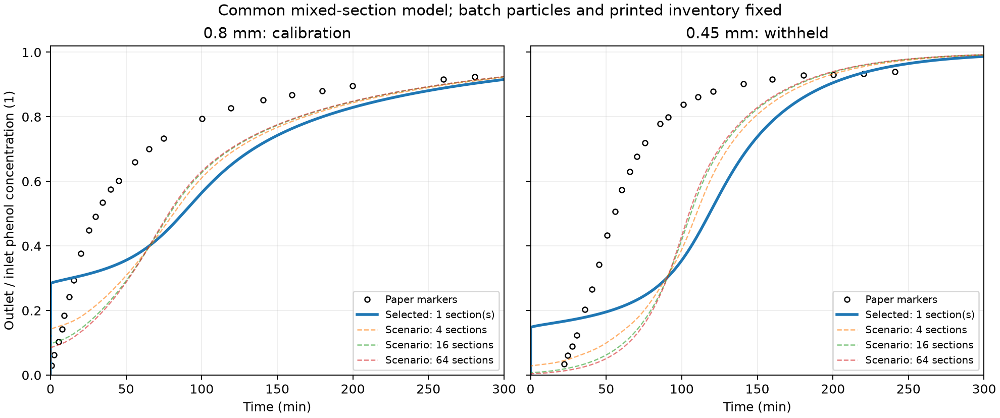
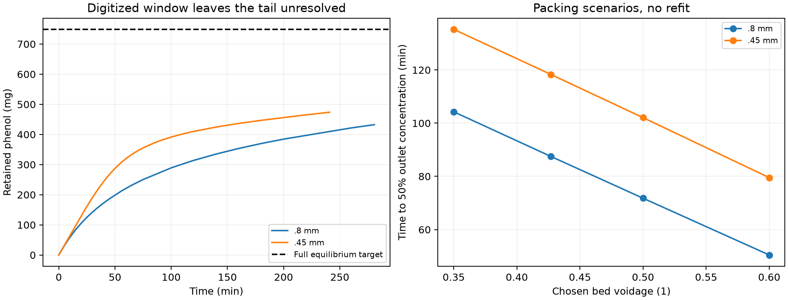

# Column contact and inventory: a common mixing model still fails

## Research question

Can a single contact pattern explain Alhamed's two particle-size breakthrough
curves while the batch-qualified particle transport, printed isotherm and
density-derived inventory remain unchanged? Separately, what can the reported
breakthrough window actually establish about retained mass? This example
tests a specific common mixing family rather than fitting each column separately.

## Source and inventory definition

[Alhamed (2009)](https://doi.org/10.1016/j.jhazmat.2009.05.002), Figure 7,
uses 150 mg/L phenol, 43.8 mL/min, 10 cm bed height, 11 mm column diameter
and 22 ±1 °C. Table 1 labels 740 kg/m³ as **bulk density** and gives porosity
0.427. Literal interpretation implies

```math
M_s=\rho_bAL=7.032455\ \mathrm g,\quad
\rho_p=\rho_b/(1-\epsilon)=1291.4485\ \mathrm{kg/m^3},\quad
u=Q/A=0.00768153\ \mathrm{m/s}.
```

The liquid void residence time is $\epsilon AL/Q=5.55879$ s; empty-bed
contact time is 13.0182 s. The dry mass is derived, not a reported weighing
for each fraction. Calling 740 kg/m³ a particle density would contradict the
printed label and change the batch flux boundary; it is only an arithmetic
diagnostic, not an applied correction.

At $C_0=150$ mg/L, the unchanged Langmuir isotherm gives 106.397 mg/g.
For a clean bed eventually equilibrated to its feed,

```math
M_\infty=M_s q_{eq}(C_0)+\epsilon ALC_0
=748.232+0.609\ \mathrm{mg}.
```

The complete breakthrough deficit would integrate to
$M_\infty/(QC_0)=113.979$ min. Changing contact pattern can change curve shape
and useful breakthrough time; it cannot remove the eventual inventory when
all the assumed solid remains active and equilibrates.

## Common contact equations

The model has $N$ equal perfectly mixed sections, each containing its full
share of liquid and solid. For section $j$,

```math
V_{l,j}\frac{dC_j}{dt}+M_{s,j}\frac{d\bar q_j}{dt}
=Q(C_{j-1}-C_j),\qquad
V_{l,j}=\epsilon AL/N,\quad M_{s,j}=(1-\epsilon)\rho_pAL/N.
```

$C_0=C_{in}$ and $C_{out}=C_N$. There is no bypass, dead solid, external
delay or reverse exchange. Each section reuses the existing particle model:

```math
q_t=\frac{D_s}{r^2}(r^2q_r)_r,\quad q_r(0)=0,\quad
q(R)=\frac{q_{max}bC_s}{1+bC_s},\quad
k_f(C_j-C_s)=\rho_pD_sq_r(R).
```

Frozen values are $D_s=1.84603549\times10^{-12}$ m²/s,
$q_{max}=0.1115$ kg/kg, $b=139$ m³/kg and the above particle density.
The declared superficial-velocity film correlation
$Sh=2+1.1Re_p^{0.6}Sc^{1/3}$ has multiplier one for both sizes. The earlier
fitted column film multiplier is not carried into this alternative.

$N$ is a **physical contact-model parameter**, not an axial numerical mesh.
All integers 1–64 are evaluated against the 24 digitized 0.8 mm markers only;
0.45 mm remains withheld. Radial shells/time steps are refined at fixed $N$.
For a nonadsorbing tracer, the independent tanks-in-series step response is

```math
F(t)=1-e^{-x}\sum_{k=0}^{N-1}\frac{x^k}{k!},\qquad
x=Nt/\tau,\quad \tau=\epsilon AL/Q.
```

Its mean residence time is $\tau$ and variance $\tau^2/N$. These limits and
the retarded linear-adsorption limit verify the implementation independently
of fitting the article.

## Results: source-window mass audit

Integrating $QC_0(1-C_{out}/C_0)$ over the digitized window, using linear
segments and a declared clean-bed origin, gives:

| Diameter | Last marker time | Last concentration fraction | Retained in window | Fraction of assumed full inventory |
| --- | ---: | ---: | ---: | ---: |
| 0.8 mm | 280.69 min | 0.9242 | 432.44 mg | 57.75% |
| 0.45 mm | 240.92 min | 0.9394 | 473.78 mg | 63.27% |

These masses include liquid storage and are not saturation loadings. If the
last concentration deficit never increases, at least another 10.59/11.51 h
would be needed to account for the assumed full inventories. That unreported
tail is not fabricated, and this calculation does not prove a density error.

## Results: fitted common contact model

The minimum is $N=1$, the broadest-mixing boundary of the tested family.

| Quantity | Approximate digitized source | Common $N=1$ prediction |
| --- | ---: | ---: |
| 0.8 mm t50 | 30.75 min | 87.49 min |
| 0.45 mm t50 | 55.36 min | 118.32 min |
| 0.8 mm fraction RMSE | — | 0.1821 |
| 0.45 mm fraction RMSE | — | 0.2909 |
| 0.8 mm t05 | 101.57 s, poorly resolved early source crossing | 0.3060 s |
| 0.45 mm t05 | 1412.24 s | 0.3401 s |

The subsecond model crossings have separate refined startup calculations;
coarse full-duration crossings are not used as converged values. Both RMSE
and t50 screens fail; the resolved withheld t05 also fails by a large margin.
For the 0.8 mm source crossing, image time resolution limits interpretation of
a precise relative-error percentage.

Chosen packing scenarios $\epsilon=0.35,0.50,0.60$ retain particle density,
particle transport, isotherm, film and $N$, changing liquid and solid volumes
consistently. At 0.60 the mass is 4.9092 g and t50 is 50.45/79.52 min. Both
curves still fail; no packing scenario is promoted to a specimen estimate.





## Discussion

Selecting $N=1$ does not establish that the real bed is a stirred tank. It
indicates that this constrained family prefers its mixing boundary yet still
cannot explain the two curves. It does not rule out all flow-distribution,
accessibility or property-transfer explanations. The paper's fitted dispersion
and Peclet numbers are not independent tracer measurements and do not define $N$.

The reported glass-bead inlet section contains at most 6.51 s liquid holdup;
the entire reported tube holds at most 65.1 s at this flow. These bounds do
not support explaining tens-of-minutes discrepancies solely by that section.
Unknown tubing holdup and per-fraction packing remain unavailable.

Run `20261110T092735Z-39dae4b2` replays 24 forward cases, 66 calibration
evaluations and 83 artifacts. Maximum normalized mass residual is
$1.62\times10^{-11}$ and interface mismatch below $2.01\times10^{-13}$.
Refined early t05 changes are below 0.062%, full-run t50 changes below 0.014%.
Numerical/refinement checks pass; physical column comparisons remain failed.
There are no new OpenLB/DWSIM solves or adsorption browser claims.

## Conclusions

A common tanks-in-series topology does not repair this column transfer with
the frozen batch properties and printed inventory. Retain the batch component
and the failed column evidence separately. A synthetic packed-bed inert-tracer
benchmark is a useful next tool test; it would not reconstruct this specimen
or retroactively validate its adsorption/energy predictions.

## Reproduction and evidence

[Commands](README.md) · [Frozen audit protocol](protocol.md)
· [Detailed audit](../../../docs/verification/adsorption/column_contact.md)
· [Compact reference](reference/column_contact_reference.json)
· [Particle component](../film_particle/REPORT.md).
Figure/table locations, source hashes and reading sensitivities remain with
the source extraction. New experiments and unavailable raw data are not prerequisites.
