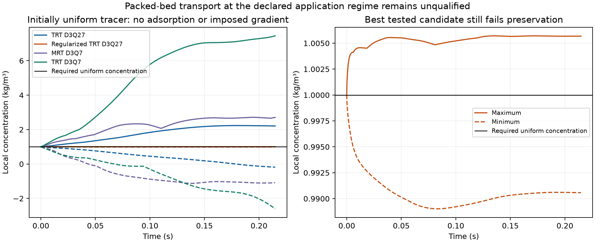
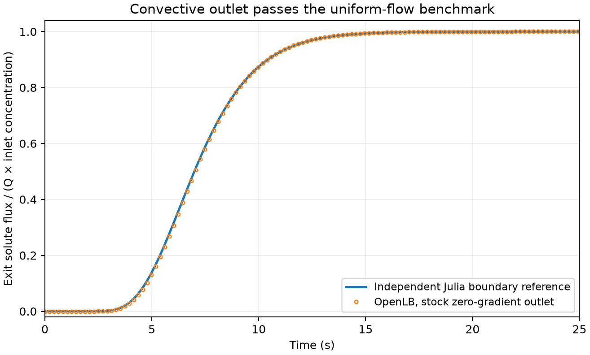
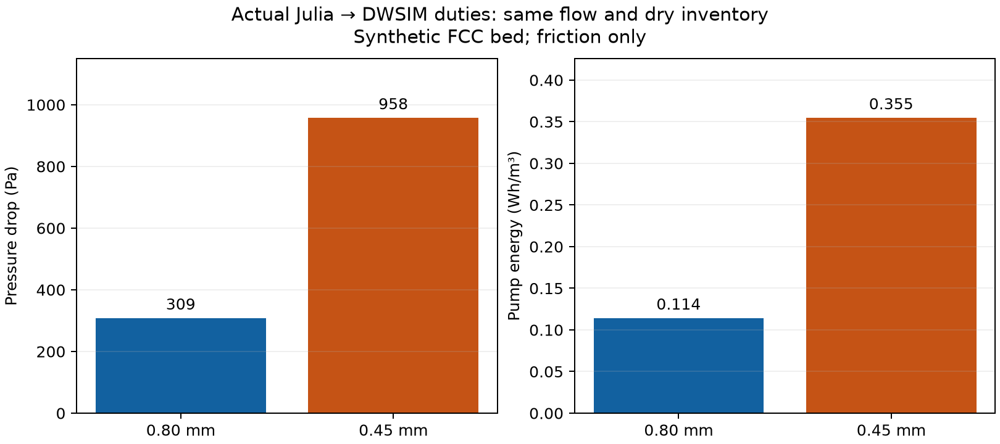
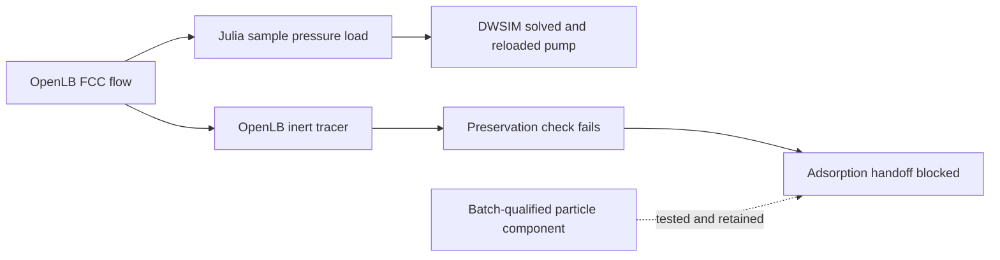

# Column transport qualification and process consequences

## Engineering question and present status

At fixed dry adsorbent inventory, flow and outlet-quality limit, do smaller
particles provide enough additional usable treatment capacity to justify their
higher pumping requirement?

The requested full adsorption milestone is **unfinished**. The convective-outlet
controls now pass, but the tested packed-bed scalar configurations do not
preserve an initially uniform concentration at the declared application regime.
That numerical failure prevents a qualified tracer coefficient and a new
adsorption service prediction. The independently testable native hydraulics and
actual DWSIM pump branch are completed separately. Earlier completed
examples and failed experimental comparisons remain unchanged.

## What the numerical test means physically

Fill a periodic bed with a uniformly mixed, inert tracer. There is no adsorption,
reaction, imposed concentration gradient or tracer source. Its concentration
should remain uniform. Global mass conservation alone is insufficient: a
numerical method can conserve total solute while moving it incorrectly between
local regions. A coefficient inferred from such an error would mix physical
transport and numerical artifacts.

The application check uses synthetic FCC impermeable spheres, native steady
TRT velocity, 0.80 mm particles and the source 43.8 mL/min superficial duty.
Free-liquid Dm=1e-9 m2/s is the previously declared phenol-water scenario, not a
new measurement. Using the actual carrier properties gives particle Peclet
about 10,350 and maximum cell Peclet about 991 at N=32. This is substantially
more advection dominated than the earlier artificial-diffusivity benchmark.

Four stock choices were tested. The formal run `20261110T151006Z-1aaf231f`
contains **19 actual native scalar executions**, including free-flow, outlet,
refinement and application controls. All formal cases conserve global kinetic
solute to below 6e-13 relative; their local behavior differs:

| Application model | Minimum concentration | Maximum concentration | Preservation |
| --- | ---: | ---: | --- |
| TRT D3Q27 | -0.1850 | 2.2334 | Failed |
| Combined regularized TRT D3Q27 | 0.989013 | 1.005709 | Failed |
| MRT D3Q7 | -1.1256 | 2.7122 | Failed |
| TRT D3Q7 | -2.6048 | 7.4429 | Failed |

Concentration is kg/m3; it starts at exactly 1 throughout. The regularized
candidate is much better but still departs by about 1.10%, against the declared
1e-6 absolute preservation screen. Its positive values are not a scientific
pass. No threshold was relaxed, no concentration clipped, and no adsorption
curve was used to choose or fit these transport operators.

Three additional native diagnoses (`20261110T153541Z-923381eb`) retain the same
physical conditions and acceptance limits. Halving dt reduces the regularized
maximum departure from 1.099% to 0.563%; dividing dt by ten reduces it to 0.285%.
The N48 diagnostic at the same physical elapsed time and matched lattice-speed
limit gives 1.267%. All still fail. That N48 test changes both mesh and dt;
it is not an independent proof of spatial convergence. Its kinetic mass residual
is 1.68e-12. These failures never supply a dispersion coefficient.



An auxiliary lower-Peclet TRT test improves its maximum departure from 9.06%
at N=24 to 5.86% at N=32 and 3.10% at N=48. Halving dt at N=24 changes it very
little. This demonstrates refinement dependence, not convergence at application
conditions. These are counterexamples; a full application RTD/dispersion
qualification was not inferred from them. The current evidence localizes a
problem in this imported-velocity/scalar/wall configuration. It does not establish
that OpenLB generally cannot simulate such transport or uniquely identify its
root cause. The stock direct velocity coupler and physical-velocity exporter
both call the same `computeU`; simply changing from a saved field to that coupler
does not by itself supply a different steady velocity reconstruction.

## Verified outlet and macroscopic reference

The installed stock zero-gradient postprocessor needs its existing `NEIGHBOR`
field available in the transverse periodic halo, and its changed boundary
populations synchronized before streaming. Configuring stock communicators
resolves the initial outlet setup error; original OpenLB sources are unchanged.
An independent stock D3Q7 Robin zero-gradient route was also exercised. The legacy
convection setter was inspected/compiled in exploratory work but is incompatible
with the installed block postprocessor API; it was not patched or promoted.

Uniform free-flow concentration stays exactly 1 in the recorded extrema. Both
outlet routes pass boundedness, kinetic conservation, plateau, tail and
analytical/Julia-reference screens at N=16/32. For the selected zero-gradient
outlet N=32, mean error is 0.409%, variance error 2.376%, normalized-profile RMSE
0.002419 and steady flux error 1.2e-9. These are **free-flow** outlet checks,
not packed-bed application validation.



For uniform velocity v, length L and dispersion D, the fixed-concentration
inlet/zero-gradient exit has

```math
\bar t=L/v-(D/v^2)(1-e^{-Pe}),\qquad Pe=vL/D,
```

```math
\sigma^2=(2DL/v^3)(1+2e^{-Pe})-(D^2/v^4)(5-4e^{-Pe}-e^{-2Pe}).
```

They follow by differentiating the Laplace-domain transfer function
`exp(vL/(2D))/(cosh(beta*L)+v/(2D*beta)*sinh(beta*L))`, with
`beta^2=(v/(2D))^2+s/D`. The separate Julia uniform finite-volume reference
conserves its actual boundary flux and is checked against these expressions.

A Danckwerts total-flux inlet instead gives the physical void-volume/Q mean:

```math
\bar t=L/v,\qquad
\sigma^2=(L/v)^2[2/Pe-2(1-e^{-Pe})/Pe^2].
```

The unchanged `FilmParticle.jl` column uses this total-flux inlet and a
zero-dispersive-flux outlet. Its nonadsorbing limit is now explicitly tested
against these independent moments at Pe=2/20, including mesh refinement and
exact physical liquid/dry inventory. The earlier absorbing-reservoir exit mean
is never substituted for this column's residence time.

## Adsorption evidence and qualification boundary

The batch-qualified particle module is preserved, including its source Langmuir
equilibrium and batch-only effective loading diffusivity. The printed bulk
density remains a bed quantity; source per-run weighed mass and measured fluid
dispersion remain unavailable. Earlier Figure 7 failures remain failures.
Alhamed's empirical fitted DL/Pe are not used as independent transport data.

The new bridge rejects the actual failed native packet before invoking particle
kinetics. Its coefficient and new service time, treated volume and cumulative
service energy remain null. No effective velocity, inaccessible-solid fraction,
capacity multiplier or per-curve dispersion is introduced to rescue the result.
The particle component passes its existing tests; that does not mean the new
native-to-adsorption connection is physically qualified.

## Independent hydraulic/process branch

This branch uses the two source particle diameters and flow, with a declared
synthetic FCC packing at nominal voidage .6. The source-density-derived mass is
7.032455 g, not an independently weighed per-column value. Preserving that mass
at particle-envelope density 740/(1-.427) kg/m3 and 11 mm ID gives length .14325 m.
This separates the source's .427 voidage/740 kg/m3 bulk density from the FCC
scenario and does not reconstruct an experimental specimen.

DWSIM supplies actual water properties at 295.15 K. Native flow matches the
carrier Reynolds number and pressure is adjusted to impose the same 43.8 mL/min
for both diameters. N=32/48 and half-dt checks precede actual DWSIM pump
solve/save/reload. Operating-point resistance is used; no nonlinear pressure
response is relabelled as a constant Darcy permeability. Pump efficiency .75
is a scenario assumption. The demonstrated circuit has zero elevation and no
ancillary pressure load. Source downflow geometry is not a complete measured
pressure circuit; these are bed-friction duties, not the paper's measured pump
energy or a plant-wide energy estimate.

The final hydraulic study is `20261110T154704Z-d14d13ed`. Eighteen actual native
flow executions impose/check the two particle sizes at N32/N48 and half dt.
Twelve completed executions are preserved from partial coordinators; six are
new in the final resumed coordinator. All declared screens pass. Grid pressure
changes are 2.545% and 2.697%; half-dt pressure changes are 5.67e-7 and 8.77e-8
relative. At 0.80 mm, an additional cold-start run agrees within 5.06e-9 relative
velocity. A perturbed two-cell domain agrees within 4.26e-10; its final inter-cell
velocity difference is 7.03e-9. These are **two additional actual native runs**,
not new runs when their portable wrapper later reanalyzes identical saved data.
No arbitrary-domain stability or finite-column distributor validation is claimed.

The selected process run, `20261110T163606Z-3e5ef256`, actually executes
OpenLB output → Julia operating-point translation → DWSIM pump solve/save/reload.
Julia checks matching Reynolds number and supplies the pump pressure and flow.
Both DWSIM inputs and outputs are archived, with source/parent hashes. The
earlier hydraulic arithmetic/three DWSIM cases remain verification evidence;
the selected Julia route adds two actual DWSIM executions. That is **five executed
cases**, including the carrier anchor and repeated physical duties, not five
independent particle designs.

| Same 43.8 mL/min and 7.032455 g dry inventory | 0.80 mm | 0.45 mm |
| --- | ---: | ---: |
| Particle Reynolds number, superficial convention | 6.424 | 3.614 |
| Computed bed-friction pressure drop | 308.809 Pa | 958.188 Pa |
| Actual DWSIM shaft power | 0.300574 mW | 0.932636 mW |
| Shaft energy per volume pumped | 0.114374 Wh/m3 | 0.354884 Wh/m3 |

Smaller particles require **3.10285 times** the pumping work in this defined
friction-only scenario. This quantifies the hydraulic cost, not whether faster
uptake compensates it. Service time, compliant treatment volume and cumulative
service energy remain unavailable. An algebraic process sensitivity, explicitly
not additional DWSIM runs or uncertainty bounds, varies efficiency .6/.75/.85
and common extra pressure 0/1000/10000 Pa. A 10 kPa common pressure duty reduces
the small/large energy ratio to about 1.063: other equipment duties can dominate
the total. Actual circuit/equipment data would be needed for a specific plant.





## Evidence, scope and next technical requirement

The saved scalar checker verifies 1,790 artifacts and 29 source files and replays
four independent Julia boundary references. It executes no new native or DWSIM
simulation. Figures above were visually inspected. The exact commands, file
contracts and MRT raw-field caveat are in [README](README.md). The declaration
preceding the trials is in [protocol](protocol.md); failed exploratory builds
and runs remain under ignored `results/adsorption/column_transport/probes/`.
Exploratory link-wall mass diagnostics had an initial-inventory convention error
and are not used as formal evidence. No vendor source was changed.

The full host-graphics Python suite passes **174 tests**. Direct Julia checks
pass 26 boundary-moment assertions, five uniform-profile assertions and ten
operating-point translation assertions; the unchanged particle suite passes
51 assertions. Repository checks cover 18 examples with no errors. Saved-data
checks and Julia replay are distinguished from actual simulator executions.
No new browser interface was implemented or visually accepted.

The technical blocker is a qualified conservative, concentration-preserving
transport representation at the selected porous geometry/flow/diffusivity.
The next investigation must resolve the discrete continuity/wall consistency,
or qualify another stock method at the same physical conditions. A repeated
high-diffusivity absorbing-end comparison would not close this gap. Until then,
the usable-capacity/pumping tradeoff is unavailable. No new laboratory data,
author contact, reactive model or non-isothermal extension is a prerequisite.

Primary implementation references are the installed OpenLB 1.9r0
`advectionDiffusionReaction/microMixer3d`, `longitudinalMixing3d` and native FCC
flow application. General boundary behavior is described in the official
[OpenLB boundary guide](https://openlb.gitlab.io/release/content/06_initial_boundary.html).
Source adsorption evidence remains [Alhamed (2009)](https://doi.org/10.1016/j.jhazmat.2009.05.002)
with its existing curated extraction and separate physical-comparison reports.
