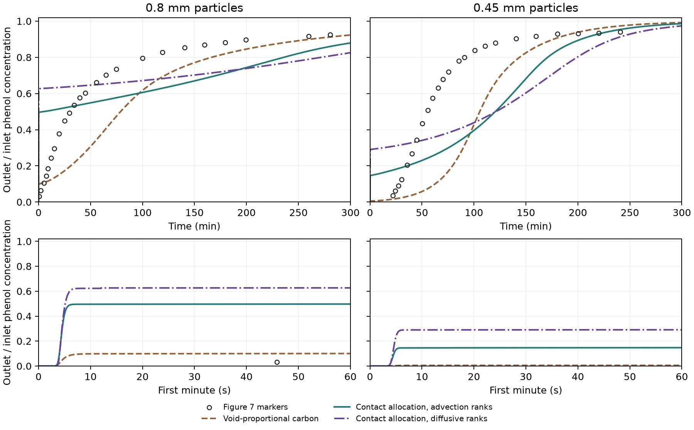

# Figure 7 rerun with wall-contact carbon and Péclet-matched exchange

This forward comparison couples the [wall-contact allocation](../carbon_contact/REPORT.md)
and the [Péclet-matched exchange law](../exchange_attribution/REPORT.md)
to the existing batch-qualified particle model. The total dry carbon was
7.032455155 g for both sizes, and the source void volume, flow, geometry,
equilibrium, film correlation and particle diffusivity retained their
earlier values. Neither Figure 7 curve supplied a fitted parameter.
[Alhamed (2009), Figure 7](https://www.sciencedirect.com/science/article/pii/S0304389409007687)

## How wall exposure enters the column

The primary case uses the advection-ranked allocation reported in the
wall-contact study. We rebuilt that allocation over the 40 flow bins in
the exchange model. Each grain octant contributes its solid voxel
fraction, shared among classes in proportion to their reflected length
on the octant's surface. The primary transfer aligns the advection and
diffusive transit classes by flow percentile. Those labels can differ
for the same marker. The rank-label sensitivity uses the actual diffusive
labels for both carbon allocation and exchange. The saved marker pairs
reproduce the matrix counts exactly for both diameters. The two models
keep the same carrier delay distribution and the same Péclet-matched
transition matrix for each size.

| Diameter | Rank label for allocation | Carbon assigned to slowest 10% | Classes with zero recorded contact |
| --- | --- | ---: | ---: |
| 0.80 mm | Advection | 87.79% | 12 of 40 |
| 0.80 mm | Diffusive | 99.98% | 22 of 40 |
| 0.45 mm | Advection | 77.24% | 6 of 40 |
| 0.45 mm | Diffusive | 99.87% | 21 of 40 |

The 40 µs exposure allocation differed from the primary 80 µs allocation
by 4.12% and 3.01% in total variation across all 40 advection-ranked bins,
and by 0.41 and 0.72 percentage points in the slowest tenth. Column
predictions use the frozen 80 µs data. Zero sampled contact becomes zero
carbon assigned to a class in this closure. That is a consequential
assumption about how a grain-envelope exposure proxy enters the
macroscopic model. It leaves experimental adsorptive accessibility
unresolved. [Pre-scoring protocol](protocol.md)

## Comparison against Figure 7

| Diameter | Case | Time to 5% of feed (s) | Time to 50% of feed (min) | Curve RMSE |
| --- | --- | ---: | ---: | ---: |
| 0.80 mm | Figure 7 | 101.57 | 30.75 | — |
| 0.80 mm | Void-proportional carbon, Péclet-matched control | — | 78.88 | 0.194 |
| 0.80 mm | Contact allocation, advection ranks | 3.83 | 4.83 in full run | 0.224 |
| 0.80 mm | Contact allocation, diffusive ranks | 3.90 | 0.086 | 0.286 |
| 0.45 mm | Figure 7 | 1,412.24 | 55.36 | — |
| 0.45 mm | Void-proportional carbon, Péclet-matched control | — | 105.59 | 0.318 |
| 0.45 mm | Contact allocation, advection ranks | 4.21 | 120.52 | 0.270 |
| 0.45 mm | Contact allocation, diffusive ranks | 4.14 | 121.21 | 0.257 |

All four contact-allocation cases fail the 5% arrival, 50% arrival and
curve-error screens. The early Figure 7 crossing for 0.80 mm is poorly
resolved by the source image. Its chosen reading scenarios still span
21.72–205.58 s, above the predicted 3.8–3.9 s. The 0.45 mm source crossing
has a reading range of 1,297.51–1,526.96 s. These are reading sensitivities.

Both primary cases leak phenol within seconds. The 0.80 mm curve rises
to nearly 50% of the feed in the first few seconds. Its midpoint is much
earlier than the published curve even with numerical uncertainty. The
0.45 mm curve first rises to about 15% of the feed, then crosses 50% later
than the void-proportional control. Its overall curve RMSE improves from
0.318 to 0.270 and still exceeds the 0.10 limit. Using diffusive ranks
raises both early plateaus. This shows the effect of assigning the
contact proxy as distinct solid inventories, including classes with zero
sampled contact. The resulting leakage and midpoints leave both
experimental breakthrough predictions unqualified.

## Numerical checks

The final full-curve refinement changed the normalized concentration
after 24 s by at most 0.00486 across the four cases. The 0.80 mm
diffusive-rank early crossings use an independently refined 12 s run.
Its concentration differs from the long run by 0.00338 of the feed at
12 s. All four 5% crossings met the numerical refinement criterion.
Three cases also passed their 50% crossing criterion.

The 0.80 mm primary outlet sits near 0.50 after startup. The finest
full-duration run gives 4.83 min. Two additional refinements through
600 s move that crossing to 5.86 and 6.20 min. These two timings differ
by 5.48%, above the 2% criterion. A small profile error on the plateau
produces a larger error in the crossing time. The main RMSE remains
the score of the frozen full-duration curve. All fine midpoint
estimates are far earlier than the measured 30.75 min.

Cohort `20261112T112916Z-e6cbd3c6` contains ten full-duration and two
short startup runs, plus the separately archived two plateau checks.
The maximum normalized total mass residual in the reported full runs
was 7.06e-11 and the largest normalized film-flux mismatch was
4.85e-15. The Julia coupling tests passed all 10 assertions and the
generated solver reproduced the pinned baseline. Read-only replay
verified 31 sources and 46 artifacts and reproduced the plateau
check. The run used Julia 1.11.6 through JuliaCall. No new OpenLB or
DWSIM runs were used. [Run and replay guide](README.md) ·
[Compact numerical record](reference_summary.json)
