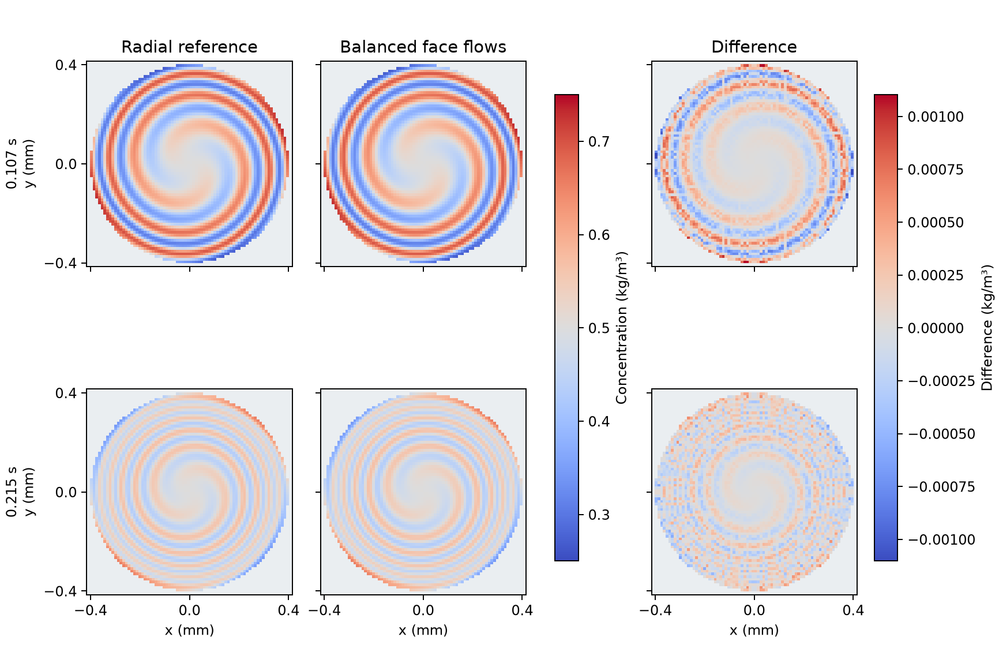

# Balanced face flows passed the stationary disk benchmark

The Julia finite-volume calculation preserved the uniform tracer at exactly
0.500 kg/m³ at every saved step. The varying tracer met the 1% RMS criterion
throughout the liquid and in the outer 50 µm at both comparison times. The
largest of those RMS errors on the working mesh was **0.235% of the initial
amplitude**. A finer disk calculation confirmed the working mesh.

## Physical setup and numerical method

The comparison used the 0.4 mm-radius disk, peak liquid speed of 12.9373 mm/s,
angular shear that vanishes at the wall, and molecular diffusivity of
1e-9 m²/s from the original benchmark. The depth equals the four axial
layers of the N=128 control. The working mesh used 160 radial rings and
1,024 azimuthal sectors and followed the smooth circular wall. Both initial
tracer conditions and the archived observation times were retained.
[Original disk and independently converged Julia radial solution](../stationary_curved_wall/REPORT.md)

With the radial ring spanning radii a to b and depth h, the carrier flow
through one azimuthal face is

```text
Q = h Ω₀ [(b² − a²)/2 − (b⁴ − a⁴)/(4R²)]
```

The two azimuthal faces have identical Q, one incoming and one outgoing.
The radial and axial carrier flows are zero, so the net flow is exactly
zero in every sector. A single shared tracer flux at each internal face
combines centered advection and two-point molecular diffusion. The wall
face has zero tracer flux. A symmetric radial–azimuthal–radial sequence
of Crank–Nicolson updates evolves the full real-valued field. The separate
radial reference evolves just the complex amplitude of the m=2 mode.
[Finite-volume background](https://faculty.washington.edu/rjl/pubs/hiresadv/index.html)

## Results on the working mesh

Errors are RMS percentages of the initial 0.25 kg/m³ amplitude. Native
sector errors use volume weights and sector-averaged reference values.
The fixed-point comparison interpolates the sector solution to 4,272
liquid cell centres from the archived N=128 OpenLB mesh.

| Time | Sector RMS, all liquid | Sector RMS, outer 50 µm | Fixed-point RMS, all liquid | Fixed-point RMS, outer 50 µm |
| --- | ---: | ---: | ---: | ---: |
| 0.107373 s | 0.080% | 0.131% | 0.117% | 0.164% |
| 0.214764 s | 0.171% | 0.235% | 0.072% | 0.089% |

The uniform run completed 2,148 steps with zero recorded concentration
departure or relative liquid inventory drift. The varying concentration
stayed within **0.250015–0.749985 kg/m³** across the full history, within the
initial physical bounds of 0.25–0.75 kg/m³. The working varying case's
relative liquid inventory drift was 3.44e-15. Independent integration
recovered the saved face flows, and the maximum cell net flow and wall
flow were both zero.



## Refinement and scope

The 40×256 mesh missed the reference screen. The 80×512 mesh passed it,
and its largest change on doubling to 160×1024 was 0.600% of amplitude
at the midpoint near the wall. This exceeded the separate 0.5% mesh-change
check. A further doubling to 320×2048 at the same time step cap reduced the
maximum sampled change to **0.139%**, passing that check. The largest
sampled change on halving the 160×1024 time step cap from 200 to 100 µs
was **0.0122%**, below the 0.1% time-step criterion. The working mesh
therefore passes the tracer, inventory and refinement checks.
[Spatial confirmation protocol](refinement_note.md)

Seven Julia disk executions completed across the original and confirmation
cohorts. Read-only replay checked 24 source hashes and 74 artifacts in
the first cohort and 20 source hashes and 29 artifacts in the confirmation.
The independent reference's eight Julia tests passed.

The benchmark qualifies transport with **prescribed, balanced face flows
on a smooth disk**. The Julia and OpenLB transport meshes differ. Transfer
from an OpenLB-computed velocity field is a separate verification step.
The study produced zero full-bed, OpenLB, or DWSIM executions.
[Run guide](README.md) · [Compact numerical record](reference_summary.json)
