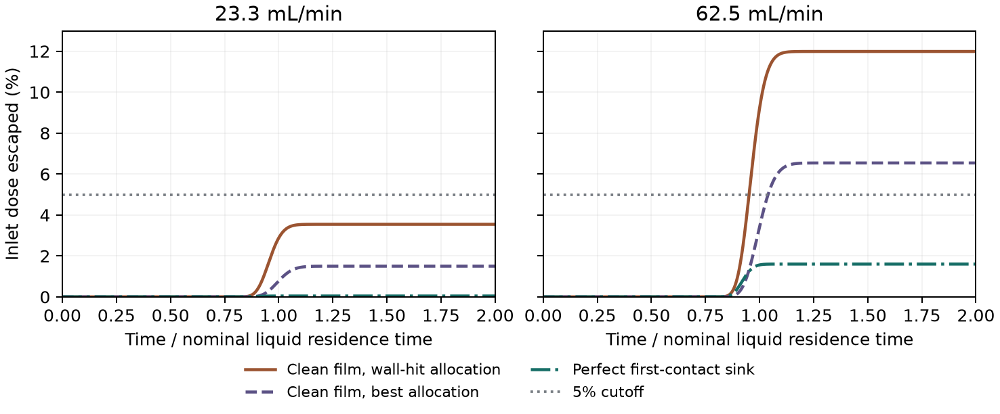

# First wall contact and early escape from the 25 cm phenol column

At both tested flow rates, enough tracer reaches a wall for a perfectly
absorbing surface to keep projected escape below 5%. At 62.5 mL/min, the
existing liquid-film conductance is too small to do the same even with
perfectly clean carbon and the most favorable allocation across flow paths.
This explains how early leakage can persist in the model despite repeated
wall contact. [Previous carbon-access study](../carbon_access_transfer/REPORT.md)

## Eight-section tracer holdout

The two velocity fields used for tracer transport have the same saved
N160 stock OpenLB TRT velocity shape, scaled to the two flow conditions at
matched Péclet numbers. The test reused the 8,192-marker holdout and the
separate 16,384-marker operator probes for each flow. All three reductions
passed the predeclared limit of 2 percentage points in absolute cumulative
escape and at the times when the first 10% and 25% of the inert tracer arrived
at sections 3–8. The table reports the reduction that preserves the joint
dependence of first contact and local travel time. Changing the histogram bins
from 2 to 1 ms in archive time moved its cumulative curves by at most
0.41 percentage points. [Protocol](protocol.md)

| Flow (mL/min) | No wall contact by section 8 (% of inlet dose) | Largest cumulative error (percentage points) | Largest early error (percentage points) |
| ---: | ---: | ---: | ---: |
| 23.3 | 70.76 | 1.34 | 1.04 |
| 62.5 | 83.22 | 1.46 | 1.42 |

## Projected escape in a 25 cm bed

The column calculation applies the same fully mixed joins as the frozen
column model. It combines 22 repeats of the eight-section pattern followed
by four terminal sections. For the perfect sink, a wall hit removes all
tracer mass on first contact. The other two calculations use the existing film
conductance and assume zero concentration at the carbon surface, so there is
no loss of driving force from particle loading. Carbon mass, external area,
flow and the prior 50%-direct, 1%-conductance slow-access scenario stay fixed.
The wall allocation uses saved contact weights. The favorable allocation gives
each path the same conductance per unit liquid flow. [First-contact capture reference](https://doi.org/10.1103/PhysRevE.107.044105)

| Flow (mL/min) | Perfect sink from held-out trajectories (%) | Clean film, wall-hit allocation (%) | Clean film, best allocation (%) |
| ---: | ---: | ---: | ---: |
| 23.3 | 0.042 | 3.54 | 1.50 |
| 62.5 | 1.60 | 11.99 | 6.54 |

The percentages are eventual fractions of an inlet pulse that exit, or the
steady outlet-to-inlet ratio for a step through these linear diagnostic
models. They had already reached these values to the displayed precision
after three nominal liquid residence times. The reduced joint model projects
perfect-sink escape of 0.035% and 1.23%, respectively. The 25 cm result uses
the specified mixing assumption and repeated synthetic geometry. The direct
trajectory comparison extends through eight sections.

For a liquid path through the staged model, a section with conductance-to-flow
ratio $a$ transmits a fraction $1/(1+a)$. The overall escape averages the
product of these fractions over liquid paths. Jensen's inequality for the
exponential and then for $\log(1+a)$ gives the minimum escape
$(1+G/(NQ))^{-N}$, where $G$ is total film conductance, $Q$ is liquid
flow, and $N=180$ is the number of sections. The flow-proportional numerical
allocation attains this bound. At 62.5 mL/min, $G/Q=2.748$ and the 5%
target requires $G/Q=3.021$. This means at least **9.94% more conductance**
under the favorable allocation in the current staged model. It is a necessary
change for that model, even before carbon loading or uneven allocation reduces
uptake.

The wall-contact check passed and the high-flow film bound missed the 5%
screen. No adsorption cases were rerun and no column curves were fitted.
The literature-based service predictions remain unqualified. An independent
liquid-film conductance estimate at these operating conditions would test
whether the current film assumption accounts for the shortfall.

[Commands](README.md) · [Compact record](reference_summary.json)
