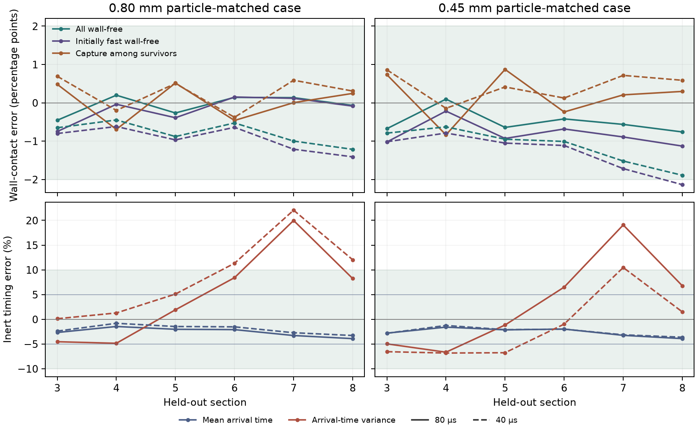

# Can two sections predict path exchange and wall contact through eight?

The [N160 refinement](../disordered_n160/REPORT.md) qualified the
eight-section trajectory reference for this disordered packing.
Here the first two sections supply a reduced Julia model, with
sections 3–8 held out. Each of four Péclet-matched cases uses its
own 8,192 saved marker tracks and the same carbon basis of
7.032455155 g. The 0.80 mm and 0.45 mm particle-matched Péclet
numbers are 24,985.45 and 14,054.32. The wall observable is first
contact with a perfect sink. [Protocol](protocol.md)

## How the reduction works

Transit times in each training section define ten equal-flow
classes. The fastest nine form the initially fast cohort. The
fraction of markers in donor class \(i\) reaching receiver class
\(j\) gives the inert transition \(P_{ij}\). The fraction making
that transition without wall contact gives \(W_{ij}\), with both
fractions measured relative to the entire donor class. Thus
\(0\le W_{ij}\le P_{ij}\). The inert matrix preserves a uniform
tracer and the carrier class flow fractions. The wall-free
matrix passes the surviving mass to the next class and removes
the captured mass from the liquid dose.

The model starts with the measured distribution at the end of
section 2. It repeats the same matrices for the remaining six
sections. Arrival-time moments use the measured delay moments
conditional on each class transition. The new delay is treated
as independent of prior travel times given that transition. A
control keeps the same inert matrix and uses the receiving
class alone for wall contact. All calculations stop at tracer
transport and first wall contact.

## Held-out results

Maximum absolute errors over sections 3–8 are shown below.
Wall errors use percentage points of the relevant tracer
population. Mean and variance errors are relative to the
N160 tracer observations.

| Particle-matched case | Time step | Total wall-free, pp | Conditional capture, pp | Initially fast wall-free, pp | Mean arrival | Arrival variance |
|---|---:|---:|---:|---:|---:|---:|
| 0.80 mm | 80 µs | 0.46 | 0.69 | 0.75 | 3.91% | 19.98% |
| 0.80 mm | 40 µs | 1.21 | 0.69 | 1.41 | 3.28% | 22.06% |
| 0.45 mm | 80 µs | 0.76 | 0.87 | 1.13 | 3.91% | 19.08% |
| 0.45 mm | 40 µs | 1.89 | 0.86 | 2.14 | 3.63% | 10.47% |

Wall contact meets the 2-point screen in three cases. The
0.45 mm case at 40 µs predicts 72.93% initially fast tracer
wall-free at the outlet versus 75.07% observed. The pair-based
model lowers the maximum fast-cohort wall error in all four
cases relative to the receiving-class control. In that borderline
case it reduces the error from 2.47 to 2.14 points.

Mean arrival passes the 5% screen in all four cases. Variance
exceeds the 10% limit in all four cases, with the largest error
at section 7 each time. The observed distribution of successive
transit classes differs from the frozen training seam by
15.7–25.1 percentage points in total variation. This measures
the share of joint probability that would need to be redistributed
to match the later seam. At the outlet, the model also predicts
roughly 1–2 points too much uninterrupted fast-path persistence.
The repeated two-section rule captures much of the wall-contact
signal, but its timing and exchange do not qualify as a full
eight-section transport model. Spatial variation and omitted
travel-time memory can both contribute to the variance error.

## Provenance

Cohort `20261113T170400Z-e462ad77` contains the Julia outputs
and the first-two-section training files. The frozen prediction
SHA-256 is
`6944c16ec01f86f5e0415c4d637cc96c1c37f794503ace1e088ba24f47ada2b8`.
All 17 Julia model assertions passed. Read-only replay verified
27 sources and 92 artifacts. The result is a spatial holdout on
one packing using the same tracer identities. Adsorption and
Figure 7 were outside the study.
[Reproduction commands](README.md) · [Compact record](reference_summary.json)
