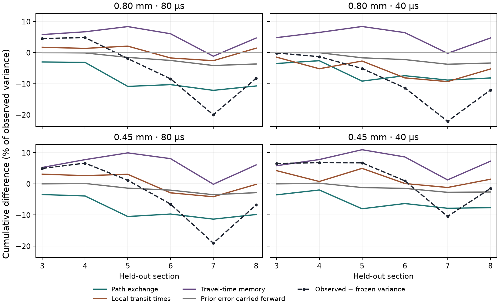

# What caused the held-out variance error?

The frozen Julia model overpredicted arrival-time variance most strongly
at section 7 in all four saved N160 runs. This audit retains the original
section 1–2 calibration, ten transit-time classes, and the frozen
predictions for sections 3–8. The observed later sections enter only the
diagnostic calculations below. [Frozen holdout](REPORT.md) · [Audit protocol](variance_protocol.md)

## Diagnostic calculation

If \(A\) is the time already spent in the bed and \(D\) is the next
section transit time, the section adds
\(\mathrm{Var}(D)+2\mathrm{Cov}(A,D)\) to arrival variance.
For each seam, hold the donor-class elapsed-time means at their
observed values. Compare the variance increment using the training and
observed exchange tables, crossed with the training and observed
transit-time distributions within each transition. Attribute exchange
and local transit effects by averaging each substitution with the other
input frozen and with it observed. This assigns half of their
interaction to each.

With both inputs observed, the difference from the measured increment
quantifies the travel-time information lost when elapsed time is
represented by its donor-class mean. This includes sorting of older
and younger tracer into different receiving classes, and residual
elapsed-time/delay covariance within a given class pair. A fourth
term accounts for the difference between the frozen model's elapsed
times and the observed donor-class means. The four terms reproduce
the measured minus frozen variance at each held-out section.
[Spatial Markov transport](https://journals.aps.org/pre/abstract/10.1103/PhysRevE.78.026308)

## Results

Entries are signed cumulative contributions as percentages of the
observed variance at section 7. Negative values lower the variance
relative to the frozen model. Totals may differ from the displayed
sum due to rounding.

| Particle-matched case | Time step | Path exchange | Local transit times | Travel-time memory | Earlier error carried forward | Observed − frozen |
|---|---:|---:|---:|---:|---:|---:|
| 0.80 mm | 80 µs | −12.12% | −2.58% | −1.14% | −4.13% | −19.98% |
| 0.80 mm | 40 µs | −8.81% | −9.30% | −0.21% | −3.73% | −22.06% |
| 0.45 mm | 80 µs | −11.34% | −4.14% | −0.12% | −3.48% | −19.08% |
| 0.45 mm | 40 µs | −7.85% | −1.17% | +1.27% | −2.72% | −10.47% |

Changing exchange along the bed is the largest term in three runs.
In the 0.80 mm run at 40 µs, exchange and changes in local transit
times are comparable. Their combined contribution lowers the
frozen variance by 9.0–18.1% of the observed section-7 variance across
the four runs. The cumulative contribution of missing travel-time
memory at section 7 is between −1.14% and +1.27%.

Travel-time memory still matters. Its cumulative contribution is
positive by 8.4–11.0% at section 5 and 4.7–7.3% at the outlet.
At the outlet it partly offsets the −7.6% to −10.7% exchange
term. The memory term there comes primarily from the receiving
class sorting markers with different elapsed times within the
same donor class. Dependence between elapsed time and new delay
within the same class pair contributes less.

The alternative exchange tables assign up to 3.52% of probability to
pairs whose delay moments must be filled from the receiver class.
Using the nearest sampled donor within that class instead changes the
section-7 exchange attribution by at most 0.38 percentage points of
observed variance. Both approaches support the same interpretation.

The diagnostic points to spatial variation in exchange and travel
times as the first model limitation to address for this packing.
A travel-time memory term could still matter for the outlet.
The audit uses later sections to explain the existing errors, and
the frozen predictor still exceeds the 10% variance limit in all
four runs.



## Replay

```sh
source scripts/env.sh
uv run python -m examples.adsorption.disordered_exchange.variance_audit --check
uv run python -m examples.adsorption.disordered_exchange.plot_variance
uv run pytest -q tests/adsorption/test_disordered_variance_audit.py
```

The [audit record](variance_reference.json) pins the original N160
and frozen holdout hashes and retains each section's signed
increments. Two independent synthetic cases verify the covariance
and sorting terms. Adsorption and Figure 7 were outside the audit.
