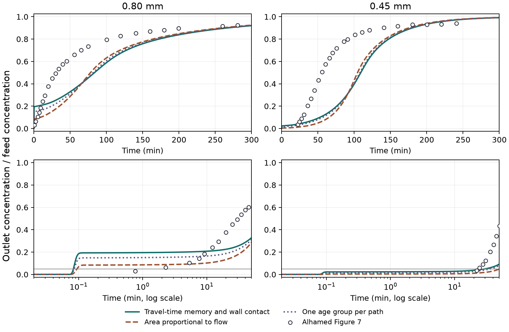

# Phenol breakthrough with section-specific travel-time memory

The section-specific N160 model passes the inert tracer check when
connected to the column solver. The coupled predictions for both particle
sizes fall outside the experimental breakthrough limits at the fixed
carbon inventory. [Alhamed (2009), Figure 7](https://doi.org/10.1016/j.jhazmat.2009.05.002)

## Fixed inputs and transfer to the bed

The column uses the source 10 cm bed, 43.8 mL/min flow, 150 mg/L phenol
feed and void fraction 0.427. The dry inventory is 7.032455155 g for
both sizes, calculated from the printed bulk density and bed volume.
The batch-qualified particle loading diffusivity is
1.84603549 × 10⁻¹² m²/s. The source Langmuir parameters and the
superficial-velocity film correlation are carried over.
[Particle model](../film_particle/REPORT.md)

Conservative delay lines carry the saved transition and transit-time
moments for the ten path classes and their four elapsed-time groups.
The first two sections use the tracer calibration data. The later six
use the qualified N160 rules. Each of the eight sections has one
shared radial particle profile. Its external particle area is divided
among the liquid paths in proportion to their independently sampled wall
hits. This is a contact proxy in the synthetic geometry. Every section
retains its full share of carbon and total external surface area.
[Tracer qualification](../disordered_travel_memory/REPORT.md) · [Protocol](protocol.md)

The physical column uses nine repeats of the eight-section pattern
for 0.80 mm and sixteen repeats for 0.45 mm. The section Péclet numbers
match the saved probes at 24,985 and 14,054. A common delay scaling per
size preserves total liquid hold-up. The liquid paths mix at the joins
between repeats, and the delay lines transfer solute to the particles
at the section exits. These are assumptions for mapping the synthetic
packing to the experimental bed.

## Held-out Figure 7 comparison

| Diameter | Model time to 5% | Figure 7 time to 5% | Model time to 50% | Figure 7 time to 50% | Curve RMSE in outlet/feed |
|---|---:|---:|---:|---:|---:|
| 0.80 mm | 4.97 s | 101.57 s | 83.57 min | 30.75 min | 0.182 |
| 0.45 mm | 30.11 min | 23.54 min | 109.06 min | 55.36 min | 0.307 |

The screens are curve RMSE ≤0.10, midpoint error ≤20%, and resolved
5% crossing error ≤25%. Both sizes fail. At 0.80 mm the model starts
leaking early, then takes about 53 minutes longer to reach 50% of feed.
At 0.45 mm the first crossing is about 6.6 minutes late and the
midpoint about 54 minutes late. The early crossing differences exceed
the digitization reading sensitivity for both sizes. The reported reading
sensitivity represents marker extraction, and pointwise experimental
uncertainty is unavailable.

At fixed path-level wall contact, travel-time memory reduces the
0.45 mm early crossing error. The 5% crossing moves from 36.28 to
30.11 min, compared with 23.54 min from Figure 7. It moves the
midpoint roughly one minute later. Distributing the same area by flow
also fails the screens. Both controls leave midpoint errors of roughly
47–53 minutes. Thus reproducing inert tracer spreading has limited
effect on the remaining breakthrough mismatch for these contact and
repeat assumptions.

## Numerical checks and reproduction

The inert check used the unscaled eight-section geometry. The largest
mean and variance errors on archived sections 3–8 were below 0.60%
and 6.00% across both sizes and time steps. The primary column
refinement from 24 to 48 radial shells, 8 to 4 s late time steps and
20 to 10 ms startup steps passed. Both compared crossing times changed
by less than 0.2%. The primary runs' normalized phenol balance
residuals are below 4.1 × 10⁻¹³, and the normalized film-to-particle
flux mismatch is below 2.5 × 10⁻¹². The two 40 µs tracer-input
sensitivities also fail the experimental screens.

The final runs use the corrected positive quadrature for skewed local
delays. An inventory check identified a swapped weight in the first
implementation. The corrected quadrature is checked analytically and
against the saved first and second moments. Run
`20261116T155928Z-7a767fbb` froze the final curves before scoring.
Read-only replay checked 43 sources and 13 artifacts.
[Commands](README.md) · [Compact record](reference_summary.json)
