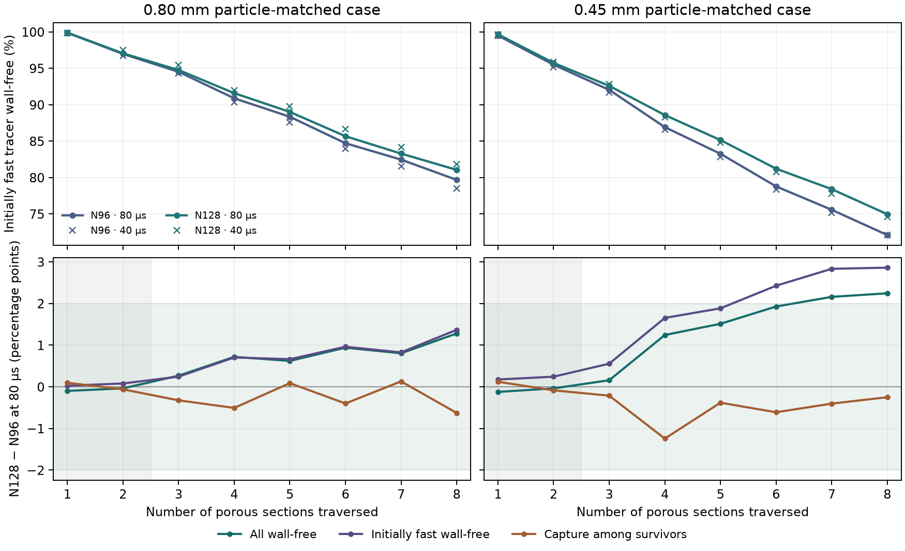

# N128 wall tracer in the disordered packing

The [N96 study](../disordered_refinement/REPORT.md) found that the
N64-to-N96 profile differences exceeded two percentage points for
both particle-matched conditions. This refinement repeats the
eight-section test on the same disordered geometry at N128.

The 32 sphere centres, 0.8 mm sphere diameter, axial origin,
11.113 mm length and transverse dimensions come from the archived
N96 input. The continuous sphere volume is 8.57864234 × 10⁻⁹ m³,
with 7.032455155 g as the column-scale dry carbon basis. The
0.80 and 0.45 mm conditions match Péclet numbers 24,985.45 and
14,054.32 using the accepted mean interstitial velocity.
[Protocol](protocol.md)

The external OpenLB application reuses the stock 1.9r0 D3Q27
TRT collision, Kupershtokh forcing, BounceBack and sphere
indicators. A 1024 × 128 × 128 lattice resolves the same full
disordered domain. The interpolated N96 velocity and density
initialize the N128 solve. The relaxation offset preserves the
N96 ratio of lattice time step to voxel width, and the starting
driving gradient extrapolates the two accepted grid values
linearly in inverse resolution. The new lattice evolves to the
same native acceptance criteria.
[OpenLB 1.9 release](https://www.openlb.net/download/)

The native solve converged in 13,923 steps with a voxel width
of 10.85 µm and a lattice time step of 4.188 µs. The 10,066,466
fluid voxels match the independent sphere rasterization exactly.
The N128 void fraction is 0.600008130 versus 0.600008082 at N96.
The voxel solid volume differs by 0.0000121%. The maximum
lattice Mach is 0.03461, the largest fractional density departure
is 0.001194, and the interstitial velocity-vector mismatch is
0.106% of target. The axial carrier flow is 1.48298 × 10⁻⁸ m³/s.

The Julia face projection preserves the native directional
throughputs and balances each pore voxel. The eight-section
perfect-sink wall tracer uses 8,192 flux-weighted markers at
each of 80 and 40 µs, with the same inlet seeds as N96. The
initially fast cohort is the 90% with the shortest first-section
inert transit times. The grid test uses the largest absolute
difference over sections 3–8 in cumulative wall-free survival,
conditional capture, and initially fast wall-free survival.

The face correction was 0.220% RMS. The maximum cell imbalance
was 4.01 × 10⁻¹⁵ of the largest face rate. The maximum plane
throughput error was 2.27 × 10⁻¹³ of the axial carrier flow.
The original inlet remained forward-flowing at all 8,208 fluid
faces.

## Matched grid comparisons

The entries below are the maximum absolute N96-to-N128 differences
over sections 3–8, in percentage points.

| Particle-matched case | Tracer time step | Total wall-free | Conditional capture | Initially fast wall-free | 2-point result |
|---|---:|---:|---:|---:|---|
| 0.80 mm | 80 µs | 1.28 | 0.63 | 1.37 | Pass |
| 0.80 mm | 40 µs | 3.16 | 0.88 | 3.34 | Exceeded |
| 0.45 mm | 80 µs | 2.25 | 1.24 | 2.86 | Exceeded |
| 0.45 mm | 40 µs | 2.38 | 0.66 | 2.67 | Exceeded |

The refinement increases wall-free passage in both cases. At 80 µs
the initially fast wall-free outlet fractions change from 79.68%
to 81.05% for 0.80 mm and from 72.10% to 74.96% for 0.45 mm.
The ordered N96 reference gives 93.77% and 88.82% for the same
conditions. The direction of the geometry effect persists,
and the 2-point screen for its magnitude remains unmet.
[Ordered N96 reference](../repeated_geometry/REPORT.md)

All four N128 runs recovered the full inert dose. The N128
80-to-40 µs profile changes were at most 0.95 and 0.69 points
for 0.80 and 0.45 mm. Both pass the 1-point time-step screen
on the original 8,192-marker ensembles.

The lower panels shade the 2-point band and the first two
sections excluded from scoring.

## Provenance

Cohort `20261112T214029Z-59d60ca7` retains the geometry,
initial and native fields, face flows, and marker observations.
The N96 archive is pinned by SHA-256
`4cf9d60ca9471036681fe62d7f166414c470a3e7445e6ac9e7b476a8f697dd0f`.
The N128 tracer plan was frozen with SHA-256
`0e2dd0facd9c0bfd14bebae1a67d72e2f479966defdde205644169a450df128e`.
OpenLB integrity verification checked 2,070 original files.
Read-only replay verified 42 sources and 257 artifacts.
The study ends at tracer transport and wall contact.
[Reproduction commands](README.md) · [Reference summary](reference_summary.json)
