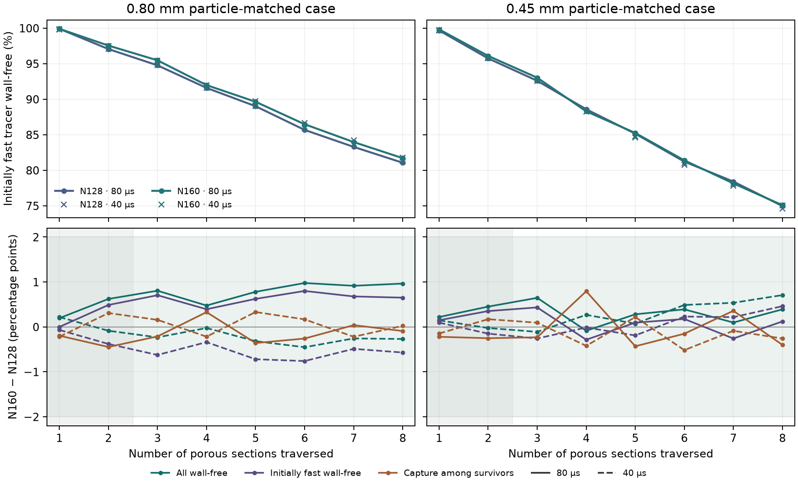

# N160 wall tracer in the disordered packing

The [N128 study](../disordered_n128/REPORT.md) exceeded the 2-percentage-point
grid limit in three of four matched comparisons. This study repeats the
eight-section test with the same disordered packing at N160.

The sphere-centre file, 32 spheres, axial inlet cut and dry carbon basis
of 7.032455155 g come from N128. The two particle-matched cases use the
same target Péclet numbers, 24,985.45 and 14,054.32, using the accepted
carrier speed for the diffusivity match.
[Protocol](protocol.md)

The external stock OpenLB 1.9r0 TRT application uses D3Q27,
Kupershtokh forcing, BounceBack walls and sphere indicators.
The 1280 × 160 × 160 grid is initialized from the archived N128 field,
with the same lattice time step to voxel-width ratio. The initial pressure
gradient extrapolates the accepted N96 and N128 gradients in inverse
resolution. The native acceptance criteria are carried over from N128.

The 8.68 µm grid has 19,660,839 liquid voxels, matching the independent
sphere rasterization exactly. The voxel void fractions are 0.600001190
at N160 and 0.600008130 at N128. Voxel solid volume increased by 0.00174%.
The native solve converged after 17,920 steps at a lattice time step of
3.350 µs. The velocity-vector mismatch was 0.192% of target, maximum
lattice Mach was 0.03461, and maximum fractional density departure was
0.001200. Axial throughput was 1.48434 × 10⁻⁸ m³/s.
[OpenLB 1.9 release](https://www.openlb.net/download/)

The conservative face projection supplies Julia with locally balanced
rates and preserves the native directional throughputs. The eight-section
tracker uses 8,192 flux-weighted markers, the same inlet seeds as N128,
and 80 and 40 µs time steps. A solid-wall encounter counts as capture.
The grid test takes the largest absolute change over sections 3–8 in
total wall-free survival, conditional capture among survivors and
initially fast wall-free survival.

The face projection adjusted raw rates by 0.152% RMS. Maximum cell
imbalance was 1.51 × 10⁻¹⁴ of the largest face rate and maximum
plane-throughput error was 1.75 × 10⁻¹³ of axial throughput. All 12,820
fluid faces on the original inlet cut remained forward-flowing. The
N160 matched diffusivities were 7.12749 × 10⁻¹⁰ and 1.26711 × 10⁻⁹
m²/s for the two particle-matched conditions, respectively.

## Matched grid results

Each entry is the maximum absolute N128-to-N160 difference across
sections 3–8, in percentage points.

| Particle-matched case | Tracer step | Total wall-free | Conditional capture | Initially fast wall-free | 2-point result |
|---|---:|---:|---:|---:|---|
| 0.80 mm | 80 µs | 0.98 | 0.36 | 0.80 | Pass |
| 0.80 mm | 40 µs | 0.45 | 0.33 | 0.76 | Pass |
| 0.45 mm | 80 µs | 0.65 | 0.79 | 0.43 | Pass |
| 0.45 mm | 40 µs | 0.71 | 0.52 | 0.46 | Pass |

At 80 µs the share of initially fast tracer reaching the outlet without
touching carbon changed from 81.05% to 81.70% for 0.80 mm and from
74.96% to 75.08% for 0.45 mm. The archived ordered N96 values for the
same tracer conditions are 93.77% and 88.82%, respectively.
[Ordered tracer reference](../repeated_geometry/REPORT.md)

All four runs recovered the full inert tracer dose. The N160
time-step differences were at most 0.66 and 0.62 percentage points
for 0.80 and 0.45 mm, respectively, within the 1-point limit on
the original marker ensembles.

The lower panels show the 2-point tolerance band and shade the two
sections outside the scoring window.

## Provenance

Cohort `20261113T130058Z-5ba9e799` retains the fields and marker
observations. The N128 parent summary has SHA-256
`e28d69bb9dac4441edcd5ba20f5486463a3502552d0832a16d828de957414117`.
The N160 tracer input plan was frozen with SHA-256
`2b7fba4873e7fd89b10f4b96cff33f8cb45b8290220c0e6a2a4d8aa7f2f9f721`.
The native run reused the accepted N128 external executable. The OpenLB
archive integrity check covered 2,070 original files.
Read-only replay verified 44 sources and 259 artifacts. The six
repository-layout and packing mesh tests passed.
[Reproduction commands](README.md) · [Reference summary](reference_summary.json)
