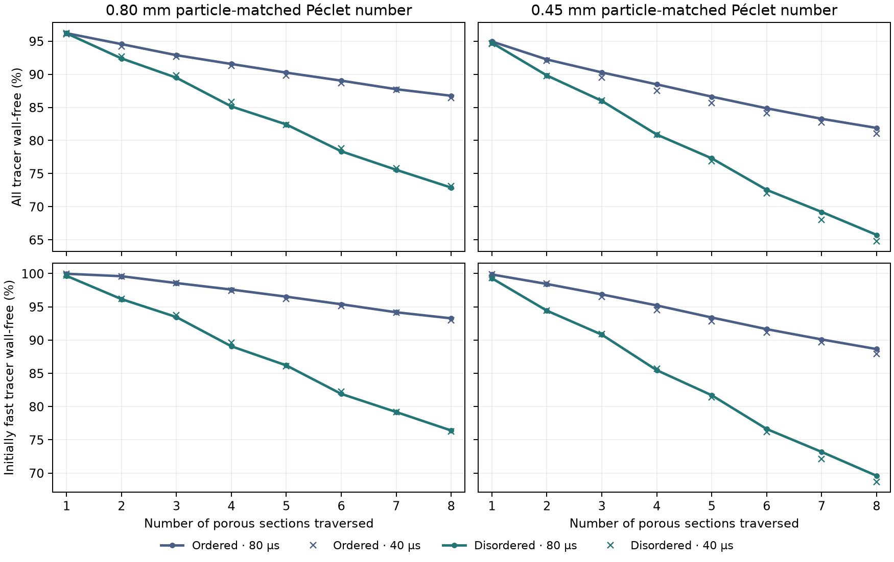

# Does a disordered packing reduce fast-path carbon bypass?

The earlier aligned geometry supported wall-free paths through
eight FCC repeats. This case compares that geometry with one
disordered packing in the same 11.113 mm by 1.389 mm by 1.389 mm
box. The disordered velocity field is solved across the whole
eight-section domain. Its geometry is periodic only at the outer
edges of the domain. The tracer enters and exits at one axial cut.
[Prior ordered tracer holdout](../repeated_geometry/REPORT.md)

## Matching the comparisons

Both domains contain 32 equal spheres of diameter 0.8 mm, with
8.57864234 × 10⁻⁹ m³ of continuous solid volume and nominal
void fraction 0.600. They have the same nominal external sphere
area and the same carbon mass at equal particle density. The
column-scale basis remains 7.032455155 g dry carbon. The synthetic
tracer treats each solid face as a perfect sink, so it measures
access to the external surface.

The disordered geometry starts from FCC and uses 2,500 seeded
hard-sphere displacement sweeps with periodic minimum-image
distances. The minimum gap is 20.08 µm in the resulting packing.
The transverse domain is one reference cell wide, so the
comparison describes a narrow, periodically bounded sample and
one disordered realization.
[Declared protocol](protocol.md)

The native flow uses OpenLB 1.9r0 D3Q27 with stock TRT,
Kupershtokh forcing, BounceBack walls and sphere indicators.
Axial interstitial velocity is matched to approximately
0.012798 m/s. Mean transverse velocity is driven toward zero.
After reducing the lattice time step, each accepted field is
checked against an independently rasterized sphere mask. The
existing Julia face projection preserves native throughput and
locally balances each pore voxel before tracking.
[OpenLB 1.9](https://www.openlb.net/download/)

Both particle labels use the same synthetic sphere geometry.
The 0.80 and 0.45 mm labels refer to two diffusivities chosen to
match the archived particle-scale Péclet numbers using each
field's measured interstitial speed. The new trajectories
measure the response of path exchange to geometry directly.
Each run injects 8,192 flux-weighted markers. The fastest
90% by first-section inert transit form the initially fast
cohort. Wall-free survival counts markers reaching a seam
without any sampled solid-wall hit.

## Native hydraulic verification

The high-Mach pilot fields were used to initialize lower-time-step
runs. The accepted native fields had the following diagnostics.
Velocity mismatch includes all three components relative to the
target axial interstitial velocity.

| Packing and grid | Voxel void fraction | Velocity mismatch | Maximum lattice Mach | Maximum fractional density departure |
|---|---:|---:|---:|---:|
| Ordered N64 | 0.600220 | 0.0764% | 0.0157 | 0.000458 |
| Disordered N48 | 0.599904 | 0.1755% | 0.0348 | 0.001191 |
| Disordered N64 | 0.599996 | 0.0642% | 0.0346 | 0.001178 |

The native axial gradient changed by 0.83% between the two
disordered grids. At N64 the voxel solid volume differed by
0.056% between the two packings. The continuous sphere volume is
identical. The Péclet numbers are 24,985.45 and 14,054.32 for
the 0.80 and 0.45 mm conditions respectively.

At matched N64 the inlet throughputs were 1.48124 × 10⁻⁸ and
1.48106 × 10⁻⁸ m³/s for ordered and disordered. The N64
disordered handoff changed the raw face rates by 0.742% RMS
and preserved the three directional throughputs to 2.52 × 10⁻¹⁴
relative to axial flow. The maximum cell imbalance was
4.60 × 10⁻¹⁴ of the largest face rate. Both disordered meshes
used the original axial origin as their common forward-flowing cut.
At N64 the disordered section void fractions ranged from 0.552 to
0.632, and even the most similar pair of sections differed in
28.7% of voxel occupancies. The 21.7 µm voxel width is comparable
to the smallest 20.1 µm sphere gap.

## Eight-section wall tracer

These are the matched N64 results at 80 µs. Percentages are
fractions of the population in each column.

| Particle-matched condition | Packing | All tracer wall-free at outlet | Initially fast tracer wall-free at outlet | Initially fast tracer still fast in all eight sections |
|---|---|---:|---:|---:|
| 0.80 mm | Ordered | 86.76% | 93.27% | 86.64% |
| 0.80 mm | Disordered | 72.89% | 76.40% | 51.47% |
| 0.45 mm | Ordered | 81.90% | 88.65% | 81.60% |
| 0.45 mm | Disordered | 65.75% | 69.59% | 50.77% |

In the disordered packing, about half of the initially fast
tracer stayed in the fastest 90% in every section. That share
was above 80% in the ordered packing. Capture from the incoming
survivors was nearly the same in section 1 for the two packings
at each Péclet number. By section 8 it was 3.55% versus 1.13%
for 0.80 mm and 5.01% versus 1.66% for 0.45 mm, with the
disordered value first. The main difference accumulated over
the later sections. Median inert exit time increased from
0.741 to 0.822 s and from 0.749 to 0.827 s.

The disordered packing increased access to carbon for the fast
cohort. Among the initially slowest 10%, wall-free passage
rose from 28.1% to 41.3% and from 21.1% to 31.1%. Disorder
changed which routes encountered the wall as well as increasing
total capture.

## Numerical sensitivity

The 80 µs comparison between disordered N48 and N64 changes
the initially fast wall-free profile by up to 4.25 and 4.04
percentage points. Total wall-free survival changes by up to
4.17 and 3.85 points. Both exceed the 2-point grid screen.
The matched ordered N64 case differs from the archived N96
ordered case by at most 1.13 points. Refinement reduces the
estimated benefit of disorder, and both disordered meshes
still show substantially more wall contact than the ordered
reference. The sign is supported across the tested grids.
The reported outlet differences are grid-sensitive.

All cases recovered the entire inert tracer dose. At N64 the
0.80 mm time-step changes were at most 0.39 percentage points
for ordered and 0.79 for disordered. The first 0.45 mm ensembles
gave changes of 1.001 and 1.221 points. Adding 8,192 independently
seeded markers to each 0.45 mm run reduced the combined profile
changes to 0.49 and 0.66 points. Both met the 1-point time-step
screen in the expanded ensembles. The initial ensembles are
retained and supply the matched-grid comparison table.

The reduction in initially fast wall-free passage at 40 µs was
16.71 and 19.25 percentage points. The previously frozen
ordered model overpredicts the wall-free fast cohort in the
disordered packing by as much as 17.48 and 19.96 points across
cells 3–8. The disordered packing requires its own path-exchange
description even at matched carbon inventory and global Péclet
number.

The plotted markers use the matched 8,192-marker runs. The
expanded ensembles serve the separate time-step sensitivity
check.

## Verification and reproduction

Cohort `20261112T161615Z-52964a01` retains the sphere centres,
stock TRT fields, conservative face files, frozen tracer
commands, initial and additional marker ensembles, and the
comparison. The calculations ran on macOS arm64 with GCC 15.2.0,
Python 3.12.9 and Julia 1.11.6. OpenLB archive verification
checked 2,070 original files. Both Python mesh tests and all
three Julia tracker assertions passed. Read-only replay verified
34 sources and 942 artifacts. The study stops at tracer
transport and external wall contact.
[Reproduction commands](README.md) · [Reference summary](reference_summary.json)
