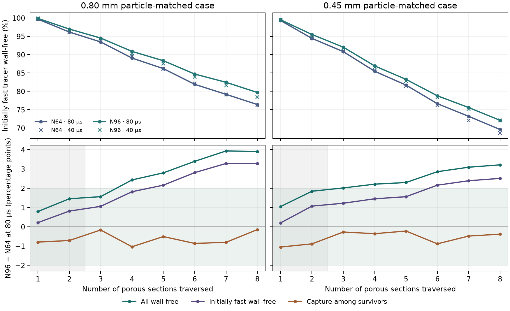

# Does the disordered tracer result meet the 2-point grid limit?

The preceding comparison found less wall-free passage in a
disordered sphere packing than in an ordered packing. The N48 to
N64 disordered profiles differed by up to 4.25 percentage points.
This refinement tests the same disordered geometry at N96.
[Prior ordered and disordered comparison](../disordered_packing/REPORT.md)

## Fixed physical case

The saved 32 sphere centres, sphere diameter, transverse extent,
and original forward-flowing tracer inlet define the geometry.
The axial length is 11.113 mm across eight distinct sections.
Both disordered meshes represent the same continuous sphere volume
of 8.57864234 × 10⁻⁹ m³ and share the 7.032455155 g column-scale
dry carbon basis. The two particle-matched tracer conditions use
Péclet numbers of 24,985.45 and 14,054.32 based on the reference
section length and measured axial interstitial speed.
[Protocol](protocol.md)

The 768 × 96 × 96 lattice uses the same external stock
OpenLB 1.9r0 D3Q27 TRT application, with Kupershtokh forcing,
BounceBack walls, and the stock sphere indicators. Periodic
trilinear interpolation of the N64 moments initializes the N96
lattice at relaxation time 0.58. All flow and tracer inputs are
drawn from the separately converged N96 field. [OpenLB](https://www.openlb.net/)

## Native flow verification

The N96 voxel width is 14.47 µm. The OpenLB material mask
agreed exactly with independent sphere rasterization and contains
4,246,790 liquid voxels. The voxel void fraction is 0.600008 at
N96 and 0.599996 at N64. The resulting voxel solid volumes
differ by about 0.0030%, with identical continuous carbon volume.

The stock TRT calculation converged in 17,480 steps. Maximum
lattice Mach was 0.03459, maximum relative density departure
was 0.001194, and the interstitial velocity-vector mismatch
was 0.0401% of the target. The N96 axial carrier flow was
1.48145 × 10⁻⁸ m³/s.

## Conservative face handoff

The original face projection minimizes the squared correction to
the native face rates subject to zero net flow in each pore voxel
and preservation of the three carrier throughputs. A multilevel
preconditioner accelerates the same graph solve. It reproduced
the archived N64 face rates within 6.7 × 10⁻¹⁵ of the largest
absolute face rate, against a 10⁻¹⁰ parity limit.

The N96 face correction was 0.361% RMS. The largest cell
imbalance was 2.84 × 10⁻¹⁴ of the largest face rate and the
largest plane-throughput error was 4.45 × 10⁻¹⁴ of axial flow.
The original axial cut remained forward-flowing on N96.

At each mesh, the Julia tracker uses 8,192 markers at the same
inlet seeds for both 80 and 40 µs. The fastest 90% by first-section
inert transit define the fast cohort. The grid criterion is a
maximum absolute difference of two percentage points over
sections 3–8 in total wall-free survival, conditional capture
among incoming survivors, or initially fast wall-free survival.
The 80 µs result is the primary grid comparison.

## Primary grid comparison

| Particle-matched case | Total wall-free at outlet, N64 → N96 | Initially fast wall-free at outlet, N64 → N96 | Max total survival change | Max conditional capture change | Max initially fast survival change |
|---|---:|---:|---:|---:|---:|
| 0.80 mm | 72.89% → 76.79% | 76.40% → 79.68% | 3.93 pp | 1.04 pp | 3.28 pp |
| 0.45 mm | 65.75% → 68.96% | 69.59% → 72.10% | 3.21 pp | 0.88 pp | 2.51 pp |

The finer disordered mesh predicts more wall-free passage in
both cases. At 80 µs the two survival metrics exceed the
2-percentage-point limit for each case. The conditional capture
differences are within the limit.

| Particle-matched case | Matched tracer time step | Max total survival change | Max conditional capture change | Max initially fast survival change | 2-point grid screen |
|---|---:|---:|---:|---:|---|
| 0.80 mm | 40 µs | 2.88 pp | 1.04 pp | 2.44 pp | Exceeded |
| 0.45 mm | 40 µs | 4.14 pp | 1.28 pp | 3.42 pp | Exceeded |

The disordered mesh refinement exceeds the 2-point grid screen
for both particle-matched cases at both time steps. All four
N96 runs recovered the full inert tracer dose. At 80 µs the
archived ordered N96 fast wall-free fractions are 93.77% and
88.82%, compared with the new disordered 79.68% and 72.10%.
The direction of the observed geometry effect holds at N96.
Its precise magnitude remains sensitive to the disordered grid.
[Archived ordered N96 tracer](../repeated_geometry/REPORT.md)

## Time-step sensitivity

At N96 the 0.45 mm 80-to-40 µs profile changes are at most
0.58 percentage points. The first 0.80 mm ensembles differed
by up to 1.21 points. An additional 8,192 markers at each time
step reduced the 0.80 mm combined maximum to 0.86 points.
Both satisfy the 1-point time-step screen with the expanded
0.80 mm ensemble. The grid comparison uses the original
matched 8,192-marker runs at both meshes.

The green band in the lower panels is the grid tolerance.
The shaded first two sections are outside the comparison window.

## Verification and reproduction

Cohort `20261112T171431Z-193be93e` retains the native initial
and converged fields, N64 projection parity check, matched tracer
commands, and original and additional marker records. The native
run reused the archived external executable. OpenLB source
verification checked 2,070 original files. The N96 tracer plan
was frozen with SHA-256
`9f257fb041a71e82a30b56d4181f29bd8452dc878ac94ba67e0f5612c9535c9d`.
Two Python mesh tests and three Julia tracker assertions passed.
Read-only replay verified 40 sources and 277 artifacts. The
study stops at tracer transport and external wall contact.
[Reproduction commands](README.md) · [Reference summary](reference_summary.json)
