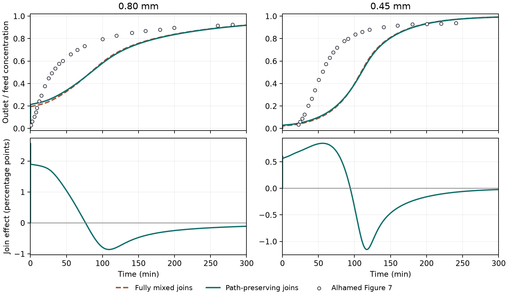

# Does mixing between repeats explain the late phenol breakthrough?

This comparison reruns the [fixed-carbon N160 column](../disordered_memory_column/REPORT.md)
and changes the flow routing only at the joins between its eight-section
repeats. The 0.80 mm bed has nine repeats and the 0.45 mm bed has sixteen.
Both use 7.032455155 g of dry carbon, the batch-qualified particle
diffusivity, the source isotherm, the same film coefficient and the same
wall-weighted contact area in each section.

## Join scenarios

At a fully mixed join, the next repeat receives the flow-weighted average
of the preceding repeat's outlet concentrations. At a path-preserving
join, each outgoing state is sent to the state with the same local
transit-time rank and within-class age rank at the next inlet. Both joins
use the same first-section conditional delays and the same downstream
exchange rules. They also preserve each state's water flow and the total
liquid hold-up. The first repeat uses the original feed in both runs.
The rank map is a sensitivity scenario for persistent paths in the
synthetic bed. [Protocol](protocol.md)

The existing Julia solver takes the path-preserving arrangement as
one continuous section sequence. Its film, particle and liquid equations
are shared by both cases. The analytical two-path test verifies the
outlet curves and inert variance for both join rules. The archived
mixed column curves and inventory histories are reproduced before
comparison. Both predicted curves are frozen before reading the markers.
[Alhamed, Figure 7](https://doi.org/10.1016/j.jhazmat.2009.05.002)

## Inert tracer

The mean transit time stayed at 5.56 s for both joins and both sizes.
The change in routing increased the arrival-time variance of the full
column.

| Particle size | Mixed variance (s²) | Path-preserving variance (s²) | Increase |
|---|---:|---:|---:|
| 0.80 mm | 0.2362 | 0.3165 | 34.0% |
| 0.45 mm | 0.1247 | 0.1696 | 36.0% |

The numerical variances agreed with the analytical delay-network
moments within 0.07%. The outlet recovered the full inert tracer dose
in all four runs.

## Phenol breakthrough

| Particle size | Fully mixed midpoint | Path-preserving midpoint | Figure 7 midpoint | Shift with path preservation |
|---|---:|---:|---:|---:|
| 0.80 mm | 83.57 min | 84.13 min | 30.75 min | +34 s |
| 0.45 mm | 109.06 min | 109.89 min | 55.36 min | +50 s |

Preserving path memory makes both midpoints slightly later. The
remaining midpoint errors are 53.38 and 54.53 min, so the tested
join change accounts for less than a minute of the discrepancy and
moves it in the wrong direction. The results apply to the
rank-preserving map and fixed wall-contact and particle assumptions.
The physical path connections between repeats remain unverified.

The 0.45 mm 5% crossing moves from 30.11 to 25.16 min, closer to the
digitized 23.54 min. It passes the 25% early-crossing limit. At
0.80 mm, the 5% crossing is 4.85 s with path preservation and 4.97 s
with full mixing, with a digitized value of 101.57 s. Overall curve
RMSE changes from 0.182 to 0.179 and from 0.307 to 0.304 for 0.80 and
0.45 mm, respectively. Both joins fail the 0.10 RMSE and 20% midpoint
screens for both sizes.

The lower panels show the path-preserving curve minus the fully mixed
curve in percentage points of feed concentration.

## Reproduction

Matched refinement from 24 to 48 radial shells, 8 to 4 s steps after
startup and 20 to 10 ms steps during startup passed for each size and
join. The crossing times changed by at most 0.34%. The normalized
phenol balance residual was below 4.1 × 10⁻¹³ in the four selected
runs. Read-only replay of run `20261116T160738Z-2328c4c8` verified 26
source hashes and 9 artifacts.
[Commands](README.md) · [Compact record](reference_summary.json)
