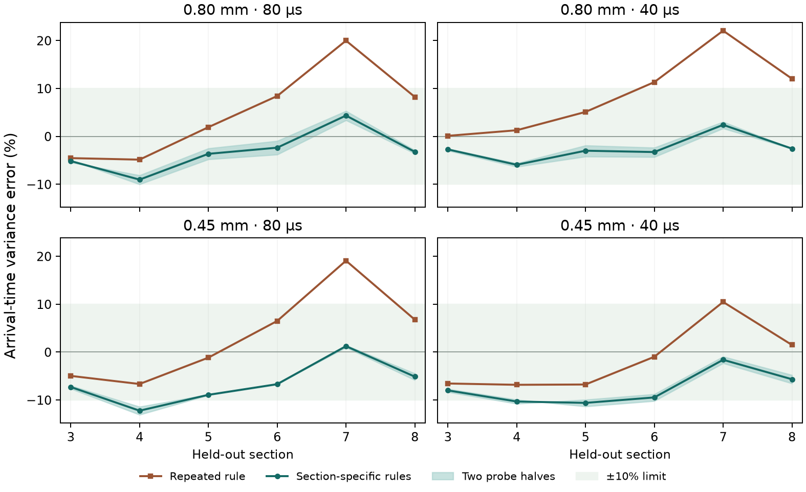

# Can section-specific rules predict tracer spreading?

The [stationary model](../disordered_exchange/REPORT.md) repeated the
section 1→2 exchange rule down the bed. Its largest arrival-time
variance errors were 10.47–22.06%. The [variance audit](../disordered_exchange/VARIANCE_AUDIT.md)
identified changes in path exchange and transit times as the main
contributors near section 7. This run tests whether local rules
derived from the saved flow are sufficient to meet the 10% variance
limit at every downstream section.

## Model and holdout

The probes reuse the eight-section synthetic packing and the saved
balanced OpenLB 1.9r0 D3Q27 TRT flow. The dry carbon basis stays
7.032455155 g and the balanced throughput is 1.48433617 × 10⁻⁸ m³/s.
The 0.80 and 0.45 mm particle-matched cases retain Péclet numbers
24,985.45 and 14,054.32 respectively, each tested at 80 and 40 µs.

Only the archived first two sections initialize the reduced model
and calibrate its stationary comparison. For each condition, 16,384
fresh flow-weighted tracers supply the section-specific rules.
The ten classes describe local transit-time rank, with the fastest
tenth in the first class. For each adjacent pair of sections, the
rule gives the fraction moving from each donor class into each receiver
class and the first two moments of time spent in the receiving section.
Julia carries tracer mass and the first two arrival-time moments down
the bed. Tracers of different ages in the same donor class receive the
same probabilities and delay moments. [Protocol](protocol.md)

The probes sample the flow and geometry of sections 3–8. The original
arrivals at those sections were opened for scoring after the new
predictions and rules were frozen. This checks the composition of local
transport rules on one known packing.

## Results

The 10% limit applies at **every** held-out section. Error at the
worst section and at the outlet is signed relative to the archived
tracer variance.

| Particle-matched case | Tracer step | Repeated rule, max error | Section-specific max error | Worst section | Section 8 error | 10% limit |
|---|---:|---:|---:|---:|---:|---|
| 0.80 mm | 80 µs | 19.98% | 9.03% | 4 | −3.22% | Pass |
| 0.80 mm | 40 µs | 22.06% | 5.93% | 4 | −2.55% | Pass |
| 0.45 mm | 80 µs | 19.08% | 12.23% | 4 | −5.13% | Fail |
| 0.45 mm | 40 µs | 10.47% | 10.60% | 5 | −5.66% | Fail |

All probe markers reached the outlet. The reduced model conserved
tracer mass at every section, and the largest mean arrival error
was 0.59%, within the 5% limit.

Section-specific rules lowered the variance overprediction at section 7
from 10.47–22.06% to signed errors between −1.61% and +4.35%.
For 0.45 mm, the remaining error is an underprediction of arrival-time
spread around sections 4–5. Both independent halves of the fresh probes
exceeded the 10% limit for this condition at both time steps. The previous
variance audit identified travel-time memory as a contributor near
section 5. The current model still pools markers of different ages
within each path class, so the result leaves that mechanism open.
An outlet-only check would have passed all four cases and missed the
interior error. The reduced tracer model remains unqualified across both
sizes. This run covers inert tracer transport.

## Reproduction

Run `20261113T173037Z-5d62c7c1` used 65,536 fresh tracer trajectories
in total. Read-only replay verified 36 source hashes and 142 artifacts.
The Julia analytical model test and the Python variance-gate regression
passed. [Commands](README.md) · [Compact reference](reference_summary.json)
