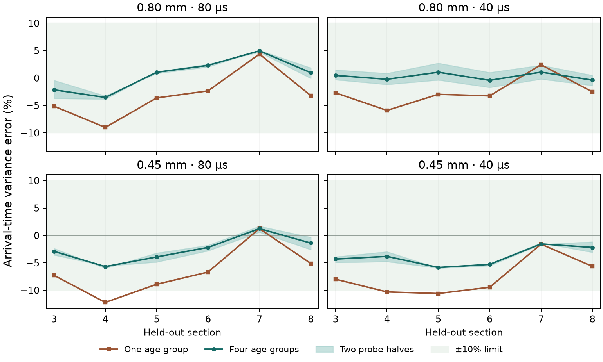

# Within-path travel-time memory passes the N160 variance screen

The [section-specific model](../disordered_section_exchange/REPORT.md)
underpredicted tracer spreading around sections 4–5 for the 0.45 mm
condition. We tested whether distinguishing tracers by their elapsed
time within each path class could recover that spreading.

## Geometry, calibration and holdout

The model uses the same eight-section N160 packing and saved
OpenLB 1.9r0 D3Q27 TRT flow. The carbon basis is 7.032455155 g, with
matched Péclet numbers 24,985.45 for 0.80 mm and 14,054.32 for
0.45 mm. Both cases use the archived 80 and 40 µs tracer time steps.

Archived sections 1–2 initialize the tracer mass and time moments
at section 2. Each of the original ten local transit-time path classes
is split into four groups, ranked by elapsed time from youngest to
oldest. The independent N160 tracer probes used in the previous study
provide local exchange probabilities and local transit-time moments for
each combination of path and age group. Their elapsed times supply
ranks. Julia predicts cumulative arrival moments by advancing the
initialized state through the six downstream rules. Markers in the same
age group still share the same transition and delay statistics.
[Protocol](protocol.md)

Collapsing the age groups recovers the previous section-specific
exchange counts and delay moments for each path pair. With one age
group the new model reproduces the previous predictions. The primary
four-group prediction was frozen before opening the archived sections
3–8 for scoring. The independent probes span that same geometry, so
this tests the ability to combine known local flow rules across one
packing. It measures agreement with inert tracer trajectories.

## Results

The maximum error is taken across all six held-out sections. The limits
are 10% for variance and 5% for mean arrival time.

| Particle-matched case | Tracer step | Previous variance error | Four age groups | Worst section with memory | Outlet variance error | Result |
|---|---:|---:|---:|---:|---:|---|
| 0.80 mm | 80 µs | 9.03% | 4.94% | 7 | +0.95% | Pass |
| 0.80 mm | 40 µs | 5.93% | 1.06% | 7 | −0.41% | Pass |
| 0.45 mm | 80 µs | 12.23% | 5.70% | 4 | −1.41% | Pass |
| 0.45 mm | 40 µs | 10.60% | 5.86% | 5 | −2.20% | Pass |

Tracer mass was conserved at every section. The largest mean arrival
error was 0.59%. The aggregate local delay distributions give the
same mean predictions as before. The age groups improve variance by
preserving part of the dependence between earlier travel time,
path exchange and later delays.

The two- and eight-group variants also pass every case. Their maximum
variance errors across all conditions are 8.32% and 4.70%, respectively.
At four groups, both independent probe halves pass all cases. The
largest error across the two halves and four conditions is 5.99%.
These comparisons check numerical sensitivity on the same packing.

## Reproduction

Run `20261116T153803Z-b1f18981` reuses the saved N160 field and probes.
The synthetic Julia test recovers the exact variance when an older
tracer cohort consistently takes longer through downstream sections.
Replay verifies 33 source hashes and 45 artifacts and reproduces all
four Julia rule and prediction outputs byte for byte.
[Commands](README.md) · [Compact reference](reference_summary.json)
