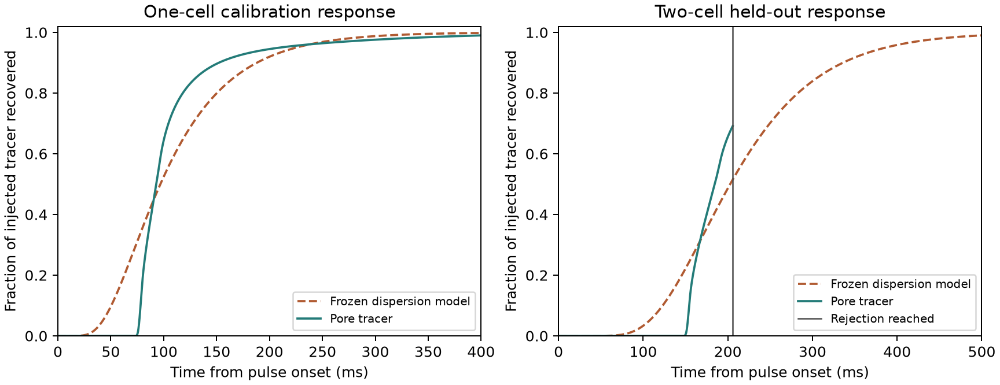

# Two-cell holdout for a one-cell axial dispersion coefficient

The [N384 one-cell outlet pulse](../porous_outlet_tracer/N384.md)
provided the calibration variance. The measured liquid volume,
saved TRT flow and physical segment length set the velocity.
The model uses a prescribed inlet solute flux and zero diffusive
outlet flux, matching the pore calculation. Its finite 4 ms inlet
pulse is included in the mean and variance.
[Residence-time method](https://www.sciencedirect.com/science/article/pii/0009250953800011)

The one fitted coefficient is 3.24979e-6 m²/s. The model matches
the one-cell exit variance of 0.00352487 s² by construction. Its
mean exit time is 110.548 ms, compared with 110.262 ms in the
one-cell tracer calculation. Its 5% arrival is 42.413 ms,
compared with 76.967 ms, and its cumulative-profile RMS error is
0.05615. The one-cell waveform remains a separate diagnostic.

The frozen two-cell prediction uses the same coefficient and
velocity, twice the volume and length, and the same inlet pulse.
Its predicted mean and variance are 219.096 ms and 0.0078292 s².
The pore holdout restores the archived seam flows between the
two repeated periods. The outer faces remain open. It uses N288
tracer cells per period and the archived 80 µs step. There is
no adsorption, fitted hydraulic property or DWSIM run.
[Prospective protocol](protocol.md)

## Two-cell result

| Observable | Pore tracer | Frozen dispersion model |
| --- | ---: | ---: |
| Time to 5% recovery (ms) | 152.725 | 107.302 |
| Time to 10% recovery (ms) | 154.332 | 123.035 |
| Recovery at 205.76 ms (% of injected mass) | 69.119 | 51.471 |

The frozen prediction failed the outlet-profile criterion. It
predicted the first 5% of the dose 45.42 ms too early, then
predicted a more gradual increase in recovered mass. At 205.76 ms,
the recorded portion of the curve alone gave a full-window RMS
error lower bound of 0.0300194 against the 0.030 limit. Even a
perfect match at every later sample would leave the error above
the limit. The run stopped at that predeclared point and provides
no two-cell pore-tracer mean, variance or late-tail comparison.

The maximum mass balance residual was 2.40e-15 of the injected
mass. Concentrations stayed within the physical bounds to roundoff.
Flow was 1.48238e-8 m³/s through both repeats. These checks support
using the simulated pulse for the profile comparison. The variance
fit from one cell is insufficient for predicting arrival and the
shape of the outlet response over two cells at this operating point.
The coefficient is therefore unqualified for breakthrough predictions
in this synthetic case.

## Reproduction and checks

Cohort `20261112T033234Z-32e27f5e` ran on an Apple M3 Max with
Julia 1.11.6. The pore solver used ten Julia threads and ran for
about 26 minutes. It retained 2,573 samples of the 21,711 planned.
Read-only replay verified 25 sources and 41 artifacts. The Julia
open transport and independent inlet/outlet reference checks passed
all 31 assertions. See the [run guide](README.md) and the
[compact reference summary](reference_summary.json).
