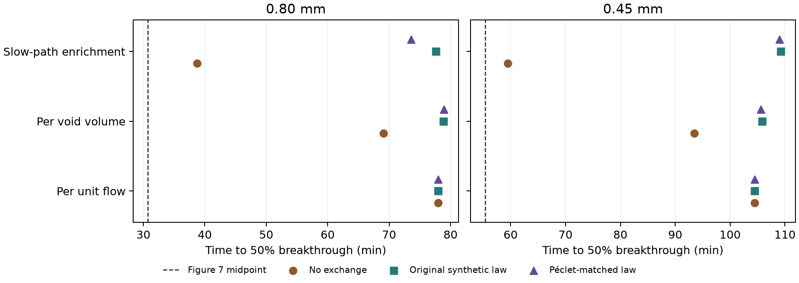

# Separating carbon allocation and exchange in the Figure 7 comparison

The [original unfitted column model](../exchange_column/REPORT.md)
predicted 50% breakthrough 48.10 and 50.47 min late for the 0.80 and
0.45 mm beds. The crossed comparison isolates the effects of the carbon
allocation and the path-exchange law within that model. All predictions
used 7.032455 g of dry carbon, 4.057917 mL of pore liquid, the same
flow, and the same equilibrium, film correlation and batch particle
diffusivity. Both Figure 7 curves were scored after freezing the cases.
[Alhamed (2009)](https://www.sciencedirect.com/science/article/pii/S0304389409007687)

## Scenarios

The original allocation assigns equal carbon per unit void volume. The
flow-proportional scenario assigns equal carbon per unit throughput. The
slow-path enrichment scenario weights the original carbon fractions by
one more factor of the local transit time and renormalizes them. This
keeps the full carbon inventory active and leaves the carrier flow and
liquid hold-up of each path fixed.

| Carbon allocation | Carbon in fastest 10% of flow | Carbon in slowest 10% of flow | Implied local voidage range |
| --- | ---: | ---: | ---: |
| Per void volume | 6.93% | 23.03% | 0.427 |
| Per unit flow | 10.00% | 10.00% | 0.338–0.820 |
| Slow-path enrichment | 3.68% | 47.81% | 0.137–0.586 |

Each allocation was crossed with zero exchange, the original synthetic
transition law and a Péclet-matched law. New marker pairs used the
same saved TRT velocity field and pore geometry. Their reference-field
diffusivity was 7.115e-10 or 1.265e-9 m²/s to reproduce the target
column-period Péclet number for 0.80 or 0.45 mm. This changes the rank
transitions while preserving the common one-period delay distribution.
The same geometry and stationary transition assumption apply across the
bed. The calculation tests sensitivity to the advective-to-diffusive
ratio within the synthetic field. The experimental path geometry,
exchange law and local carbon allocation remain unmeasured.
[Correlated pore transit times](https://agupubs.onlinelibrary.wiley.com/doi/abs/10.1029/2011WR010457)

## Breakthrough midpoint

| Particle size | Carbon allocation | Zero exchange (min) | Original exchange (min) | Péclet-matched exchange (min) |
| --- | --- | ---: | ---: | ---: |
| 0.80 mm | Per void volume | 69.08 | 78.84 | 78.88 |
| 0.80 mm | Per unit flow | 77.98 | 77.98 | 77.98 |
| 0.80 mm | Slow-path enrichment | 38.73 | 77.60 | 73.56 |
| 0.45 mm | Per void volume | 93.45 | 105.83 | 105.59 |
| 0.45 mm | Per unit flow | 104.48 | 104.48 | 104.48 |
| 0.45 mm | Slow-path enrichment | 59.52 | 109.25 | 109.02 |

The digitized midpoints are 30.75 and 55.36 min. With the original
allocation, Péclet matching moves the predictions by +0.04 and −0.24 min,
within the observed refinement change. Zero exchange alone brings the
midpoints forward by 9.76 and 12.38 min. With the original exchange
law, concentrating carbon in slow paths shifts the midpoints by −1.24
and +3.42 min. With zero exchange, that same redistribution advances
the midpoints by 30.36 and 33.93 min relative to the void-proportional
allocation. The effect of allocation depends strongly on the amount of
exchange between paths.

The closest scenario concentrates nearly half the carbon in the paths
carrying the slowest tenth of the flow and keeps those paths separate.
Its remaining delays are 7.98 and 4.16 min. Its Figure 7 marker RMSEs
are 0.0855 and 0.0847, both within the 0.10 screen. Only the 0.45 mm
midpoint passes the 20% screen. The 0.80 mm midpoint is still 26.0%
late. The combination is a fixed sensitivity with an extreme implied
local voidage and a persistent flow separation assumption. It gives a
mechanism by which the model can produce much earlier breakthrough.
It leaves the actual experimental contact pattern and service time
unqualified.

## Verification and reproduction

All four 65,536-marker runs recovered every pair. The largest change
with a half time step was 0.00168 in cumulative fraction, 1.53% in time
to 99% recovery and 0.613% in variance. The carbon-allocation extension
reproduced the parent solver in a controlled test. Redistributing
carbon preserved the liquid volumes and the inert tracer response.

Cohort `20261112T095114Z-99e65489` evaluates 18 column scenarios, with
four archived results and 30 new forward solves including refinements.
The final refinement changed midpoints by at most 20.12 s and the
normalized outlet fraction by at most 0.00414 after startup. The largest
normalized phenol mass residual across the reported scenarios was
2.91e-11. Read-only replay verified 29 sources and 77 artifacts. The
score uses midpoint and curve error for this sensitivity. No column
parameter was fitted, and no new OpenLB hydraulic or DWSIM case ran.
[Run and replay guide](README.md) · [Compact record](reference_summary.json)
