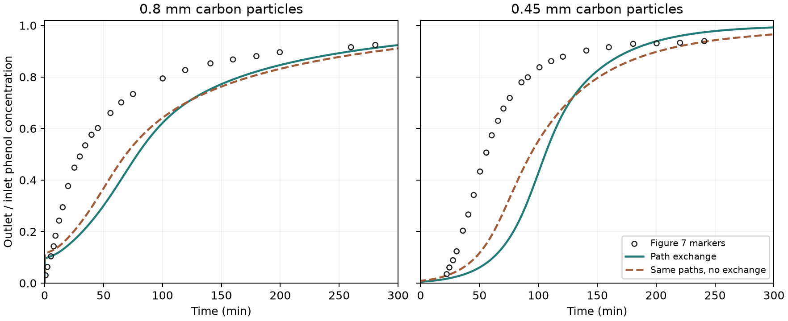

# Unfitted Figure 7 predictions with path exchange and particle uptake

Can a transport model derived from the pore tracer and a particle model
checked against batch data predict phenol breakthrough for both date-stone
activated carbon sizes? Both experimental curves are comparisons against
frozen predictions. Their markers and the paper's fitted dispersion
parameters supply no inputs to the calculation.
[Alhamed (2009), Figure 7](https://www.sciencedirect.com/science/article/pii/S0304389409007687)

## Carrier flow, contact and particle uptake

The [qualified tracer calculation](../path_exchange/REPORT.md) supplies
the one-cell delay distribution and the pairing of first- and second-period
time ranks from the saved stock OpenLB TRT field. Forty path classes retain
the flow shares and mean transit. For two ideal delay periods, grouping
changes the outlet cumulative fraction by at most 0.00480, the 99% recovery
time by 0.802%, and the variance by 0.514%, relative to the ungrouped
exchange prediction. The 20-class option missed the cumulative error limit.

Let \(n_{ij}\) be the number of archived marker pairs transferring from class
\(i\) to class \(j\) and \(N_m\) the number of pairs. The inter-period
flow is \(Q_{ij}=Qn_{ij}/N_m\). Incoming liquid concentrations are mixed
using these flows. Each class \(i\) holds liquid volume \(Q_i T_i\), where
\(T_i\) is its mean transit time. Dry mass is distributed in the same
proportion as liquid volume. This assumes a common local solid-to-liquid
ratio across all paths. For a control volume with liquid volume \(V\)
and dry mass \(M\), the backward Euler update satisfies

```math
V(C^{n+1}-C^n)+M(\bar q^{n+1}-\bar q^n)
=\Delta t\,Q_i(C_{\mathrm{up}}^{n+1}-C^{n+1}).
```

The [batch-qualified spherical particle operator](../film_particle/REPORT.md)
uses the same Langmuir equilibrium and effective intraparticle diffusivity
of 1.84603549e-12 m²/s. The column film coefficient comes from the previously
declared Wakao-form correlation, using superficial velocity and a multiplier
of one. The shaken-bath film coefficient is retained in the input record
with its original role.

The source inputs are 150 mg/L feed, 43.8 mL/min, a 10 cm bed of
11 mm internal diameter, and voidage 0.427. The reported bulk density
of 740 kg/m³ implies 7.0325 g dry carbon and the void volume is 4.0579 mL.
The dry mass is a density-derived inventory. All of it participates in
the uptake model. The nominal liquid residence time is 5.559 s.

The normalized delays and rank transitions from the synthetic FCC tracer
are applied repeatedly along the column. The period length scales with
particle diameter, and delay units follow the reported void residence
time. Repeating one transition law over many periods and transferring
it across the two diameters, voidage and Peclet numbers are modeling
assumptions. The two-period tracer result qualifies the synthetic flow
study. It supplies no direct measurement of the experimental column's
contact pattern or particle surface exposure.
[Pre-scoring protocol](protocol.md)

## Comparison with both particle sizes

| Diameter | Measure | Digitized Figure 7 | With path exchange | Same paths with zero exchange |
| --- | --- | ---: | ---: | ---: |
| 0.80 mm | Time to 5% of feed (min) | 1.69 | 0.079 | 0.071 |
| 0.80 mm | Time to 50% of feed (min) | 30.75 | 78.84 | 69.08 |
| 0.80 mm | Fraction RMSE | — | 0.197 | 0.166 |
| 0.45 mm | Time to 5% of feed (min) | 23.54 | 45.63 | 32.41 |
| 0.45 mm | Time to 50% of feed (min) | 55.36 | 105.83 | 93.45 |
| 0.45 mm | Fraction RMSE | — | 0.316 | 0.242 |

Both exchange predictions fail the 0.10 RMSE and 20% midpoint-error
criteria. Both also fail the 25% early-breakthrough criterion. For
0.80 mm, the digitized early crossing is particularly sensitive to image
resolution and interpolation from the assumed clean-bed origin. The
chosen reading scenarios span 0.36–3.43 min. The calculation predicts
4.74 s. For 0.45 mm, the corresponding range is 21.63–25.45 min. The
reported reading ranges describe the digitization sensitivity.



The model gives the observed ordering of the midpoints. It predicts that
both beds reach half the feed concentration about 48–50 min too late.
Holding particle uptake and solid allocation fixed, exchange delays
the midpoint another 9.8 min for 0.80 mm and 12.4 min for 0.45 mm and
increases the curve error compared with the same paths without exchange.
The inert-tracer result and the failed breakthrough comparison test
different contact assumptions. The physical source of the discrepancy
remains unresolved. Treated volume and service energy remain unqualified.

## Numerical verification and execution

| Diameter | Periods | Period Peclet | Maximum outlet fraction change | Change in 5% time | Change in 50% time |
| --- | ---: | ---: | ---: | ---: | ---: |
| 0.80 mm | 72 | 24,985 | 0.00476 | 0.112% | 0.066% |
| 0.45 mm | 128 | 14,054 | 0.00167 | 1.071% | 0.091% |

The saved tracer period Peclet was 17,778. The column film coefficients
were 4.541e-5 and 5.846e-5 m/s for the two sizes. All six forward runs
preserved concentration and loading bounds. The maximum total mass
residual was 2.90e-11 of the introduced phenol and the maximum normalized
film/radial flux mismatch was 3.36e-15. All 10 coupling assertions and
51 existing film/particle assertions passed. The numerical checks
support interpreting the difference with Figure 7 as a model comparison.

The first bridge launch had an incorrect Julia module reference and
stopped before solving. Initial constant-step runs exposed an unresolved
startup for 0.80 mm. Shorter steps in the first 24 s and a joint mesh
refinement resolved the transient without changing physical parameters.
Cohort `20261112T080827Z-1b52e000` was frozen before scoring and passed
read-only replay of 32 sources and 41 artifacts. It used Julia 1.11.6
through JuliaCall and executed zero new OpenLB or DWSIM cases.
[Run and replay guide](README.md) · [Compact numerical record](reference_summary.json)
