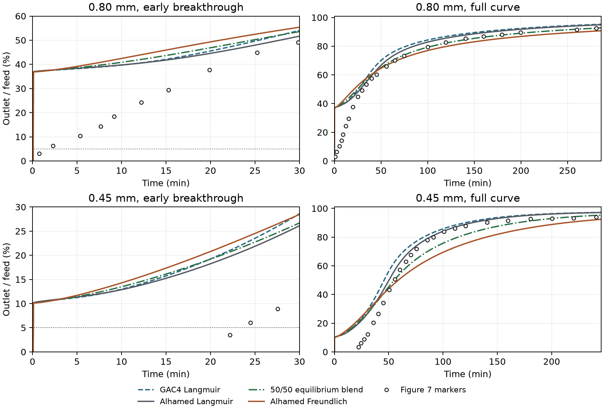

# Figure 7 particle-size transfer and equilibrium sensitivity

The four batch-supported material cases all predict 5% breakthrough
at about five seconds. Figure 7 gives **1.69 minutes** for 0.80 mm
particles and **23.54 minutes** for 0.45 mm. The equilibrium laws and
their associated kinetics affect the retained mass much more than
first arrival. None passes the complete comparison at both sizes.
[Alhamed (2009), Figure 7](https://doi.org/10.1016/j.jhazmat.2009.05.002)

## Fixed conditions and source inputs

The 10 cm bed has an 11 mm diameter, reported void fraction 0.427,
43.8 mL/min flow, and 150 mg/L phenol feed. Both predictions use
7.032455 g dry carbon from the paper's bulk density and nominal bed
volume. The per-size weighed inventories and experimental pressure
losses are unavailable. The size-specific tracer inputs reuse a
synthetic stock TRT flow with matched section Péclet numbers of
24,985 and 14,054. The Julia model carries the original contact
allocation, fluid-film correlation, delay rules and mixed joins.
The tracer verification applies to that synthetic packing.
[Transit-time verification](../disordered_travel_memory/REPORT.md)
· [Prior column model](../disordered_memory_column/REPORT.md)

Each axial section gives half its carbon direct film access and the
other half a common extra resistance of 2.180223 × 10⁶ s/m.
This illustrative resistance is transferred from the preceding
bed-depth study. The slow-to-direct film ratios are 0.0100 and
0.00779 for 0.80 and 0.45 mm. The prescribed carbon mass stays in
the calculation and both cohorts can take up phenol.
[Common access transfer](../carbon_access_transfer/REPORT.md)

The fixed material cases give 99.2, 106.4, 129.8 and 153.2 mg/g
equilibrium loading at the feed concentration. The GAC4 plateau
comes from the reported 2019 fit and uses the original Langmuir
particle kinetics. The blend weight comes from the two Figure 5
calibration beds. The Freundlich and blended diffusivities come
from their respective qualified batch inputs. Figure 7 was used
only to score the sealed forecasts.
[2019 capacity sensitivity](../breakthrough_hypotheses/batch/REPORT.md#capacity-sensitivity-using-the-reported-gac4-plateau)
· [Earlier blend selection](../breakthrough_hypotheses/batch/conditional/README.md)

## Results against Figure 7

Retention includes dissolved and adsorbed phenol through the last
marker of each series. RMSE is measured in outlet/feed fraction.

| Size | Material case | 5% crossing (s) | 50% crossing (min) | Retained (mg) | Curve RMSE |
| --- | --- | ---: | ---: | ---: | ---: |
| 0.80 mm | Published | 101.57 | 30.75 | 432.44 | — |
| 0.80 mm | GAC4 Langmuir | 4.90 | 25.44 | 334.19 | 0.142 |
| 0.80 mm | Alhamed Langmuir | 4.90 | 27.79 | 355.69 | 0.139 |
| 0.80 mm | 50/50 blend | 4.90 | 24.67 | 396.97 | 0.141 |
| 0.80 mm | Alhamed Freundlich | 4.90 | 21.08 | 425.31 | 0.148 |
| 0.45 mm | Published | 1412.24 | 55.36 | 473.78 | — |
| 0.45 mm | GAC4 Langmuir | 5.31 | 45.81 | 377.93 | 0.103 |
| 0.45 mm | Alhamed Langmuir | 5.31 | 50.27 | 402.52 | 0.078 |
| 0.45 mm | 50/50 blend | 5.32 | 55.10 | 473.49 | 0.085 |
| 0.45 mm | Alhamed Freundlich | 5.32 | 58.89 | 532.30 | 0.114 |

The experimental crossings are interpolated from the Figure 7
markers. All predicted early crossings lie below their respective
±2-pixel reading ranges of 21.72–205.58 s and 1297.51–1526.96 s.
Both sizes have a nominal liquid residence time of 5.56 s, close
to the simulated early crossings. For 0.45 mm,
the blend matches the midpoint and final retention, and passes the
0.10 RMSE check. It retains 206.91 mg after the experimental midpoint
versus 167.53 mg from the markers. Agreement in the final
inventory comes from opposite deviations before and after
the midpoint.

## Clean-bed check

The additional check sets every carbon surface concentration to zero.
This maximizes uptake at the given film conductance. In each section,
the saved carrier transition moves the liquid between paths, and a
path's outlet is attenuated by `1/(1 + k A/Q)` using its assigned area
and flow. Mixed joins repeat the eight-section calculation across
the bed. The inert calculation returns all injected mass.

| Size | Direct-access assumption | Minimum clean escape with saved contact (%) | Clean escape with conductance proportional to flow (%) |
| --- | --- | ---: | ---: |
| 0.80 mm | Half direct, half slow | 36.84 | 28.04 |
| 0.80 mm | All direct | 19.17 | 8.24 |
| 0.45 mm | Half direct, half slow | 10.10 | 5.52 |
| 0.45 mm | All direct | 2.22 | 0.34 |

At fixed total conductance, the flow-proportional limit is
`(1 + k A/(Q N))^(-N)` for `N` sections. It allocates the same
conductance per unit flow to every path. For 0.80 mm, even this ideal
allocation with full access requires **at least 20.4% more total film
conductance** to reach 5% clean escape. The saved contact distribution
gives higher escape. For 0.45 mm, full access makes sub-5% clean escape
possible. The archived full-access Langmuir forecast for that size
reaches 5% at 30.11 min. With the fixed half-direct scenario it reaches
5% in five seconds. These are bounds and sensitivities of the adopted
transfer model. The initial liquid contact and film conductance give
the next quantities to verify independently at the Figure 7 conditions.
[Earlier full-access and half-access results](../carbon_access/REPORT.md)

## Usable water and bed-friction pumping

The actual archived DWSIM pump calculations use the same 43.8 mL/min
flow and dry mass. Their synthetic bed is 14.325 cm long at 0.60
porosity. The experimental service times are for a 10 cm bed at
reported porosity 0.427. The energy below combines the measured
curve crossings with the modeled bed-friction head. The shaft
energy per volume is the saved power divided by flow.
[Verified DWSIM pump calculations](../column_transport/REPORT.md)

| Size | Water before 5% breakthrough | Figure-reading range | Bed-friction shaft energy through 5% | Shaft energy per volume |
| --- | ---: | ---: | ---: | ---: |
| 0.80 mm | 74.1 mL | 15.9–150.1 mL | 0.0305 J | 0.114 Wh/m³ |
| 0.45 mm | 1.031 L | 0.947–1.115 L | 1.317 J | 0.355 Wh/m³ |

At the published operating point the smaller particles treat about
**14 times** as much water before the cutoff, with a **3.10 times**
greater bed-friction energy per volume in the synthetic pump case.
The service volume advantage persists across the two marker-reading
ranges. The marker ranges characterize digitization sensitivity.
The eight model forecasts give only about 3.6 and 3.9 mL before
the cutoff. They leave the predicted service-volume advantage and
associated cycle energy unqualified.

## Numerical checks

All eight cases pass numerical refinement at 48 radial shells,
4 s main step and 10 ms startup step. The maximum normalized phenol
balance residual is 1.04 × 10⁻¹² and the maximum interface mismatch
is 2.51 × 10⁻¹². The 0.80 mm Langmuir case reproduces the
archived half-access outlet and inventories. Replay checks 16 frozen
histories, and the GAC4 batch check passes at all four particle sizes.
[Commands](README.md) · [Compact evidence](reference_summary.json)
