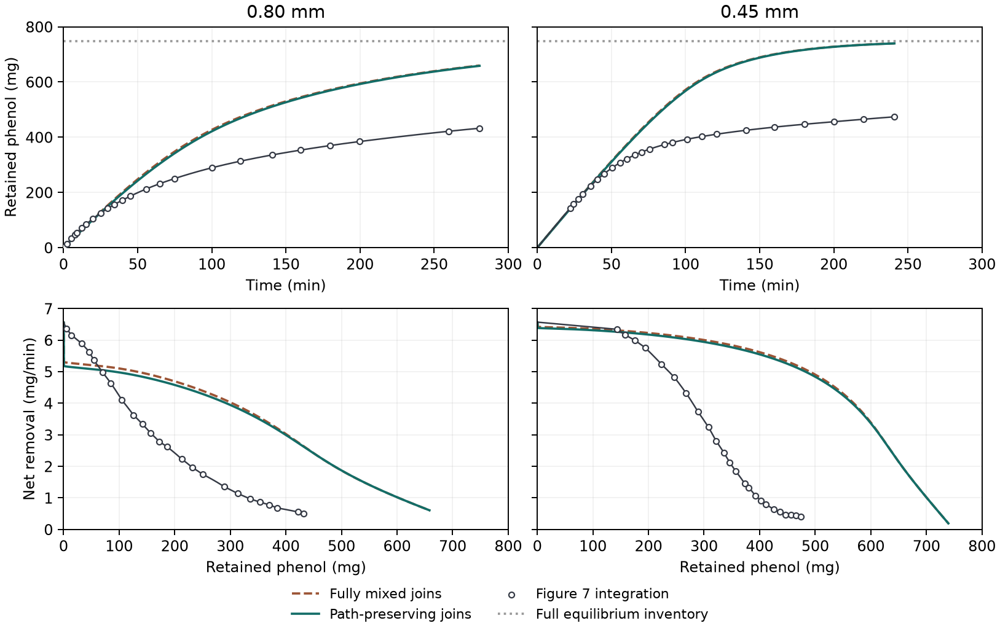

# How much phenol did the Figure 7 beds retain?

The digitized Figure 7 curves give **432 mg** of cumulative retention
for 0.80 mm and **474 mg** for 0.45 mm through their respective last
markers. The fixed-carbon models retain roughly **226–227 mg** and
**266 mg** more over those same windows. Most of the difference develops
after the experimental outlet reaches half the feed concentration.
[Alhamed Figure 7](https://doi.org/10.1016/j.jhazmat.2009.05.002)

## Basis and mass balance

The feed is 150 mg/L at 43.8 mL/min, or 6.57 mg phenol/min, through the
10 cm bed. The 7.032455 g dry carbon basis comes from the reported bulk
density of 740 kg/m³ and an 11 mm internal diameter. The packed mass of
each size fraction is unavailable in the paper. Assuming an initially
clean bed and constant flow, the outlet deficit gives total retention
$R(T)=Q\int_0^T(C_0-C_{\mathrm{out}}(t))\,dt$. Integration uses
linear segments through the 24 open markers per size and an assumed
clean-bed origin. It ends at the last experimental marker for each
series. [Source audit](../../../literature/sources/alhamed2009/README.md)

Total retention includes adsorbed phenol and phenol in the void liquid.
At voidage 0.427 the bed liquid volume is 4.058 mL. It can hold at most
0.609 mg at the feed concentration. Over the last-marker windows, the
implied sorbed loadings on the density-derived carbon basis are
61.41–61.49 mg/g and 67.28–67.37 mg/g. Those intervals account for
bed liquid hold-up only. The model inventory histories give both terms
separately and agree with the independently integrated inlet and
interval-averaged outlet dose. [Protocol](protocol.md)

## Retained mass through the recorded windows

| Size | Last marker | Last outlet/feed | Figure 7 total | Fully mixed total | Path-preserving total |
|---|---:|---:|---:|---:|---:|
| 0.80 mm | 280.69 min | 0.924 | 432.44 mg | 659.64 mg | 658.38 mg |
| 0.45 mm | 240.92 min | 0.939 | 473.78 mg | 739.81 mg | 739.57 mg |

At the shared cutoff of 240.92 min, the 0.80 mm curve gives 410.59 mg
from the markers and 630.60–632.24 mg from the models. The 0.45 mm
comparison already ends at that time. The image-reading scenarios
(±2 pixels with coherently shifted marker coordinates) give 414.76–450.33
mg and 457.39–490.21 mg. Monotone interpolants through the nominal markers
give 404.71–460.18 mg and 451.68–495.87 mg. Both checks leave a large
gap. These intervals quantify reading and interpolation sensitivity
separately. Experimental measurement uncertainty is unavailable.

## Capacity and uptake-rate interpretation

At the experimental midpoints, Figure 7 implies 3.29 mg/min of net
removal for both sizes. The model is still removing 4.79–4.90 mg/min
for 0.80 mm and 5.80–5.86 mg/min for 0.45 mm. About 94–96% and 86–87%
of the final model excess, respectively, builds after those midpoints.
When the models reach the same cumulative retention as the last
experimental markers, their removal rates are still 2.62–2.63 and
5.07–5.14 mg/min. The corresponding experimental rates are 0.50 and
0.40 mg/min. These are whole-bed net accumulation rates, including
changes in liquid inventory.

The model therefore sustains uptake too long and overstates how much
phenol the beds can hold over the observed timescale. The source
Langmuir isotherm gives 106.40 mg/g at the feed, equivalent to 748.23 mg
adsorbed on the assumed full carbon mass, plus 0.61 mg in the liquid.
Figure 7 covers 58% and 63% of that total inventory and still shows
positive net removal at the last marker. If net removal thereafter
stays at or below its last observed value, reaching the full model
inventory would take at least another 10.6 and 11.5 hours, respectively.
That bound uses the observed endpoint alone. The later curves are
unreported.

The finite-window evidence supports a mismatch in accessible capacity
or in how quickly the remaining carbon can be reached. The reported
window is compatible with a smaller equilibrium inventory or a larger
inventory accessed slowly through a long tail. The shares of film,
contact and intraparticle effects in the rate decline are unresolved.

## Verification

The last-marker integrals reproduce the earlier
[source-window audit](../column_contact/REPORT.md). The two archived
join scenarios retain their original parameters. Replay verifies the
paper, pixel extraction and frozen histories before recalculating
all comparisons. The analytical regression tests check partial-interval
integration and the model's separate liquid and solid inventories.
[Reproduction](README.md) · [Compact record](reference_summary.json)
