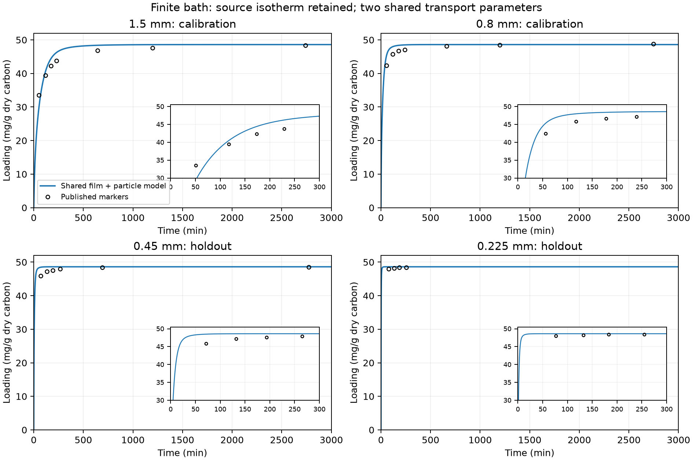
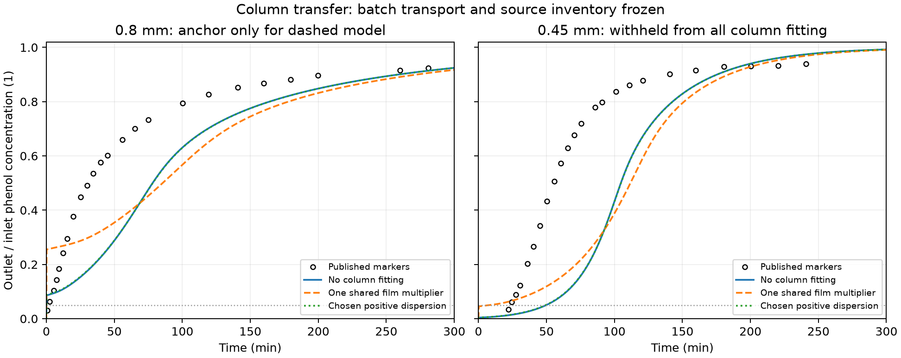

# Film and particle transport: batch qualification does not ensure column prediction

## Research question

Can a shared film-plus-intraparticle model reproduce withheld particle-size
uptake data and then predict a packed column without fitting every column
curve? The batch loading comparison passes its declared screen; the column
transfer still fails. The two findings concern different validation stages.

## Material and experimental boundary

[Alhamed (2009)](https://doi.org/10.1016/j.jhazmat.2009.05.002) supplies
date-stone activated carbon, Figure 2 batch markers and Figure 7 column
markers. The unchanged Langmuir parameters are $q_{max}=0.1115$ kg phenol/kg
dry carbon and $b=139$ m³/kg. Printed bulk density 740 kg/m³ and voidage 0.427
give particle-envelope dry density $\rho_p=1291.45$ kg/m³.

The primary batch conditions are 1 g carbon, 250 mL liquid, 200 mg/L phenol,
200 rpm and 22 ±1 °C. The 0.8/1.5 mm curves fit shared transport parameters;
0.45/0.225 mm curves are withheld. Figure 2 starts at 30 mg/g, so rapid early
uptake is not directly observed. Seven Table 3 fitted equilibrium endpoints
are a consistency audit, not seven independent raw equilibrium experiments.

## Governing equations

The homogeneous spherical loading-diffusion approximation uses loading
$q(r,t)$ in kg/kg dry solid and an effective diffusivity $D_s$ in m²/s:

$$
\frac{\partial q}{\partial t}
=\frac{D_s}{r^2}\frac{\partial}{\partial r}
\left(r^2\frac{\partial q}{\partial r}\right),\qquad
q_r(0,t)=0,\qquad
q(R,t)=\frac{q_{max}bC_s}{1+bC_s}.
$$

Surface liquid concentration $C_s$ couples film supply to particle uptake
through one shared inward solute flux $j_s$ in kg/(m² s):

$$
j_s=k_f(C-C_s)=\rho_pD_s q_r(R,t),\qquad
\bar q=\frac{3}{R^3}\int_0^R q(r,t)r^2dr.
$$

Internal liquid storage is neglected explicitly. This $D_s$ is an effective
loading-diffusion parameter, not free-liquid diffusivity or a uniquely
identified micropore property.

A finite bath loses dissolved solute as the carbon loads:

$$
V\frac{dC}{dt}=-M_s\frac{d\bar q}{dt},\qquad
VC_{eq}+M_s q_{eq}(C_{eq})=VC_0.
$$

The equilibrium equation is independently checked against the Langmuir
quadratic. Holding bath concentration artificially fixed would violate this
experimental boundary. The clean-particle film-supply limit is
$d\bar q/dt=3k_f C_0/(\rho_pR)$ at $t\to0$.

For the column, axial finite volumes conserve

$$
\epsilon C_t+\partial_z(uC-\epsilon D_{ax}C_z)
=-a_s\rho_b\bar q_t,\qquad \rho_b=(1-\epsilon)\rho_p.
$$

The primary active-solid fraction $a_s=1$; chosen sensitivities 0.5/0.75 are
not measured inventories. The clean-bed inlet specifies total solute flux
and the outlet has zero dispersive flux. Baseline $D_{ax}=0$; a positive
dispersion scenario uses $0.5(u/\epsilon)d_p$ without claiming it is measured.

The declared column film correlation is

$$
Sh=\frac{k_fd_p}{D_m}=2+1.1Re_p^{0.6}Sc^{1/3},\quad
Re_p=\frac{\rho u d_p}{\mu},\quad Sc=\frac{\mu}{\rho D_m}.
$$

It follows Alhamed Eq. 19 and
[Wakao–Funazkri (1978)](https://doi.org/10.1016/0009-2509(78)85120-3).
Superficial velocity defines the primary Re; interstitial velocity is a separate
convention scenario. Backward-Euler shell/axial finite volumes share interface
fluxes and conserve inventory. Final shell arrays are `(axial cells, radial
cells)`, ordered inlet→outlet and centre→surface, with SI values and zero-based
Python indexing. No heat, reaction or regeneration equation is included.

## Calibration and results

Shared batch fitting gives $D_s=1.84603549\times10^{-12}$ m²/s and
$k_{f,ref}=7.73224603\times10^{-5}$ m/s at 0.8 mm. The assumed diameter law
is $k_f=k_{f,ref}(0.8\ \mathrm{mm}/d_p)$; its exponent is not fitted.

| Batch size | Role | Loading RMSE | Screen ≤3 mg/g |
| --- | --- | ---: | --- |
| 1.5 mm | Fit | 2.10 mg/g | Pass |
| 0.8 mm | Fit | 1.62 mg/g | Pass |
| 0.45 mm | Withheld | 1.33 mg/g | Pass |
| 0.225 mm | Withheld | 0.42 mg/g | Pass |

All four remain below the screen in chosen ±2-pixel reading scenarios. The
finite-bath equilibrium audit agrees with Table 3 fitted endpoints within
2.03%. Similar batch fits occur along a film/diffusivity trade-off; these
profiles are not statistical confidence bounds.

Columns use 150 mg/L feed, 43.8 mL/min, 10 cm height, 11 mm diameter and
derived dry mass 7.032455 g. Batch diffusivity, isotherm and physical mass
remain fixed. One route has no column fit; another fits only a common film
multiplier 0.54782 to the 0.8 mm column before freezing it for 0.45 mm.

| Column quantity | Digitized source | No column fit | One common film multiplier |
| --- | ---: | ---: | ---: |
| 0.8 mm t50 | 30.75 min | 78.14 min | 85.52 min |
| 0.45 mm t50 | 55.36 min | 104.71 min | 111.76 min |
| 0.8 mm fraction RMSE | — | 0.204 | 0.178 |
| 0.45 mm fraction RMSE | — | 0.322 | 0.298 |

Both routes fail RMSE ≤0.10 and t50 error ≤20%. The withheld t05 is about
23.54 min; the unfitted prediction is 49.80 min and the common-film prediction
11.90 min after separate early-time refinement. The latter supersedes its
coarse 7.88 min crossing and also fails the 25% screen.

## Discussion

Batch agreement supports a component under a shaken finite-bath boundary; it
does not establish a packed bed's accessible inventory, flow distribution or
usable capacity. Film and particle diffusion alone do not explain the column
series under the retained inputs. The discrepancy does not uniquely identify
its cause, and fitting size-specific film or inventory factors would not be a
withheld-size prediction.

Serial 1 mL sampling at selected digitized times, 1.47/1.5 mm source labels,
active-solid fractions and alternate film conventions are explicitly chosen
sensitivities. Their bounds are not experimental uncertainty. None repairs the
common column prediction. Unreported full sampling schedules and per-fraction
weighed column masses remain unavailable.

The saved study has 57 Julia forward cases plus calibration and endpoint
audits. Maximum normalized mass residual is $1.84\times10^{-10}$ and interface
flux mismatch $2.04\times10^{-13}$. Analytical spherical diffusion, finite-bath
film limits, equilibrium, sampling and refinement checks pass. Numerical
success makes the retained physical discrepancy interpretable; it does not
turn it into successful column validation. No new OpenLB/DWSIM run is involved.

## Conclusions

One shared film/particle model passes the selected withheld batch loading
screen, but fails transfer to the column. The next
[contact/inventory audit](../column_contact/REPORT.md) tests a common mixing
family while preserving the qualified particle component and source isotherm.

## Reproduction and evidence

[Commands](README.md) · [Frozen protocol](../../../literature/alhamed2009_film_particle_protocol.md)
· [Source extraction](../../../literature/alhamed2009_film_particle_extraction.json)
· [Full record](../../../docs/film_particle_adsorption.md)
· [Compact reference](../../../docs/film_particle_reference.json).
Source conditions, pixels and hashes are retained; no new laboratory data is required.
