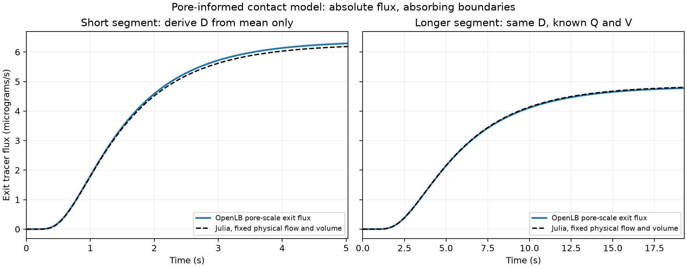
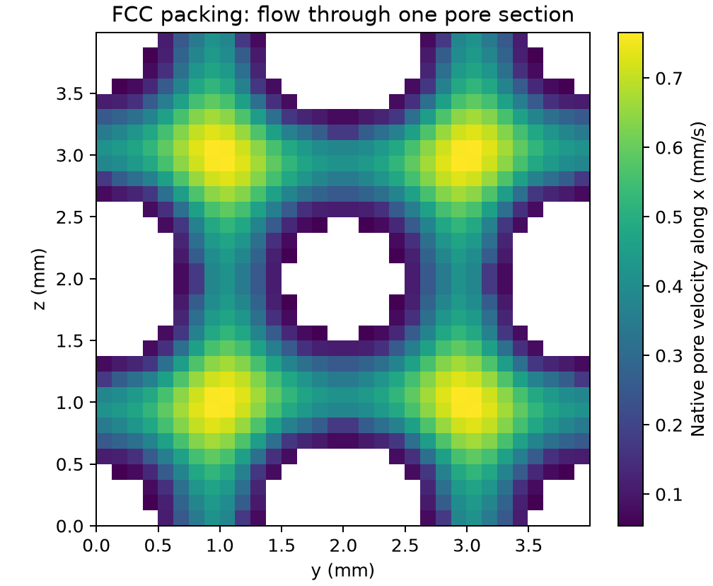

# Pore-scale inert tracer to a macroscopic contact model

## Purpose and controlled question

Can a contact model informed by a native pore-scale tracer calculation predict
the exit response of a longer segment without fitting that second response?
This is the next software/numerical step toward structure-to-adsorption-to-process
translation. It preserves the earlier batch-qualified particle component and
failed experimental column comparisons.

The packing is synthetic ordered FCC impermeable spheres at nominal voidage 0.6,
with 2.3 mm sphere diameter and 3.993871 mm cell side. Fixed steady pore velocities
come from native D3Q27/TRT flow calculations. The scalar simulation resolves
advection/diffusion through that geometry with stock OpenLB facilities. The
particle interiors are not tracer storage; no adsorption, heat or reaction is
present. The chosen large free diffusivity is a numerical verification scenario.

## Theory and boundaries

The pore-space tracer satisfies

```math
\frac{\partial C}{\partial t}+\nabla\cdot(\mathbf{u} C)
= D_m\nabla^2 C.
```

Impermeable solids use stock bounce-back, transverse boundaries are periodic,
and the finite segment has a unit inlet reservoir and zero-concentration
absorbing exit. Flow is the fully developed periodic native velocity field,
not a separate finite-bed entrance/exit solution. The exit signal is total
scalar flux, including diffusion. Its meaning differs from outlet concentration
in a convective-outlet packed column.

The exact kinetic control volume is bounded by streaming-link cuts between the
reservoir and interior planes. Its length is `(nx-2)*dx`; reservoir-node spacing
is `(nx-1)*dx`. Physical pore volume and temporary wall-population inventory are
separate. Stock `lbm<D>::computeRho` reads kinetic population mass. The wall
momenta's prescribed density is not that mass. Global conservation is checked
against actual postcollision populations crossing the cuts, without correction.

OpenLB's scalar diffusivity uses the odd TRT channel:

```math
D_m=c_s^2(\tau_{odd}-1/2)\Delta x^2/\Delta t,
\quad(\tau_{even}-1/2)(\tau_{odd}-1/2)=\Lambda.
```

The qualified trial uses stock D3Q27, `cs2=1/3`, `Lambda=0.3`, primary odd/even
relaxation times 1/1.1 and a half-dt sensitivity 0.75/1.7. Both are unequal TRT
channels. Hydrodynamic TRT retains its independently verified settings.

For normalized exit-flux step F(t), finite-window moments are

```math
\bar t=\int(1-F)dt,\qquad
\sigma_t^2=2\int t(1-F)dt-\bar t^2.
```

No unreported tail is invented. Late-window contributions, final plateau and
concentration bounds are checked. In a uniform 1D ADE with inlet Dirichlet
step and absorbing exit, independently solving its Laplace-domain boundary
problem gives, for `Pe=vL/D`:

```math
\bar t=\frac{L}{v}\coth(Pe/2)-\frac{2D}{v^2},
```

```math
\sigma_t^2=\frac{2DL}{v^3}\coth(Pe/2)
+\frac{L^2}{v^2}\operatorname{csch}^2(Pe/2)-\frac{8D^2}{v^4}.
```

The steady flux per area is `v/(1-exp(-Pe))` for unit concentration. At small
Pe diffusion contributes strongly to that flux, so it can exceed volumetric
flow times inlet concentration without violating conservation. These moments
are not the void-volume/Q fluid residence time.

Julia independently solves the conservative 1D ADE with the same scalar
boundaries, using central finite volumes and backward Euler. Analytical
moments and refinement verify that reference. Effective v/D are derived from
ONLY the short N=32 native tracer moments. The longer N=32 segment uses the
same values with no refit. They are boundary-specific effective contact
coefficients, not independently measured material constants or Alhamed's fitted
breakthrough dispersion. A tracer shape outside the ADE family is rejected.
Effective contact volume Q*mean and actual fluid volume are recorded separately;
neither replaces the bed inventory or particle density in adsorption calculations.

## Evidence design and current limits

The initial high-Peclet trial and intermediate diagnostic failures remain
recorded in the [protocol](protocol.md). They are not accepted by association
with a successful free-flow test. The bounded, more diffusive regime is tested
separately at 16/24/32 nodes per unit cell, with half-dt, doubled free diffusivity
and doubled length. Acceptance limits are declared before that study.

This case makes no experimental comparison, no new DWSIM solve and no new
browser acceptance claim. The printed density and both Alhamed column failures
remain unchanged. New operating regimes need fresh native qualification.

## Reproduction and primary API references

[Commands and SI contracts](README.md) · [Protocol](protocol.md).
The installed OpenLB 1.9r0 examples supply the exact API reference:
`advectionDiffusionReaction/microMixer3d`, `advectionDiffusion1d` and the
existing verified FCC flow application. OpenLB's [user guide](https://www.openlb.net/user-guide/)
provides general background. The new Julia model is
[TracerContact.jl](../../../julia/adsorption/TracerContact.jl).

## Selected conservative handoff and recorded results

Status on 10 November 2026: **the bounded synthetic native-to-macro contact
benchmark passes**. The selected translation fixes physical flow and fluid
inventory; it derives one coefficient from the short native response and
predicts the longer response without refitting.

The initial two-moment v/D route above is retained as a diagnostic shape
comparison. It is not the selected process handoff: a free effective velocity
can imply a different liquid inventory. A stricter
[pre-evaluation protocol](conservative_protocol.md) instead imposes

```math
A_f=V_{pore}/L,\qquad v=Q/A_f=QL/V_{pore}.
```

Thus `v*Af=Q` and `Af*L=Vpore` exactly. Only D is derived from the short
inert-tracer mean. Velocity, area, mass, delay and adsorption parameters are
not fitted. Julia's area-specific concentrations, fluxes and inventories are
scaled by this declared physical fluid area. Feed minus exit equals stored
solute without a correction. Each segment uses its own measured Q,V,L, with
one common D. No native wall-population volume is added to physical inventory.

The native run is `20261110T131217Z-7d3c3c65`; the selected conservative
translation is `20261110T132745Z-1528e655`. Their compact records are
[the native/diagnostic reference](reference/tracer_reference.json) and
[the selected conservative reference](reference/conservative_reference.json).

| Quantity | Short segment | Longer segment |
| --- | ---: | ---: |
| FCC cells along x | 1 | 2 |
| Measured control-surface length | 3.86906 mm | 7.86293 mm |
| Physical liquid volume | 36.8768 microlitres | 74.7024 microlitres |
| Volumetric flow | 4.48716e-9 m3/s | 4.48716e-9 m3/s |
| Native mean exit-transit time | 1.676648 s | 6.436791 s |
| Julia predicted mean | 1.676648 s, calibration target | 6.432490 s |
| Native transit-time variance | 1.093390 s2 | 15.303666 s2 |
| Julia predicted variance | 1.099771 s2 | 15.153807 s2 |
| Native steady exit tracer flux | 6.379778 micrograms/s | 4.838103 micrograms/s |
| Julia predicted steady exit flux | 6.274152 micrograms/s | 4.862879 micrograms/s |

The longer segment's independent errors are **0.0668% in mean, 0.979% in
variance and 0.512% in absolute steady exit flux**. Its normalized-profile
RMSE is 0.000339. The short segment's variance and steady-flux errors are 0.584%
and 1.656%; neither was used to determine D. The selected coefficient is
**D=1.45034807e-6 m2/s**. It is a closure derived from a synthetic inert-tracer
simulation, not an independently measured experimental dispersion coefficient.
Alhamed's fitted breakthrough DL/Pe never enter either native or macro model.

These three diffusivities have different roles despite sharing SI dimensions:

| Symbol | Meaning | Role here |
| --- | --- | --- |
| Dm=2e-6 m2/s | Free tracer diffusivity | Chosen OpenLB verification input |
| D=1.45035e-6 m2/s | Effective longitudinal contact coefficient | Derived from one short native tracer mean |
| Ds=1.84604e-12 m2/s | Effective particle loading diffusivity | Preserved batch component; not used or fitted in this tracer case |

No intrinsic tortuosity or material diffusion constant is uniquely identified
by this contact coefficient. It includes the specified boundary/regime and
finite-resolution transport closure. The more diffusive scenario is deliberately
outside a claim of phenol/water experimental conditions.





The first figure compares **absolute** exit flux at unit inlet concentration,
not only two separately normalized shapes. White regions in the velocity
section are impermeable sphere material; the colours are actual native pore
velocities, not an invented or reconstructed specimen.

## Numerical verification and preserved evidence

The qualifying study executes **one new native TRT flow case and eight native
TRT scalar cases**. Existing accepted N=24/32 flow fields are reused with their
hashes; the new N=16 field is independently checked for conservation and
stationarity. Its Mach number is 0.00165, density departure 2.66e-5 and plane mass
spread 2.33e-12. All 2,070 checked vendor distribution files remain unchanged,
with only the documented pre-existing config exception excluded.

All eight scalar cases pass positivity, upper concentration bound, kinetic
mass balance, plateau and tail screens. Maximum normalized native mass
imbalance is 2.01e-13. At fixed physics, N=24->32 changes mean/variance by
0.653%/0.915%; half dt changes them by 0.0106%/0.158%. Uniform-flow analytical
mean/variance errors are at most 0.084%/0.358%, with profile RMSE below 0.000122.
The original, unchanged thresholds remain in the protocol.

Julia's separate analytical/reference suite passes 36 assertions. The unchanged
particle suite passes 51. For the selected flow-preserving macro closure,
800->1600 cells and halved dt change the normalized profile by at most 0.000364,
mean by 0.030% and variance by 0.152%. All selected refinements pass. The macro
solver also conserves physical solute after scaling by the declared fluid area.

Saved-native verification checks 1,099 artifacts and 38 source files, reconstructs
kinetic inventories from final population densities, verifies integrated link
flux and replays both diagnostic Julia predictions. A separate conservative
checker rederives D and replays six Julia calculations, verifies its 11 artifacts
and 5 source files, and checks physical flow, volume and mass identities. These
checkers execute **zero new native simulations**. Figures were visually inspected.

The complete native study took 443.61 s on this machine, with two native jobs
allowed concurrently. Per-case loop/export timings are recorded. The combined
Julia initialization and native-data analysis phase was 7.43 s; this is not a
standalone cold-JIT or warmed-solver performance measurement. No speedup claim
is made. Tested software: Python 3.12.9, Julia 1.11.6, JuliaCall/PythonCall 0.9.37,
NumPy 2.5.4, Matplotlib 3.11.2 and GCC 15.2.0 on Apple Silicon macOS. Existing
Python/Julia manifests and locks are unchanged.

## Discussion, failures and the next executable step

The longer-segment result is an independent synthetic transfer check of the
one-coefficient, fixed-Q/V model. It is stronger than matching the short mean,
which is a calibration target. It is not a blind material-selection experiment:
exploratory boundary/regime failures informed the bounded verification scope.
No adsorption curve informed model selection or coefficient derivation.

The short segment's void-volume/Q time is about 8.22 s, while its exit-flux mean
is 1.68 s. This is not loss of liquid inventory. Strong diffusion and absorbing
reservoir conditions change the exit signal. It must not be substituted directly
for a conventional convective-outlet column residence time or an inactive-solid
fraction. Temporary wall-population storage is 4.32% of final kinetic tracer
inventory at N=32 and remains separately identified as numerical storage.

Higher-Peclet trials are **not qualified**: persistent local concentration
overshoot failed the upper-bound screen. The intermediate D=1e-6 longer case
also failed its upper-bound/tail screens despite matching normalized curves.
The more diffusive D=2e-6 regime passes, without relaxing thresholds. The prior
failed native runs, diagnostic mistakes and source snapshots remain retained.
**Protocol erratum:** the frozen revision3 history transcribed the intermediate
maximum as 1.001329; the actual saved maximum is**1.00445074**. Its failed status
is unchanged. The historical protocol/snapshot is preserved; this paragraph
corrects that diagnostic number.

No new DWSIM calculation, adsorption calibration or browser interface is claimed.
The [batch component](../film_particle/REPORT.md),
[column inventory/contact audit](../column_contact/REPORT.md) and earlier saved
process examples remain intact. In particular, this benchmark does not turn
the failed Alhamed column predictions into experimental validation.

The next executable native milestone is a uniform-tracer-preservation and
curved-wall transport check at increasing Peclet number, followed by a verified
convective-outlet boundary. Reuse stock OpenLB facilities and revalidate that
application regime before attaching the unchanged particle kinetics. Then
carry the qualified contact closure and native hydraulic resistance into Julia
service-time calculations and the actual DWSIM pumping/service case. A controlled
packing or particle-size change must influence the final process metric.
Reactive and non-isothermal additions remain deferred. New laboratory data,
author contact and inaccessible raw datasets remain unnecessary prerequisites.

The full host-graphics Python regression suite passes **150 tests**, including
the new native data-contract and flow/volume-preserving translation tests.
Repository navigation and example metadata are checked separately; no scientific
simulation is launched by those documentation checks.
