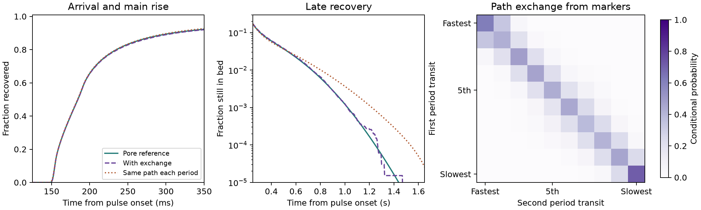

# Path exchange accounts for most of the two-cell tracer tail error

The previous [two-cell test](../residence_time_holdout/REPORT.md) matched the
main rise but predicted a longer late tail when each tracer took exactly the
same time through both periods. This study measures how transit times change
between periods and tests whether that exchange corrects the outlet response.

## What was transferred between scales

Julia traced equal-mass markers using the same saved, balanced N96 OpenLB
TRT carrier field, the same reconstructed voxel velocities and the same
liquid diffusivity of 1e-9 m²/s. Initial positions were sampled in proportion
to the inlet face flows. Each marker supplied a first-period time and a
second-period time. Molecular displacement was reflected at solid walls
and allowed across the restored interior seam. The second-period time
includes any return across that seam before final exit. In the primary
case, all 65,536 markers completed both periods. The raw first-period
prediction passed the one-cell criteria, including 0.022% error at 5%
arrival, 1.41% at 99% recovery and 5.47% in variance.

The reduced model preserves the previously calibrated N384 distribution
of one-cell transit times in each period. It uses the markers only to pair
those times by rank across the two periods. This preserves total flow,
probability, mean liquid transit and the original 4 ms input pulse. The
predictions were frozen before scoring the archived two-cell curve.
Its aggregate results were already known from the preceding milestone.
No benchmark value entered the pairing or the one-cell calibration.
[Protocol](protocol.md) · [Primary precedent for correlated transit times](https://doi.org/10.1029/2011WR010457)

## Mechanism and prediction

With molecular diffusion, 71.4% of the slowest tenth in the first period
remained in the slowest tenth in the second. The fastest tenth retained
61.9%. In the zero-diffusion control these fractions were 95.1% and 92.9%,
respectively. Most switches were between neighboring transit-time groups.
The calibrated travel-time correlation was 0.714 with diffusion and
0.981 with advection alone. With the same one-period marginals, the
total variance is \(2\sigma_T^2(1+\rho)+T_p^2/12\), where \(\rho\) is
the correlation between the two travel times and \(T_p\) is the pulse width.

| Two-cell measure | Pore reference | Same path each period | With path exchange |
| --- | ---: | ---: | ---: |
| Time to 5% recovery (ms) | 152.725 | 152.451 | 152.724 |
| Rise from 10% to 75% recovery (ms) | 64.434 | 63.910 | 65.132 |
| Mean exit time (ms) | 218.187 | 219.096 | 219.096 |
| Tracer remaining at 0.60 s (% of dose) | 2.189 | 2.444 | 2.271 |
| Time to 99% recovery (ms) | 729.773 | 804.105 | 734.249 |
| Exit-time variance (s²) | 0.0120203 | 0.0143984 | 0.0123413 |
| Cumulative-profile RMS error | — | 0.002374 | 0.001088 |

The exchange model passes all declared two-cell limits. Its 99% recovery
error falls from 10.19% to 0.61%, and its variance error from 19.78% to
2.67%. The rise duration differs from the reference by 0.70 ms, inside
the 10% limit. Applying the pairing measured with advection alone still
misses the 99% time and variance limits, with errors of 10.34% and 18.67%.
Under the fixed geometry and carrier flow, these comparisons support
molecular diffusion between flow paths as the main reason the fully
persistent model predicted too much spreading.

The 40 µs and independent-seed checks pass all stability limits. The
largest cumulative change is 0.00167, and the largest relative changes
in predicted variance and 99% recovery time are 0.248% and 0.508%.
At 1.2 s the exchange prediction still retains 0.0260% of the dose,
versus 0.0167% in the reference. The deepest tail is sparsely sampled
at the marker count used here. Qualification covers the specified
two-cell synthetic inert-tracer case. Adsorption remains on hold.

## Execution and replay

Cohort `20261112T073700Z-e27daca0` ran four sets of 65,536 markers on
Julia 1.11.6 with ten threads. An initial launch exposed roundoff in the
face-crossing calculation near zero face speed and stopped before
producing marker pairs. A stable crossing-time expression and a
regression check resolved it. All 15 Julia checks and both Python
tests passed. The read-only replay verified 26 sources and 45 artifacts.
See the [run guide](README.md) and the
[compact numerical record](reference_summary.json).
