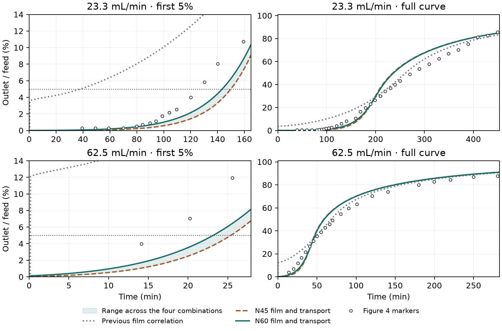

# The 25 cm phenol column with the 42.7%-void packing film

The denser packing's film and wall-contact estimates greatly reduce
initial phenol leakage in both 25 cm cases. The 23.3 mL/min prediction
passes the existing breakthrough timing and curve-shape screens. At
62.5 mL/min, breakthrough to 5% remains too late. Both predictions
underestimate the phenol retained by the last published marker.
[Alhamed Figure 4 and Table 5](https://www.sciencedirect.com/science/article/pii/S0304389409007687)

## Fixed inputs

The operating cases use 0.80 mm date-stone carbon and 150 mg/L phenol.
Each run uses 17.581 g of dry carbon, the same liquid inventory,
batch-qualified particle diffusivity and Langmuir equilibrium, and
fully mixed joins between short pore-scale sections. The previous
access scenario keeps half the carbon on a direct path and half behind
the original additional resistance of $2.1802\times10^6$ s/m. The
slow-side film combines this resistance in series with the new
liquid film. Its coefficient stays close to 0.46 µm/s.

The N60 direct film coefficients are 107.78 and 181.11 µm/s at
23.3 and 62.5 mL/min. The N45 values are 127.26 and 211.68 µm/s.
The primary forecast combines N60 film with N60 flow-path and contact
rules. The N45 forecast combines both N45 inputs. The two crossed
combinations isolate film sensitivity from sensitivity to the path
and contact rules. The previous correlation-based and 60%-void
transport curve is an archived baseline. No parameter was fitted to
breakthrough data. [Pore-scale film estimates](../porosity_matched_film/REPORT.md)

## Breakthrough and retained phenol

The 5% and 50% times are when the outlet reaches those fractions of
the feed concentration. Retained mass includes the liquid and carbon
inventories through each curve's last marker. Experimental values use
the digitized Figure 4 markers. [Extraction and units](../../../literature/sources/alhamed2009/figure45_extraction.json)

| Flow (mL/min) | Curve | Time to 5% (min) | Time to 50% (min) | Retained (mg/g dry carbon) |
| ---: | --- | ---: | ---: | ---: |
| 23.3 | Published | 125.74 | 274.40 | 57.13 |
| 23.3 | Previous correlation-based baseline | 38.07 | 261.28 | 53.21 |
| 23.3 | N45 film and transport | 149.91 | 235.14 | 53.92 |
| 23.3 | N60 film and transport | 143.50 | 236.51 | 53.88 |
| 62.5 | Published | 16.16 | 71.63 | 55.67 |
| 62.5 | Previous correlation-based baseline | 0.15 | 67.88 | 50.04 |
| 62.5 | N45 film and transport | 25.39 | 58.77 | 50.54 |
| 62.5 | N60 film and transport | 23.16 | 59.23 | 50.51 |

The primary forecast reaches 5% 14% late at low flow and 43% late
at high flow. The early-crossing screen allows 25%. The midpoints
are 14% and 17% early, both within the 20% screen. The rise from
5% to 50% takes 93 min instead of 149 min at low flow, and 36 min
instead of 55 min at high flow. The cleaner initial effluent and
the shorter rise produce slightly larger full-curve errors than
the previous forecasts at both flows. The RMSE in outlet/feed
fraction is 0.060 and 0.057, within the 0.10 limit.

After three nominal liquid residence times, the N60 outlet contained
0.004% and 0.137% of feed concentration at low and high flow. The
archived baseline gave 3.64% and 12.24% at the same times.

The N60 forecast falls short by 3.25 mg/g at the low-flow last
marker and 5.16 mg/g at the high-flow last marker. Both fall
outside the digitization reading ranges of 56.48–57.77 and
54.28–57.06 mg/g. At a common feed dose of 89.30 mg/g, raising
the flow reduces modeled retention from 53.88 to 42.85 mg/g.
The published reduction is from 57.13 to 46.16 mg/g. The duplicate
low-flow reading from Figure 5 gives the same timing and retention
conclusions. The reading ranges describe pixel sensitivity.

## N45–N60 sensitivity

Changing both pore-scale inputs from N60 to N45 delays the 5% crossing
by 6.41 min at 23.3 mL/min and 2.23 min at 62.5 mL/min. At fixed N60
transport, changing the film alone moves the crossing by 4.59 and
1.61 min. At fixed N60 film, changing the transport and wall-contact
rules shifts the crossing by 1.87 and 0.63 min. The four combinations
give retention ranges only 0.041 and 0.027 mg/g wide. Every combination
passes the low-flow curve screen, misses the high-flow 5% crossing
and underestimates retention at both flows. The grid difference
does not explain those remaining gaps.

All eight predictions passed their column time-step and particle-shell
refinement checks. The predictions were frozen before scoring the
published markers, and the prior Figure 7 comparison was left unfitted.
Read-only replay checked 30 source files and 35 output artifacts.
The comparison supports improved initial phenol capture under the
frozen 42.7%-void scenario. The full two-flow prediction remains
unqualified by the early high-flow timing and retained-mass checks.

[Protocol](protocol.md) · [Commands](README.md) · [Compact record](reference_summary.json)
