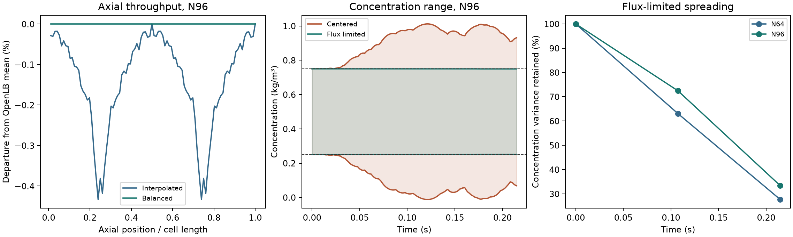

# OpenLB-to-Julia handoff on one periodic FCC cell

**Throughput and uniform-tracer checks passed. Tracer spreading at the
application diffusivity remains unqualified.** The balanced flows retained
the archived stock TRT throughput at every axial section. Flux limiting
kept the varying tracer within its physical bounds. Its predicted spreading
still changed materially with mesh and time step.

## Carrier-flow transfer

The study reused the saved, converged OpenLB 1.9r0 D3Q27 TRT fields for
0.8 mm spheres in a periodic FCC cell of side 1.389 mm. The original
carrier-to-native kinematic-viscosity ratio of 0.95655466 was applied once.
The reference flow for the transfer is the mean volume throughput from
the archived velocity field with that conversion. The three physical
fields came from independent converged hydraulic calculations.
[Hydraulic archive and flow checks](../transport_root_cause/hydraulics/README.md)

For each fluid-to-fluid Cartesian face, the initial estimate is the mean of
its two normal cell velocities times the face area. The least-squares
projection minimizes the change in those estimates subject to zero net
flow per pore cell and fixed directional throughput. Solid faces are
impermeable. Periodic seams carry the same signed shared flow as interior
faces. The finite-volume flux reconstruction uses the saved velocities.

| Saved grid | Converted axial throughput (m³/s) | Maximum plane error before balancing | RMS face correction | Maximum plane error after balancing |
| --- | ---: | ---: | ---: | ---: |
| N32 | 1.482380e-8 | 3.58% | 2.69% | 9.71e-15 relative |
| N64 | 1.482379e-8 | 1.00% | 0.736% | 7.31e-14 relative |
| N96 | 1.482382e-8 | 0.433% | 0.362% | 7.34e-14 relative |

The N96 value is about 0.8894 mL/min across the computational cell and
corresponds to the archived 43.8 mL/min reference-column operating point.
The raw N96 maximum local imbalance was 4.42% of the largest face flow.
After balancing it was 3.31e-15 relative to that face scale. The largest
individual N96 face correction was 1.27% of that scale. On every mesh the
uniform tracer stayed within 7e-14 kg/m³ of 0.500 kg/m³.

## Varying tracer and spreading

The periodic sine wave started within 0.25–0.75 kg/m³. The simulations used
physical molecular diffusivity 1e-9 m²/s and matched the two disk observation
times, 0.107373 and 0.214764 s. The centered calculation passed conservation
and the diffusion variance budget. Its agreement with the separate matrix
exponential and the half-step result verified time integration of that
discrete operator. Its N96 concentration still ranged from **−0.01186 to
1.01186 kg/m³**. The centered final variance changed by 18.0% between N64
and N96. Both observations rule out using this run for spreading.

The bounded follow-up applied conservative face-flux corrections to the
same projected flow, using three strong-stability-preserving Runge–Kutta
stages. The N96 concentration stayed between **0.250134 and 0.749866 kg/m³**
and conserved tracer inventory to 2.23e-16 relative. The method's
discretization contributed a net **31.8% of final variance loss** on N96,
estimated by subtracting the integrated molecular-diffusion dissipation
from observed variance loss. On N64 that diagnostic was 60.1%.
[Flux-corrected transport](https://www.sciencedirect.com/science/article/pii/0021999179900512) ·
[SSP time discretization](https://doi.org/10.1137/S003614450036757X)

| Bounded spreading check | Midpoint | Final | Limit |
| --- | ---: | ---: | ---: |
| N64–N96 variance difference, relative to N96 | 13.0% | 17.1% | 5% |
| N64–N96 fundamental amplitude difference | 1.92% | 1.38% | 5% |
| N64–N96 fundamental phase difference | 0.029 rad | 0.127 rad | 0.05 rad |
| N64 half-step profile difference, RMS / initial amplitude | 1.93% | 1.62% | 0.1% |

The projection and uniform checks qualify the saved-flow transfer on this
geometry. The bounded calculation removes the nonphysical extrema, and the
variance, phase, time-step and dissipation checks still show unresolved
spreading. This periodic control supplies no qualified dispersion or
breakthrough input for the process model.

## Verification record

Centered cohort `20261111T154427Z-6e178a5c` and bounded cohort
`20261111T154712Z-4a96ae28` passed read-only replay. The first centered
attempt completed all native Julia solves, then stopped while encoding a
NumPy Boolean to JSON. The completed centered cohort reran all three meshes
after conversion to standard Python values. Its read-only replay checked 24
sources and 75 artifacts. The bounded replay checked 23 sources and 48
artifacts. Both straight-flow Julia tests passed all 12 assertions, and
eight related Python tests passed. The study launched zero OpenLB, full-bed
or DWSIM runs. [Commands and SI data contract](README.md) ·
[Compact numerical record](reference_summary.json)
