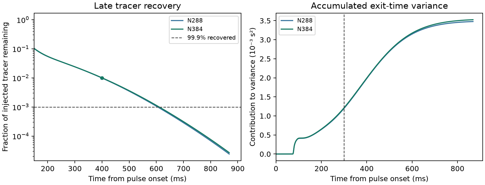

# N384 outlet tracer at the archived 80 µs step

The [protocol](n384_protocol.md) repeats the same open one-cell test
as the [N192–N288 comparison](REPORT.md), with the same saved N96
TRT hydraulic data. The tracer mesh has 64 children per original
liquid voxel, 33,986,560 liquid cells in total, and 101,425,664
internal faces. Its cell width is 3.618 µm. The liquid volume and
axial throughput remain 1.6091e-9 m³ and 1.48238e-8 m³/s. The
maximum plane flow difference is 7.92e-14 relative to that
throughput. The open geometry uses the archived cut and carrier flows.

Both meshes use the 4 ms pulse, 1e-9 m²/s diffusivity, and 0.8684 s
observation window. The 80 µs step uses 80.39% of the convex
low-order step limit on N384. The previous 80%-of-limit cap would
give 79.61 µs. The monotone limit itself is 99.51 µs. The full-run
bounds and mass criteria are unchanged.

The Julia implementation stores one carrier rate per original voxel
and normal subplane. On N288 it reproduced every archived face and
rate exactly, then matched the original open solver's concentrations
and recovered masses bit for bit on four-step tests starting from
a clean state, a smooth field, and the saved late-tail field.

## Matched-window comparison

| Measure | N288 | N384 |
| --- | ---: | ---: |
| Final tracer recovery | 99.99759% | 99.99731% |
| Time to 5% recovery | 76.944 ms | 76.967 ms |
| Time to 99% recovery | 398.882 ms | 400.484 ms |
| Mean exit time | 110.044 ms | 110.262 ms |
| Exit-time variance | 0.00347717 s² | 0.00352487 s² |
| Last-transit fraction of second raw moment | 0.410% | 0.449% |

Relative to N384, the mean differs by **0.198%** against the 5% limit
and variance differs by **1.35%** against the 10% limit. Both meshes
pass recovery and tail-completeness checks. N384 reaches 99% recovery
1.60 ms later than N288. Around 2.4% of the injected mass exits after
0.30 s on each mesh, and this late mass accounts for about 66% of
the measured exit-time variance. The N384 mass balance closes to
5.24e-15 of injected mass, and the concentration stays within 0–1
kg/m³ to roundoff.

## Verification and scope

N384 completed 10,855 steps in cohort `20261111T211006Z-4ab30fe9`.
The time grid matches N288 exactly. An initial development launch
was stopped while the cross-grid inlet dose check was changed to
permit floating-point roundoff. The completed case's injected mass
agrees exactly with the N288 history. The five existing analytical
open-boundary tests passed. Read-only replay verified 27 sources,
37 artifacts, the reconstructed flow, and the comparison.

This result qualifies the mesh comparison for the short synthetic
outlet test. It provides the short response for a future longer
segment holdout. The study generated zero new OpenLB, full-bed, or
DWSIM runs and no fitted dispersion coefficient.
[Run and replay guide](README.md#n384-late-tail-comparison) ·
[Compact numerical record](n384_reference_summary.json)
