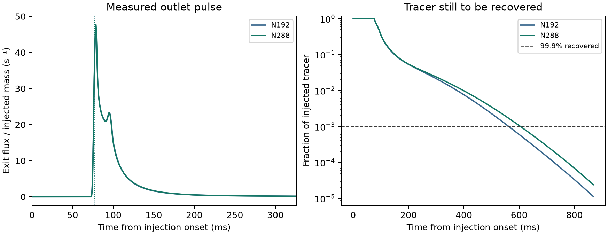

# Short inlet–outlet tracer test on the saved TRT flow

The test opens one axial seam of the 1.389 mm periodic FCC cell built
from the archived N96 stock TRT field. It retains the existing N192
and N288 tracer faces, solid mask, molecular diffusivity of 1e-9 m²/s
and transverse periodicity. The inlet and outlet each carry
1.48238e-8 m³/s. All cut faces are forward-flowing. Their maximum
relative local volume balance residual is below 2e-15 of the largest
face flow. There is no new hydraulic solve or inlet-development model.
[Protocol](protocol.md) · [Parent flow handoff](../porous_face_handoff/REPORT.md)

Clean pore liquid receives a 4 ms pulse at 1 kg/m³. The total tracer
flux at the inlet is the prescribed concentration times each
forward carrier flow. The outlet exports carrier flow times its
liquid concentration with zero diffusive flux. The Julia solver uses
the existing bounded interior corrections and SSP RK3 stages. Inlet
and outlet mass and outlet time moments are integrated with the same
stage weights. The two-cell analytical pulse and uniform-flow checks
verify this open-boundary update.
[Pulse residence-time method](https://www.sciencedirect.com/science/article/pii/0009250953800011)

The nominal liquid transit is 0.108548 s. The N96 scout first met the
mass-recovery and moment-tail criteria after seven transits. The main
N192 and N288 computations use the next checkpoint, 0.8684 s, at a
common 80 µs step. Both use 10,855 steps. Early arrival is reported
when 5% and 10% of the **injected** tracer mass have exited. The
reported mean and variance describe the finite pulse from injection
onset and use the measured mass reaching the outlet over the saved
window.

## N192 and N288 results

| Quantity | N192 | N288 | Comparison |
| --- | ---: | ---: | --- |
| Tracer recovered by 0.8684 s | 99.99887% | 99.99759% | Both pass 99.9% |
| 5% arrival | 76.884 ms | 76.944 ms | 0.061 ms difference |
| 10% arrival | 78.108 ms | 78.123 ms | 0.015 ms difference |
| Mean exit time | 109.104 ms | 110.044 ms | 0.85% difference, passes 5% |
| Exit-time variance | 0.00307860 s² | 0.00347717 s² | 11.46% difference, exceeds 10% |
| Last-transit fraction of second raw moment | 0.212% | 0.410% | Both pass 1% |

Mesh differences are relative to N288. Both injected 5.92953e-11 kg
and conserved tracer with a maximum normalized mass-balance error
of 1.12e-14. Concentrations stayed within 0–1 kg/m³ to roundoff. The
early-arrival differences are smaller than the common time step.
The reported crossing times use linear interpolation of cumulative
exit mass within a time step.

The fine mesh's tracer tail is longer. Recovery reaches 99% at about
376 ms on N192 and 399 ms on N288. Tracer exiting after 0.30 s accounts
for 61% and 66% of the corresponding exit-time variance, respectively.
The tail difference explains why the two means and early arrival agree
while the variance misses its limit. The late-window moment screens pass,
so the variance result remains a mesh sensitivity of the measured pulse.

## Verification and scope

Both comparison runs completed in cohort `20261111T194841Z-0489ef5c`.
The analytical boundary test exposed an error in the stage weighting of
outlet integration during development. The initial scout was stopped,
the weighting was corrected, and all five boundary assertions passed
before the completed scout and either comparison case. The read-only
replay checked 25 sources and 59 artifacts, including the cut faces and
the original flow constraints.

This one-cell test verifies early arrival, mean exit time and recovery
within the specified screens. Exit-time variance remains unqualified
at the tested mesh pair. The study produced zero new OpenLB, full-bed
or DWSIM runs and no fitted dispersion coefficient.
[Run and replay commands](README.md) · [Compact numerical record](reference_summary.json)
