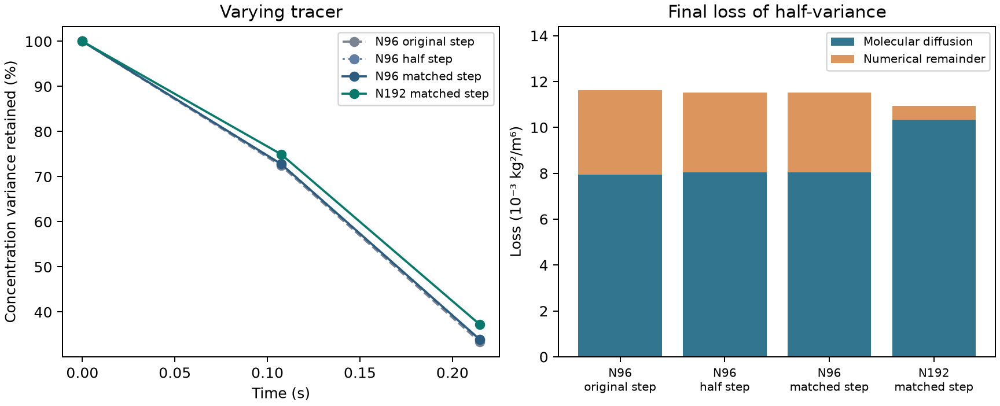

# Tracer refinement at fixed OpenLB flow

The comparison uses the same saved D3Q27 TRT flow, periodic FCC cell with
0.8 mm spheres, and molecular diffusivity of 1e-9 m²/s as the preceding
handoff. It uses the existing conservative flux-limited Julia solver.
[Parent handoff](../porous_face_handoff/REPORT.md) · [Protocol](protocol.md)

## Time-step test on N96

The two observation times were 0.107373 and 0.214764 s. Halving the
original N96 step gave 1,288 steps instead of 644. The tracer remained
in 0.25–0.75 kg/m³ and conserved mass. The profile change was 0.856%
of the initial amplitude at midpoint and 1.079% at the final time.
Both exceeded the 0.1% time-step criterion. The numerical remainder
of final variance loss fell from 31.76% to 30.31%.

## Matched spatial comparison

Each N96 liquid voxel was divided into eight children. The reconstructed
normal velocity varies linearly between the two coarse faces along each
axis and is constant along that face. Each set of four subfaces sums
exactly to its saved parent face flow. The refined cell has 4,248,320
liquid voxels and the same total liquid volume as N96. The maximum local
imbalance was 1.66e-15 relative to the largest refined face flow and the
maximum plane throughput error was 1.06e-13 relative to the archived axial
flow. [Rectangular flux reconstruction background](https://dealii.org/9.1.1/doxygen/deal.II/classFE__RaviartThomas.html)

The fine stability limit was slightly smaller than the N96 half-step cap.
The spatial comparison used 657 steps in each observation interval on
both meshes, about 163.4 µs per step. This gives identical physical time
grids and isolates the tracer mesh change for the reconstructed flow.

| Matched N96–N192 comparison | Midpoint | Final | Limit |
| --- | ---: | ---: | ---: |
| Relative concentration variance change | 2.88% | 8.94% | 5% |
| Relative fundamental amplitude change | 0.46% | 4.67% | 5% |
| Fundamental phase change | 0.0151 rad | 0.0976 rad | 0.05 rad |
| RMS profile change after averaging N192 to N96, relative to initial amplitude | 8.05% | 9.38% | Diagnostic |

The midpoint spreading measures pass. At the final time, concentration
variance and wave phase still depend on the tracer mesh beyond the
declared limits. The finer solution retains 37.23% of its initial
variance, compared with 33.90% on N96 at the same time step.

## Numerical variance loss

The net numerical remainder is the observed loss of half-variance minus
the time-integrated dissipation from the physical molecular diffusion
operator. The budget uses the resolved field on each mesh. Both the
absolute remainder and its share of total loss decrease on N192.

| Comparison | N96 matched step | N192 matched step |
| --- | ---: | ---: |
| Midpoint numerical loss (kg²/m⁶) | 1.465e-3 | 3.979e-4 |
| Midpoint share of variance loss | 30.90% | 9.12% |
| Final numerical loss (kg²/m⁶) | 3.490e-3 | 6.161e-4 |
| Final share of variance loss | 30.27% | 5.63% |

The absolute numerical remainder fell 72.8% at midpoint and 82.3% at
the final time. Both N192 shares are below the 15% screening limit.
All runs stayed inside the physical concentration range and their
relative liquid inventory drift was at most 2.23e-16.

## Scope and verification

The study isolates a substantial benefit from finer tracer cells at
the same physical time step. The N96 time-step test and the final
spatial comparison still miss their convergence limits. The finer
velocity is reconstructed from the original faces inside the fixed
N96 pore geometry. It supplies no additional hydraulic resolution.
The results support this single-cell diagnostic, with bed dispersion
qualification still open.

Three new Julia runs completed in cohort `20261111T160638Z-156b2680`.
Read-only replay checked 25 sources and 50 artifacts, including exact
reconstruction of the fine faces and comparison times. Five existing
bounded-solver analytical checks passed. This study launched zero new
OpenLB, full-bed or DWSIM runs.
[Run and replay guide](README.md) · [Compact numerical record](reference_summary.json)
