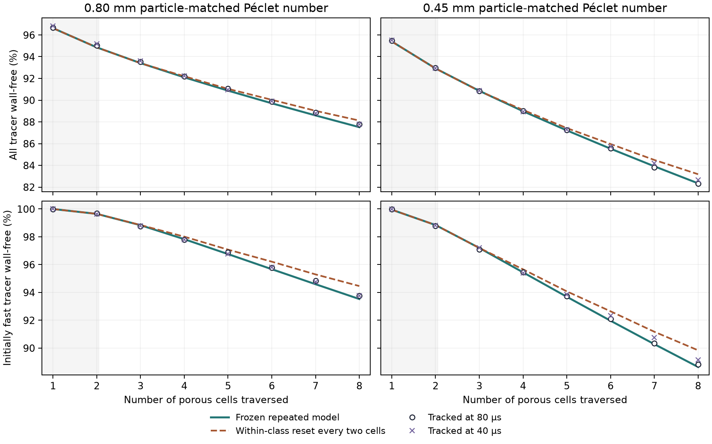

# Does the repeated geometry sustain fast-path carbon bypass?

The earlier bed calculation repeatedly used an ordered porous cell
whose fast paths showed little wall contact. This test follows tracer
on the same balanced TRT field through eight aligned copies of the
cell. It asks whether the uptake model frozen at one and two cells
predicts the first wall contact over a longer distance.
[Previous two-cell tracer and column study](../survivor_exposure/REPORT.md)

## Controls

The wall tracer uses a perfect sink at solid faces. A surviving
marker has reached the reporting seam without a sampled solid-wall
reflection. The original trajectories are continued after capture to
measure inert transit and recovery separately. Inlet markers are
sampled by carrier flux. Both particle-matched diffusivities and the
80 and 40 µs time steps come from the preceding study. The frozen
exchange between 40 flow classes and 7.032455155 g shared dry carbon
inventory carry over. Carbon loading is outside this tracer test.
[Protocol and gates](protocol.md)

Each copy is 1.389 mm long on the saved synthetic carrier, so eight
copies span 11.11 mm. The diffusivities for the 0.80 and 0.45 mm
matched cases are 7.1155 × 10⁻¹⁰ and 1.2650 × 10⁻⁹ m²/s. These
are Péclet-matched diffusivities for the saved carrier. The inlet,
seven internal seams and outlet all carry 1.48238167 × 10⁻⁸ m³/s.
An independent topology audit found reciprocal neighbor IDs and
identical face rates at every connected face.

Two reduced predictions use identical wall-contact probabilities and
the same Péclet-matched carrier exchange. One retains the four
subgroup concentrations within each original transit class. The other
redistributes survivors among those subgroups after every two cells,
leaving the parent class's dose intact. This isolates a specified
loss of fine path memory. The only pore geometry tracked directly is
the aligned repeat.

With survival probability vector \(s\) and fixed carrier transition
matrix \(P\), the tracer dose \(m\) is propagated by
\(m_{k+1}=(m_k\odot s)P\). The reset replaces the subgroup doses in a
receiving parent class with the same total dose distributed by its
subgroup carrier fractions. The first two predictions coincide
exactly. Carbon wall probabilities and class-to-class carrier
fluxes are identical across the two calculations.

As an additional trajectory diagnostic, rank the inert transit
times separately at each of the eight cells. Count markers that stay
in the fastest 90% at every cell, and measure their wall-free fraction.
This diagnostic describes the held-out trajectories and does not
alter either frozen prediction.

## Observed persistence in the aligned repeat

Each particle-matched condition used 16,384 flux-weighted markers
at each time step. The first-hit results at 80 µs are below.

| Particle-matched case | All tracer wall-free after eight cells | Initially fast tracer wall-free after eight | Initially slow tracer wall-free after eight | Initially fast tracer still fast in all eight | Wall-free among tracer fast in all eight |
|---|---:|---:|---:|---:|---:|
| 0.80 mm | 87.79% | 93.77% | 33.94% | 86.49% | 99.98% |
| 0.45 mm | 82.30% | 88.82% | 23.63% | 82.35% | 99.91% |

The fraction captured among surviving tracer entering a cell
fell from 3.32% in cell 1 to 1.21% in cell 8 for 0.80 mm,
and from 4.54% to 1.81% for 0.45 mm. This is consistent with
progressive selection of low-contact trajectories even though
the cell itself is the same at each repeat. The median inert
outlet times were 0.740 and 0.747 s.

## Effect of resetting fine path memory

| Particle-matched case | Repeated model, all tracer wall-free after eight | Within-class reset | Repeated model, initially fast tracer wall-free after eight | Within-class reset |
|---|---:|---:|---:|---:|
| 0.80 mm | 87.51% | 88.12% | 93.52% | 94.46% |
| 0.45 mm | 82.34% | 83.18% | 88.64% | 89.84% |

Resetting every two cells increased modeled wall-free passage by
0.61 and 0.84 percentage points across the dose, and by 0.93 and
1.20 points for initially fast tracer. The reset therefore leaves
the large low-contact flow fraction in place. For this intervention,
changing fine path memory alone does not relieve bypass at the
fixed exchange between the 40 original flow classes. Attribution
to the ordered geometry relative to another packing requires a
comparison with a distinct resolved geometry. The eight-cell
test also leaves the extrapolation to the full 72- or 128-cell
adsorption models open.

## Holdout verification

All four cases recovered the full inert dose. Over cells 3–8,
the frozen repeated model's largest errors were 0.280 percentage
points for total wall-free survival, 0.143 for the share captured
among incoming survivors, and 0.495 for wall-free survival in the
initially fast cohort. The largest change between the 80 and 40 µs
tracked cases was 0.400 percentage points. Both sizes met the
1-point gates. Against the aligned geometry the reset scenario
exceeded the fast-cohort limit once, by 0.018 percentage points for
0.45 mm at 80 µs.

The shaded region covers the two cells available before the longer
holdout. The lines use only that earlier evidence.

Cohort `20261112T153358Z-4f1e7011` retains the raw trajectories.
The prediction manifest was frozen before tracking with SHA-256
`b3e533b4359f140b9fb307d87b6ec766c7e23f3d9b95efa12c45d69cd9ed935b`.
Julia 1.11.6 passed eight tracker assertions. A 512-marker run
matched archived two-cell transit and first-contact times exactly.
Both Python predictor tests passed. Read-only replay verified
25 sources and 41 artifacts. This study ends at the tracer holdout.
[Reproduction commands](README.md) · [Reference summary](reference_summary.json)
