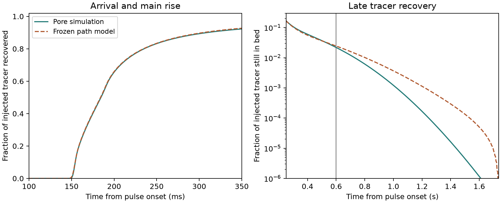

# Parallel-path transport over two repeated porous cells

Can a distribution of one-cell transit times predict the sharp rise and
late tail through two cells with the same packing and flow? The previous
[constant-dispersion model](../dispersion_holdout/REPORT.md) failed on
the first part of this two-cell response. This study freezes a model
using only the [qualified N384 one-cell pulse](../porous_outlet_tracer/N384.md)
and computes the full two-cell reference curve.

## Model and calibration

The 4 ms injection is a rectangular pulse. A path with residence time
\(T_i\) and flow fraction \(w_i\) produces the same pulse delayed by
\(T_i\). A nonnegative, regularized fit to the one-cell interval outlet
masses recovers the delay weights. The fit uses the known pulse, normalizes
the measured 99.99731% recovery to unity, and adjusts slow delays by up to
2.847 ms to impose the independently known mean liquid transit of
108.548 ms. This keeps the model's flow and liquid inventory consistent.
The resulting one-cell cumulative curve differs from the calibration data
by at most 0.001742 of the injected mass. An initial uniform delay rescaling
missed that shape check during calibration. Only the one-cell data informed
the slow-delay correction. [Residence-time method](https://www.sciencedirect.com/science/article/pii/0009250953800011)

The same path is assumed to take \(2T_i\) through two repeats. The original
4 ms pulse is then applied to these doubled delays. This assumes complete
persistence of the fast and slow paths. The path weights, delays, curves
and scoring rules were frozen before the complete two-cell run. The prior
dispersion test had already published the early prefix through 205.76 ms.
It supplied no fit data. The later pore response was withheld.
[Prospective protocol](protocol.md)

## Complete two-cell result

The reference uses the same saved stock OpenLB TRT flow with a throughput
of 1.48238e-8 m³/s, N288 Julia tracer resolution per repeat, 80 µs steps,
and 1e-9 m²/s free-liquid diffusivity. The two-cell pulse reproduced all
2,573 samples from the old prefix exactly and reached 99.99998% recovery
at 1.7368 s. The maximum mass residual was 1.63e-14 of the dose, and
concentrations stayed within physical bounds to roundoff. The last nominal
transit contributed 0.00241% of the first and 0.01394% of the second raw
time moment, passing the 1% completeness limits.

| Measure | Pore reference | Frozen path model | Error and limit |
| --- | ---: | ---: | --- |
| Time to 5% recovery | 152.725 ms | 152.451 ms | 0.180%, passes 5% |
| Rise from 10% to 75% recovery | 64.434 ms | 63.910 ms | 0.812%, passes 10% |
| Mean exit time | 218.187 ms | 219.096 ms | 0.417%, passes 5% |
| Fraction of dose remaining at 0.60 s | 2.189% | 2.444% | 11.67%, passes 25% |
| Time to 99% recovery | 729.773 ms | 804.105 ms | 10.19%, exceeds 10% |
| Exit-time variance | 0.0120203 s² | 0.0143984 s² | 19.78%, exceeds 10% |

The full cumulative profile RMS error is 0.002374, below the 0.030
limit. The front and main rise transfer accurately. Deep in the tail,
at 1.2 s the model leaves 0.114% of the dose in the bed, versus 0.0167%
in the pore calculation. The predicted tail falls to zero at the doubled
calibration support because the model uses only observed one-cell delays.

The model fails the complete qualification. The results are consistent
with fast paths persisting while the slowest tracer leaves sooner than a
simple doubling of its delay predicts. The outlet data alone cannot
identify a unique mechanism for the difference. The earlier variance-fit
dispersion model arrived too early and the path model improves that
prediction substantially. Its late-recovery and variance errors keep
adsorption coupling on hold.

## Reproduction and checks

Cohort `20261112T044839Z-2c87f73c` ran 21,710 steps on Julia 1.11.6
with ten threads, taking 2 hours 29 minutes. The first calibration-only
attempt stopped before launching the pore solver. The accepted execution
completed the full reference window without any parameter change.
Read-only replay verified 28 sources and 42 artifacts. Both analytic
path-model tests and all five existing Julia open-boundary assertions
passed. See the [run guide](README.md) and
[compact reference summary](reference_summary.json).
